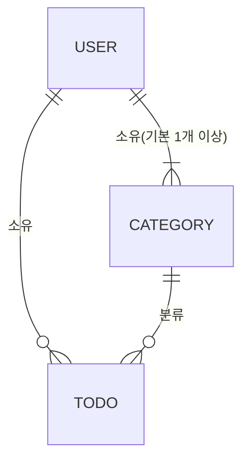

# TodoList 도메인 정의서 (초안)

## 버전 이력

| 버전 | 일자 | 작성자 | 상태 | 요약 |
|------|------|--------|------|------|
| v0.1 | 2026-11-03 | jtaewu | 초안 | 최초 작성 |
| v0.2 | 2026-11-03 | jtaewu | 초안 | 리뷰 반영: 추적성·검증 가능성 보강 |
| v0.3 | 2026-11-04 | jtaewu | 초안 | PRD v0.2와의 불일치 정리 |

## 변경 이력

| 버전 | 일자 | 변경 섹션 | 구분 | 변경 내용 | 작성자 |
|------|------|-----------|------|-----------|--------|
| v0.1 | 2026-11-03 | 전체 | 신규 | 도메인 정의서 초안 작성 | jtaewu |
| v0.2 | 2026-11-03 | 1장 | 추가 | 문제(P1~P3)·주요 기능(F1~F8) ID 부여 | jtaewu |
| v0.2 | 2026-11-03 | 6장 | 추가 | UC 표에 '요구사항', '관련 BR' 열 추가, UC-07에 필터 조합 규칙 명시 | jtaewu |
| v0.2 | 2026-11-03 | 7장 | 수정 | 색상 구분 문구를 상태 표시 여부 중심으로 변경, 주 뷰 범위 명시 | jtaewu |
| v0.2 | 2026-11-03 | 3·5·6장 | 수정 | 원문 외 추가 항목(로그아웃, 비밀번호 확인, 메모)에 '원문 외' 표시 | jtaewu |
| v0.2 | 2026-11-03 | 8장 | 추가 | ID 열 추가, 입력값 수치·주 시작 요일·원문 외 항목 가정 추가, 범위 밖 기능을 '제외'로 구분 | jtaewu |
| v0.3 | 2026-11-04 | 6장, 8장 | 수정 | 회원가입 시 이름 입력 명시(UC-01), AS-08에 이름 길이 추가 | jtaewu |
| v0.3 | 2026-11-04 | 7장 | 수정 | 상태 표시 문구를 PRD FR-10과 일치("서로 다르게 표시") | jtaewu |

> 구분: 신규 / 추가 / 수정 / 삭제. 버전을 올릴 때는 '버전 이력'에 한 줄을 추가하고, 세부 변경 사항은 '변경 이력'에 섹션 단위로 기록한다.

## 1. 개요

**목적:** 인증된 사용자가 본인의 할일을 카테고리와 기간(시작일~종료일)으로 관리하고, 월/주/일 캘린더에서 조회한다.

| ID | 문제 정의 |
|----|-----------|
| P1 | 인증된 사용자 개인별로 할일을 관리할 수 있는 앱이 없다. |
| P2 | 할일에 시작일·종료일(기간)을 다룰 수 있는 기능이 필요하다. |
| P3 | 할일을 월별·주별·일별 캘린더에서 한꺼번에 조회하고 싶다. |

| ID | 주요 기능 | 관련 문제 |
|----|-----------|-----------|
| F1 | 회원가입 후 로그인(인증)해야 앱을 사용할 수 있다. | P1 |
| F2 | 카테고리별로 할일을 등록하며, 미지정 시 '기본' 카테고리로 간주한다. | P1 |
| F3 | 로그인한 사용자는 자신의 정보를 수정할 수 있다. | P1 |
| F4 | 할일 등록 시 시작일·종료일을 캘린더로 선택·지정한다. | P2 |
| F5 | 할일 목록을 카테고리별 / 시작 전 / 진행중 / 완료 / 기한 초과로 필터링한다. | P1, P2 |
| F6 | 인증된 사용자가 할일을 삭제할 수 있다. | P1 |
| F7 | 인증된 사용자가 편집 화면에서 할일을 수정할 수 있다. | P1 |
| F8 | 할일이 월·주·일 캘린더 화면에 나타난다. | P3 |

## 2. 유비쿼터스 언어 (용어집)

| 용어 | 정의 |
|------|------|
| 사용자 (User) | 회원가입 후 로그인(인증)한 개인. 모든 할일·카테고리의 소유자. |
| 인증 | 이메일과 비밀번호로 사용자를 확인하는 행위(로그인). 인증된 사용자만 앱을 사용할 수 있다. (방식은 AS-05 가정) |
| 할일 (Todo) | 사용자가 기간 내에 수행할 작업 단위. 제목, 기간, 카테고리, 완료 여부를 가진다. |
| 카테고리 (Category) | 할일을 분류하는 사용자별 그룹. |
| 기본 카테고리 | 사용자마다 하나씩 자동 생성되는 '기본' 카테고리. 카테고리 미지정 할일이 속한다. |
| 시작일 (Start Date) | 할일을 시작하는 날짜(시간 없음, 날짜 단위). |
| 종료일 (End Date) | 할일을 끝내야 하는 날짜(날짜 단위). 이 날짜까지가 기간에 포함된다. |
| 기간 | 시작일부터 종료일까지(양 끝 포함)의 날짜 범위. |
| 완료 여부 | 사용자가 할일을 완료 처리했는지를 나타내는 값(true/false). 저장되는 유일한 상태 값. |
| 상태 (Status) | 오늘 날짜, 기간, 완료 여부로 계산되는 파생 값: 시작 전 / 진행중 / 완료 / 기한 초과. |
| 오늘 | 사용자 기준 현재 날짜. 상태 판정의 기준일. |
| 필터 | 할일 목록을 카테고리 또는 상태로 좁혀 보는 조건. |
| 캘린더 뷰 | 할일을 기간에 맞춰 날짜 위에 표시하는 화면. 월/주/일 세 종류. |

## 3. 핵심 엔티티와 관계

| 엔티티 | 주요 속성 | 비고 |
|--------|-----------|------|
| 사용자 | 사용자ID, 이메일, 비밀번호, 이름, 가입일시 | 이메일은 전체 시스템에서 고유 |
| 카테고리 | 카테고리ID, 소유자(사용자), 이름, 기본 여부 | 사용자별 이름 고유, 기본 카테고리는 사용자당 1개 |
| 할일 | 할일ID, 소유자(사용자), 카테고리, 제목, 메모(원문 외), 시작일, 종료일, 완료 여부, 생성/수정일시 | 상태는 저장하지 않고 파생 |

- 사용자 1 : N 카테고리 (최소 1개 = 기본 카테고리)
- 사용자 1 : N 할일
- 카테고리 1 : N 할일 (할일은 반드시 하나의 카테고리에 속함)
- 할일과 그 카테고리의 소유자는 항상 같은 사용자다.

## 4. 할일 상태 정의

저장 값은 **완료 여부(boolean)** 뿐이다. 상태는 조회 시점의 `오늘`과 시작일·종료일·완료 여부로 파생한다. 날짜는 모두 날짜 단위로 비교하며, 시작일·종료일 당일은 기간에 **포함**된다.

| 판정 순서 | 상태 | 조건 |
|-----------|------|------|
| 1 | 완료 | 완료 여부 = true (날짜와 무관) |
| 2 | 기한 초과 | 완료 여부 = false 이고 오늘 > 종료일 |
| 3 | 시작 전 | 완료 여부 = false 이고 오늘 < 시작일 |
| 4 | 진행중 | 완료 여부 = false 이고 시작일 ≤ 오늘 ≤ 종료일 |

경계 조건:
- 시작일 당일: 진행중 (시작 전 아님)
- 종료일 당일: 진행중 (기한 초과 아님). 종료일 다음 날부터 기한 초과
- 시작일 = 종료일인 하루짜리 할일: 그날 하루만 진행중
- 기간 전에 완료 처리해도 완료. 완료를 해제하면 위 규칙으로 다시 판정

네 상태는 상호 배타적이며 모든 할일은 정확히 하나에 속한다.

## 5. 비즈니스 규칙

| ID | 규칙 |
|----|------|
| BR-01 | 회원가입·로그인한 사용자만 앱을 사용할 수 있다. |
| BR-02 | 사용자는 본인 소유의 할일·카테고리·회원정보만 조회·생성·수정·삭제할 수 있다. 타인 데이터는 존재 여부도 노출하지 않는다. |
| BR-03 | 이메일은 시스템 전체에서 고유하며 로그인 ID로 쓰인다. |
| BR-04 | 할일의 제목, 시작일, 종료일은 필수다. 입력값 길이 제한은 AS-08을 따른다. |
| BR-05 | 종료일 ≥ 시작일 이어야 한다(같은 날 허용). |
| BR-06 | 회원가입 시 해당 사용자의 '기본' 카테고리가 자동 생성된다. |
| BR-07 | 할일 등록·수정 시 카테고리를 지정하지 않으면 기본 카테고리에 속한다. |
| BR-08 | 기본 카테고리는 삭제·이름 변경할 수 없다. |
| BR-09 | 카테고리 이름은 같은 사용자 안에서 고유하다. |
| BR-10 | 카테고리를 삭제하면 소속 할일은 삭제되지 않고 해당 사용자의 기본 카테고리로 이동한다. |
| BR-11 | 할일 삭제는 영구 삭제이며, 삭제 전 사용자 확인을 거친다. |
| BR-12 | (원문 외) 사용자 정보 수정 시 비밀번호 변경은 현재 비밀번호 확인 후 가능하다. |
| BR-13 | 할일 상태는 저장하지 않고 4장 규칙으로 매번 파생한다. |

## 6. 주요 유스케이스

액터가 '사용자'인 유스케이스는 모두 BR-01, BR-02가 적용된다.

| ID | 액터 | 유스케이스 | 요구사항 | 관련 BR | 비고 |
|----|------|-----------|----------|---------|------|
| UC-01 | 방문자 | 회원가입 | F1 | BR-03, BR-06 | 이메일·비밀번호·이름 입력, 이메일 중복 불가, 기본 카테고리 자동 생성 |
| UC-02 | 방문자 | 로그인 | F1 | BR-01, BR-03 | |
| UC-03 | 사용자 | 로그아웃 | (원문 외) | BR-01 | |
| UC-04 | 사용자 | 내 정보 조회·수정 | F3 | BR-12 | 이름, 비밀번호 |
| UC-05 | 사용자 | 카테고리 등록·수정·삭제 | F2 | BR-08, BR-09, BR-10 | 기본 카테고리 제외 |
| UC-06 | 사용자 | 할일 등록 | F2, F4 | BR-04, BR-05, BR-07 | 시작일·종료일을 캘린더(date picker)로 선택 |
| UC-07 | 사용자 | 할일 목록 조회·필터링 | F5 | BR-13 | 상태 필터는 하나만 선택, 카테고리 필터와 AND 조합 |
| UC-08 | 사용자 | 할일 수정 (편집 화면) | F7 | BR-04, BR-05, BR-07 | 제목, 메모, 기간, 카테고리, 완료 여부 |
| UC-09 | 사용자 | 할일 완료 처리 / 완료 해제 | F5 | BR-13 | '완료' 상태의 전제가 되는 기능 |
| UC-10 | 사용자 | 할일 삭제 | F6 | BR-11 | 확인 후 영구 삭제 |
| UC-11 | 사용자 | 캘린더 조회 (월/주/일) | F8 | BR-13 | 7장 규칙 |

## 7. 캘린더 표시 규칙

- 할일은 시작일부터 종료일까지 **기간에 포함된 모든 날짜**에 표시된다. 월·주 뷰에서는 기간을 잇는 막대(bar)로, 일 뷰에서는 해당 날짜가 기간에 포함된 할일 목록으로 표시한다.
- 뷰 범위와 기간이 일부만 겹치면 겹친 날짜에만 표시한다. 주 뷰의 범위는 일요일~토요일 7일이다(AS-09).
- 각 할일에는 4장의 상태(시작 전/진행중/완료/기한 초과)가 서로 다르게 표시된다. 구체적 표현 방식(색상 등)은 UI 설계에서 정한다.

## 8. 가정 및 미결 사항

| ID | 구분 | 내용 |
|----|------|------|
| AS-01 | 가정 | 시작일·종료일은 시간 없는 날짜 단위이며 둘 다 필수다. (기간 없는 할일은 캘린더에 표시할 수 없으므로) |
| AS-02 | 가정 | '오늘'은 사용자 기기(로컬) 시간대 기준 날짜다. |
| AS-03 | 가정 | 상태 판정 우선순위는 완료 > 기한 초과 > 시작 전 > 진행중. |
| AS-04 | 가정 | 기본 카테고리는 사용자별로 자동 생성되며 삭제·이름 변경 불가. 카테고리 삭제 시 할일은 기본으로 이동. |
| AS-05 | 가정 | 인증은 이메일·비밀번호 방식이다. 이메일은 로그인 ID이며 변경 불가. 수정 가능한 정보는 이름·비밀번호. |
| AS-06 | 가정 | 상태 필터는 한 번에 하나만 선택하며, 카테고리 필터와 AND로 조합할 수 있다. |
| AS-07 | 가정 | 할일 삭제는 영구 삭제(휴지통·복구 없음). |
| AS-08 | 가정 | 입력값 기준: 할일 제목 1~100자, 메모 최대 1,000자, 카테고리 이름 1~20자, 사용자 이름 1~50자(필수), 비밀번호 8자 이상, 이메일은 표준 이메일 형식. 세부값은 구현 단계에서 확정. |
| AS-09 | 가정 | 주의 시작 요일은 일요일이다. |
| AS-10 | 가정 | 원문 외 추가 항목: 로그아웃(UC-03), 비밀번호 변경 시 현재 비밀번호 확인(BR-12), 할일 메모 속성. 기본적인 사용성·보안을 위해 추가함. |
| OQ-01 | 미결 | 회원 탈퇴 지원 여부 및 탈퇴 시 데이터 처리. |
| OQ-02 | 미결 | 비밀번호 찾기/재설정 기능 포함 여부. |
| EX-01 | 제외 | 반복 할일, 알림, 공유 기능은 요구사항에 없어 범위에서 제외. |
