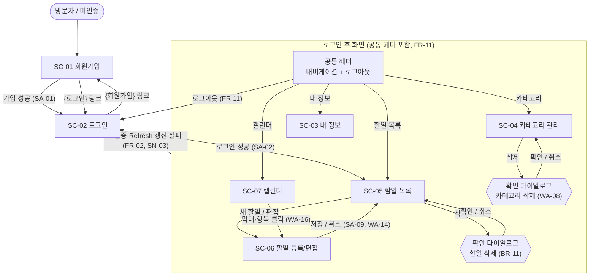

# TodoList 와이어프레임 (초안)

## 버전 이력

| 버전 | 일자 | 작성자 | 상태 | 요약 |
|------|------|--------|------|------|
| v0.1 | 2026-11-04 | jtaewu | 초안 | 최초 작성 |
| v0.2 | 2026-11-04 | jtaewu | 초안 | 사용자 시나리오 v0.3과의 불일치 정리 |
| v0.3 | 2026-11-04 | jtaewu | 초안 | PRD v0.5·시나리오 v0.4 인증 변경 반영: 세션 만료 안내 조건을 Refresh 갱신 실패로 변경 |
| v0.4 | 2026-11-04 | jtaewu | 초안 | 기준 문서 버전 갱신 |

## 변경 이력

| 버전 | 일자 | 변경 섹션 | 구분 | 변경 내용 | 작성자 |
|------|------|-----------|------|-----------|--------|
| v0.1 | 2026-11-04 | 전체 | 신규 | 와이어프레임 초안 작성 | jtaewu |
| v0.2 | 2026-11-04 | 머리말, 7장 | 수정 | 기준 시나리오 버전을 v0.3으로 갱신 | jtaewu |
| v0.2 | 2026-11-04 | 4.2, 7장 | 수정 | 세션 만료 안내는 사용 중 401로 이동한 경우에만 표시, 미인증 직접 접근은 안내 없음(SN-03 구분과 일치, WA-21) | jtaewu |
| v0.3 | 2026-11-04 | 머리말, 7장 | 수정 | 기준 문서 버전을 PRD v0.5, 시나리오 v0.4로 갱신 | jtaewu |
| v0.3 | 2026-11-04 | 3·4.2·7장 | 수정 | 세션 만료 안내(WA-21) 조건을 'Access 만료'가 아닌 'Refresh 갱신 실패 시'로 변경. 화면 구조 변경 없음 | jtaewu |
| v0.4 | 2026-11-04 | 머리말, 7장 | 수정 | 기준 문서 버전을 PRD v0.6, 시나리오 v0.5로 갱신(화면 변경 없음, 정렬 안내 문구 유지) | jtaewu |

> 구분: 신규 / 추가 / 수정 / 삭제. 버전을 올릴 때는 '버전 이력'에 한 줄을 추가하고, 세부 변경 사항은 '변경 이력'에 섹션 단위로 기록한다.

> 본 문서는 `1-domain-definition.md`(v0.3), `2-PRD.md`(v0.6), `3-user-scenario.md`(v0.5)를 기준으로 한다.

## 1. 개요

**목적:** PRD 7장의 화면(SC-01~07)과 공통 헤더·공통 컴포넌트의 레이아웃과 요소 배치를 저충실도로 정의한다. 규칙·상태 판정·시나리오는 재정의하지 않고 FR/BR/SN/SA ID로 참조한다. 색상·폰트·간격 같은 비주얼 디자인과 접근성은 다루지 않는다(PRD 4장). 문서에 없는 UI 결정은 7장 WA-xx로 기록한다.

**범위:** 웹 우선. 모바일은 반응형만 다루며 최소 폭은 360px이다(NFR-08). 각 화면은 데스크톱 1개를 기본으로 그리고, 레이아웃이 크게 달라지는 화면(공통 헤더, SC-05, SC-06, SC-07)만 모바일(360px)을 추가한다. 나머지 화면의 모바일은 6장 규칙을 따른다.

**ASCII 표기 규칙** (한글 폭 때문에 정렬은 근사치다)

| 기호 | 의미 |
|------|------|
| `[ 라벨 ]` | 버튼 (`[ + 새 할일 ]`처럼 아이콘 문자 포함 가능). 비활성은 `[- 라벨 -]` |
| `[__________]` / `[**********]` | 텍스트 입력 / 비밀번호 입력. 읽기 전용은 `[값 (읽기 전용)]` |
| `[ 값 v ]` | 드롭다운 |
| `[YYYY-MM-DD (cal)]` | date picker 입력 (5장) |
| `[x]` / `[ ]` | 체크박스·완료 토글 켬 / 끔 |
| `(*)` / `( )` | 라디오 선택 / 미선택 (탭·단일 선택 필터) |
| `{링크}` | 텍스트 링크 |
| `[!] 문구` / `(i) 문구` | 오류 메시지 / 안내 메시지 |
| `( )`, `(>)`, `(v)`, `(!)` | 상태 모양: 시작 전, 진행중, 완료, 기한 초과 (5장) |
| `====`, `- - -`, `~~~~`, `####` | 캘린더 막대 (진행중, 시작 전, 완료, 기한 초과). `<` `>`는 뷰 범위 밖으로 이어짐 |
| 바깥 상자 | 화면(브라우저/뷰포트) 영역. 안쪽 `+---+`/`\|` 표는 목록·그리드 |
| `...` | 같은 형태의 반복·생략 |

## 2. 화면 흐름도



**G-04 확인 (E2E-01):** SC-01 → SC-02 → SC-05 → SC-06 으로 화면 전환 3회 만에 첫 할일 저장 화면에 도달하고, 저장은 SC-06 안에서 일어나므로 목표 '3회 이하'를 충족한다(전제: SC-05의 `[ + 새 할일 ]`로 SC-06에 직접 진입, WA-12. 저장 후 SC-05 복귀는 SA-09에 따라 측정 제외).

## 3. 공통 레이아웃

로그인 후 모든 화면(SC-03~07)에 공통 헤더를 둔다. SC-01·SC-02는 헤더 없이 중앙 단일 폼이다. 로그아웃은 공통 헤더에서 제공한다(FR-11, SN-04).

**데스크톱**

```text
+---------------------------------------------------------------------------------------+
| TodoList | *할일 목록* | 캘린더 | 카테고리 | 내 정보 |      홍길동님  [ 로그아웃 ]    |
| -----------------------------------------------------------------------------         |
| [!] 로그아웃에 실패했습니다. 다시 시도해 주세요.        <- 헤더 오류 영역 (평소 숨김) |
| -----------------------------------------------------------------------------         |
|                                                                                       |
|                          (화면 본문 영역: SC-03 ~ SC-07)                              |
|                                                                                       |
+---------------------------------------------------------------------------------------+
```

**모바일 (360px)**

```text
+----------------------------------------+
| [=] TodoList          [ 로그아웃 ]     |
| -------------------------------------- |
| [!] (헤더 오류 영역, 평소 숨김)        |
| -------------------------------------- |
|         (화면 본문: 1열 세로 배치)     |
|                                        |
|  [=] 눌렀을 때:                        |
|  +-----------+                         |
|  | 할일 목록 |                         |
|  | 캘린더    |                         |
|  | 카테고리  |                         |
|  | 내 정보   |                         |
|  +-----------+                         |
+----------------------------------------+
```

| 요소 | 동작/규칙 | 관련 FR/BR |
|------|-----------|------------|
| 내비게이션 4개 | 할일 목록→SC-05, 캘린더→SC-07, 카테고리→SC-04, 내 정보→SC-03. 현재 화면 항목은 `*...*`로 강조(WA-04). SC-06은 내비 항목이 없으며 진입 시 '할일 목록'을 강조한다 | FR-03, FR-04, FR-06, FR-10 |
| 사용자 이름 | 데스크톱에서 표시, 모바일에서는 생략. SC-03에서 이름을 저장하면 즉시 반영(WA-04) | FR-03 |
| `[ 로그아웃 ]` | 항상 노출(모바일 포함). 성공 시 SC-02로 이동 | FR-11, BR-01 |
| `[=]` (모바일) | 내비게이션 메뉴 열기/닫기. 항목 선택 시 닫힘 | NFR-08 |
| 헤더 오류 영역 | 로그아웃 요청 실패 시에만 표시, 로그인 상태 유지(SA-05) | FR-11 |

미인증 상태이거나 Refresh Token 갱신까지 실패하면(Access Token만 만료된 경우는 자동 갱신되어 화면 유지, SN-15) SC-03~07 접근·동작 시 헤더·본문 없이 SC-02로 이동한다(SN-03, FR-02).

## 4. 화면별 와이어프레임

### 4.1 SC-01 회원가입

```text
+---------------------------------------------------------------------------+
| TodoList                                                                  |
| 회원가입                                                                  |
|                                                                           |
| 이메일      [______________________]                                      |
|             [!] 이미 사용 중인 이메일입니다.            <- 필드 오류 위치 |
| 비밀번호    [**********]   (i) 8자 이상                                   |
|             [!] 비밀번호는 8자 이상이어야 합니다.                         |
| 이름        [______________]                                              |
|             [!] 이름을 입력해 주세요.                                     |
|                                                                           |
|             [ 가입 ]                                                      |
|                                                                           |
| 이미 계정이 있나요? {로그인}                                              |
+---------------------------------------------------------------------------+
```

| 요소 | 동작/규칙 | 관련 FR/BR |
|------|-----------|------------|
| 이메일 입력 | 표준 이메일 형식(AS-08). 로그인 ID로 쓰이며 가입 후 변경 불가 | FR-01, BR-03 |
| 비밀번호 입력 | 8자 이상(AS-08). 입력값은 마스킹 | FR-01, FR-13 |
| 이름 입력 | 필수, 1~50자(AS-08) | FR-01, FR-13 |
| `[ 가입 ]` | 성공 시 자동 로그인 없이 SC-02로 이동(SA-01). 기본 카테고리는 서버가 자동 생성 | FR-01, BR-06 |
| `{로그인}` | SC-02로 이동 | FR-02 |

**상태·예외 표시 (SN-01)**

| 상황 | 표시 |
|------|------|
| 이메일 중복 (1a) | 이메일 필드 아래 오류. 입력값 유지, 계정 미생성 |
| 형식 오류·8자 미만·이름 누락/50자 초과·필수 누락 (1b, 1c) | 해당 필드 아래 오류 (WA-22). 서버 거부(FR-13)도 같은 위치에 표시 |
| 서버 오류·네트워크 실패 | 폼 상단 오류 영역(5.4) |
| 로그인 상태로 접근 | SC-05로 이동(WA-01) |

### 4.2 SC-02 로그인

```text
+--------------------------------------------------------------------------+
| TodoList                                                                 |
| 로그인                                                                   |
|                                                                          |
| (i) 가입이 완료되었습니다. 로그인해 주세요.        <- 가입 직후에만 표시 |
| [!] 이메일 또는 비밀번호가 올바르지 않습니다.       <- 폼 상단 오류 영역 |
|                                                                          |
| 이메일      [______________________]                                     |
| 비밀번호    [**********]                                                 |
|                                                                          |
|             [ 로그인 ]                                                   |
|                                                                          |
| 계정이 없나요? {회원가입}                                                |
+--------------------------------------------------------------------------+
```

| 요소 | 동작/규칙 | 관련 FR/BR |
|------|-----------|------------|
| 이메일·비밀번호 입력 | 둘 다 입력 후 로그인 | FR-02, BR-03 |
| `[ 로그인 ]` | 성공 시 SC-05로 이동(SA-02). 세션 만료 후 재로그인도 SC-05(SA-04) | FR-02, BR-01 |
| `{회원가입}` | SC-01로 이동 | FR-01 |
| 가입 완료 안내 | SC-01에서 넘어온 경우에만 표시(WA-02) | FR-01 |

**상태·예외 표시 (SN-02, SN-03)**

| 상황 | 표시 |
|------|------|
| 비밀번호 오류 / 없는 이메일 (1a, 1b) | 폼 상단에 동일한 단일 문구. 이메일 필드 오류로 구분하지 않음, 남은 시도 횟수 미표시(WA-03) |
| 5회 연속 실패 차단 (1c) | 폼 상단에 차단 안내 "로그인 시도가 5회 실패했습니다. 5분 후 다시 시도해 주세요." 정답 입력도 거부(SA-03). 문구는 이메일 존재 여부와 무관하게 동일(WA-03) |
| 사용 중 Refresh Token 갱신 실패(만료·폐기)로 이동해 온 경우 (SN-03 1a) | "세션이 만료되었습니다. 다시 로그인해 주세요." 안내 표시(WA-21) |
| 로그인하지 않은 채 앱 화면에 직접 접근해 이동해 온 경우 (SN-03 1) | 안내 없음 |
| 로그아웃 후 이동 | 안내 없음 |
| 로그인 상태로 접근 | SC-05로 이동(WA-01) |

### 4.3 SC-03 내 정보

```text
+---------------------------------------------------------------------+
| 내 정보                                                             |
|                                                                     |
| [ 기본 정보 ]                                                       |
| 이메일      [hong@example.com (읽기 전용)]   (i) 변경할 수 없습니다 |
| 이름        [홍길동____________]                                    |
|             [!] 이름은 1~50자로 입력해 주세요.                      |
|             [ 이름 저장 ]   (i) 저장되었습니다.                     |
|                                                                     |
| [ 비밀번호 변경 ]                                                   |
| 현재 비밀번호   [**********]                                        |
|                 [!] 현재 비밀번호가 일치하지 않습니다.              |
| 새 비밀번호     [**********]   (i) 8자 이상                         |
|                 [!] 비밀번호는 8자 이상이어야 합니다.               |
|                 [ 비밀번호 변경 ]                                   |
+---------------------------------------------------------------------+
```

| 요소 | 동작/규칙 | 관련 FR/BR |
|------|-----------|------------|
| 이메일 | 읽기 전용 표시, 편집 불가 | FR-03, AS-05 |
| 이름 입력 + `[ 이름 저장 ]` | 1~50자(AS-08). 저장 성공 시 인라인 안내, 공통 헤더 이름 갱신 | FR-03, FR-13 |
| 현재 비밀번호 | 비밀번호 변경 시 필수 | FR-03, BR-12 |
| 새 비밀번호 | 8자 이상(AS-08) | FR-03, FR-13 |
| `[ 비밀번호 변경 ]` | 이름 저장과 별개 동작(WA-06). 성공 시 입력란 초기화·인라인 안내, 로그인 상태 유지 | FR-03, BR-12 |

**상태·예외 표시 (SN-05)**

| 상황 | 표시 |
|------|------|
| 이름 비움/50자 초과 (2a) | 이름 필드 아래 오류, 기존 이름 유지 |
| 현재 비밀번호 불일치 (3a) | 현재 비밀번호 필드 아래 오류, 기존 비밀번호 유지 |
| 새 비밀번호 8자 미만 (3b) | 새 비밀번호 필드 아래 오류 |
| 이메일 변경 시도 (1a) | UI에 편집 수단이 없음 |

### 4.4 SC-04 카테고리 관리

```text
+------------------------------------------------------------------------------+
| 카테고리 관리                                                                |
|                                                                              |
| 새 카테고리  [______________]  [ 추가 ]                                      |
|              [!] 이미 있는 이름입니다.                     <- 추가 오류 위치 |
|                                                                              |
| +------------------------------------+--------------------+                  |
| | 기본  (기본)                       | 수정·삭제 불가     |                  |
| +------------------------------------+--------------------+                  |
| | 업무                               | [ 수정 ]  [ 삭제 ] |                  |
| +------------------------------------+--------------------+                  |
| | [학교__________] (수정 중)         | [ 저장 ]  [ 취소 ] |                  |
| | [!] 이름은 1~20자로 입력해 주세요. |                    |                  |
| +------------------------------------+--------------------+                  |
+------------------------------------------------------------------------------+
```

| 요소 | 동작/규칙 | 관련 FR/BR |
|------|-----------|------------|
| 새 카테고리 입력 + `[ 추가 ]` | 1~20자(AS-08), 같은 이름 불가 | FR-04, BR-09 |
| 기본 카테고리 행 | `(기본)` 라벨 표시. `[ 수정 ]`·`[ 삭제 ]`은 노출하지 않고 "수정·삭제 불가" 문구로 대체(WA-07) | FR-04, BR-08 |
| `[ 수정 ]` | 행이 인라인 이름 입력으로 전환, `[ 저장 ]`/`[ 취소 ]` 표시 | FR-04, BR-09 |
| `[ 삭제 ]` | 확인 다이얼로그(5.1 카테고리 변형, WA-08)에서 "소속 할일은 삭제되지 않고 '기본' 카테고리로 이동" 안내 후 확인 시 삭제 | FR-04, BR-10 |

**상태·예외 표시 (SN-06)**

| 상황 | 표시 |
|------|------|
| 이름 중복 (1a, 2a) | 추가 입력 아래 / 수정 중인 행 아래 오류 |
| 빈 이름·20자 초과 (1b) | 같은 위치 오류 (WA-22) |
| 기본 카테고리 수정·삭제 시도 (2b, 3a) | UI에서 수단 미제공. 서버 거부(직접 요청)는 화면 상단 오류 영역(5.4) |
| 삭제 확인 후 | 행 제거. 소속 할일은 SC-05에서 '기본'으로 조회됨(4단계) |
| 사용자 카테고리가 없는 경우 | 기본 카테고리 행만 표시(빈 상태 문구 없음) |

### 4.5 SC-05 할일 목록

**데스크톱**

```text
+-------------------------------------------------------------------------------------+
| 할일 목록                                                     [ + 새 할일 ]         |
|                                                                                     |
| 카테고리 [ 전체 v ]    상태  (*)전체 ( )시작 전 ( )진행중 ( )완료 ( )기한 초과      |
| 정렬: 종료일 빠른 순 (같으면 먼저 만든 순)                                          |
|                                                                                     |
| +------+-----------+----------+---------------+---------------+-------------------+ |
| | 완료 | 제목      | 카테고리 | 기간          | 상태          | 작업              | |
| +------+-----------+----------+---------------+---------------+-------------------+ |
| | [ ]  | 기획안    | 업무     | 10-28 ~ 11-03 | (!) 기한 초과 | [ 편집 ] [ 삭제 ] | |
| | [x]  | 과제 제출 | 기본     | 11-01 ~ 11-03 | (v) 완료      | [ 편집 ] [ 삭제 ] | |
| | [ ]  | 장보기    | 기본     | 11-04 ~ 11-06 | (>) 진행중    | [ 편집 ] [ 삭제 ] | |
| | [ ]  | 보고서    | 업무     | 11-05 ~ 11-07 | ( ) 시작 전   | [ 편집 ] [ 삭제 ] | |
| +------+-----------+----------+---------------+---------------+-------------------+ |
|                                                                                     |
|                       [ < 이전 ]  1  [2]  3  [ 다음 > ]                             |
|                                                                                     |
| [!] (화면 상단 오류 영역: 완료 토글·삭제 실패 시)                                   |
+-------------------------------------------------------------------------------------+
```

**모바일 (360px)**

```text
+------------------------------------------+
| 할일 목록           [ + 새 할일 ]        |
| 카테고리 [ 전체 v ]                      |
| 상태     [ 전체 v ]                      |
| 정렬: 종료일 빠른 순                     |
|                                          |
| +--------------------------------------+ |
| | [ ] 기획안                           | |
| | 업무 · 10-28 ~ 11-03                 | |
| | (!) 기한 초과      [ 편집 ] [ 삭제 ] | |
| +--------------------------------------+ |
| | [x] 과제 제출                        | |
| | 기본 · 11-01 ~ 11-03                 | |
| | (v) 완료           [ 편집 ] [ 삭제 ] | |
| +--------------------------------------+ |
| ...                                      |
|  [ < 이전 ]    1 / 3    [ 다음 > ]       |
+------------------------------------------+
```

| 요소 | 동작/규칙 | 관련 FR/BR |
|------|-----------|------------|
| `[ + 새 할일 ]` | SC-06(등록)으로 이동(WA-12) | FR-05 |
| 카테고리 필터 | 드롭다운: '전체' + 사용자 카테고리(기본 포함). 선택 시 목록 갱신 | FR-06 |
| 상태 필터 | 라디오 단일 선택: 전체 / 시작 전 / 진행중 / 완료 / 기한 초과. 카테고리 필터와 AND(AS-06). 모바일은 드롭다운. '전체'가 필터 해제(WA-09) | FR-06, BR-13 |
| 정렬 표시 | 고정 안내 문구(정렬 변경 수단 없음). 종료일 오름차순, 같으면 생성일시 오름차순 | FR-06 |
| 완료 토글 | 켜면 '완료', 끄면 날짜 기준 재판정. 즉시 저장 후 행의 상태 배지 갱신(WA-10). 완료 필터 중 해제하면 목록에서 사라짐(SN-09 3b) | FR-07, BR-13 |
| 제목 / `[ 편집 ]` | SC-06(편집, 현재 값 채움)으로 이동 | FR-08 |
| `[ 삭제 ]` | 삭제 확인 다이얼로그(5.1) | FR-09, BR-11 |
| 상태 배지 | 5.2 | FR-06, BR-13 |
| 페이지 이동 | 50건 초과 시에만 표시(5.5) | FR-06 |

**상태·예외 표시 (SN-08~11)**

| 상황 | 표시 |
|------|------|
| 조건에 맞는 할일 없음 (SN-11 2a) | 표 자리에 빈 상태 문구(5.6). 필터 컨트롤은 유지 |
| 할일이 하나도 없음 | 빈 상태 문구 + `[ + 새 할일 ]` 안내(5.6) |
| 완료 토글·삭제 요청 실패 | 토글은 이전 상태로 되돌리고 화면 상단 오류 영역에 표시(5.4) |
| 삭제 취소 (SN-10 2a) | 목록 변화 없음 |
| Refresh 갱신 실패 (SN-03 1a) | SC-02로 이동. Access 만료만으로는 이동하지 않음(SN-15) |

### 4.6 SC-06 할일 등록/편집

**데스크톱**

```text
+-------------------------------------------------------------------------------+
| 할일 등록                       (편집 진입 시 제목: 할일 편집)                |
|                                                                               |
| [!] (폼 상단 오류 영역: 서버 거부·네트워크 실패)                              |
|                                                                               |
| 제목 *      [________________________________]                                |
|             [!] 제목을 입력해 주세요.                                         |
| 카테고리    [ 선택 안 함 (기본 카테고리) v ]                                  |
| 시작일 *    [YYYY-MM-DD (cal)]                                                |
|             [!] 시작일을 선택해 주세요.                                       |
| 종료일 *    [YYYY-MM-DD (cal)]                                                |
|             [!] 종료일은 시작일보다 빠를 수 없습니다.      <- BR-05 오류 위치 |
| 메모        [________________________________]            (P1, FR-12)         |
|             [________________________________]   0 / 1000                     |
| 완료 여부   [ ] 완료                                       (편집 시에만 표시) |
|                                                                               |
|             [ 저장 ]  [ 취소 ]                                                |
+-------------------------------------------------------------------------------+
```

**모바일 (360px)**

```text
+-------------------------------------------+
| 할일 등록                                 |
| [!] (폼 상단 오류 영역)                   |
| 제목 *                                    |
| [__________________________]              |
| [!] 제목을 입력해 주세요.                 |
| 카테고리                                  |
| [ 선택 안 함 (기본) v ]                   |
| 시작일 *                                  |
| [YYYY-MM-DD (cal)]                        |
| 종료일 *                                  |
| [YYYY-MM-DD (cal)]                        |
| [!] 종료일은 시작일보다 빠를 수 없습니다. |
| 메모 (P1)                                 |
| [__________________________]              |
| [__________________________]              |
|                      0 / 1000             |
| 완료 여부 (편집 시에만)                   |
| [ ] 완료                                  |
| [ 저장 ]                                  |
| [ 취소 ]                                  |
+-------------------------------------------+
```

| 요소 | 동작/규칙 | 관련 FR/BR |
|------|-----------|------------|
| 제목 | 필수, 1~100자(AS-08) | FR-05, BR-04, FR-13 |
| 카테고리 드롭다운 | 사용자 카테고리 + '선택 안 함 (기본 카테고리)'. 등록 시 초기값은 '선택 안 함'이며 저장하면 기본 카테고리에 속함(WA-15) | FR-05, FR-08, BR-07 |
| 시작일·종료일 | 필수, date picker로 선택(5.3) | FR-05, BR-04, BR-05 |
| 메모 (P1) | 선택, 최대 1,000자. 글자 수 카운터 표시(WA-22). FR-12 구현 시에만 노출 | FR-12, AS-08 |
| 완료 여부 | 편집 모드에서만 표시. 저장 시 반영되며 상태는 4장 규칙으로 재판정 | FR-08, BR-13 |
| `[ 저장 ]` | 검증 통과 시 저장하고 SC-05로 복귀(SA-09). 편집 진입 시 현재 값이 채워져 있음 | FR-05, FR-08 |
| `[ 취소 ]` | 저장하지 않고 SC-05로 복귀, 확인 절차 없음(WA-14) | FR-05, FR-08 |

**상태·예외 표시 (SN-07, SN-08, SN-13, SN-14)**

| 상황 | 표시 |
|------|------|
| 제목·시작일·종료일 비어 있음 (SN-07 1a) | 해당 필드 아래 오류, 저장 안 됨 |
| 종료일 < 시작일 (SN-07 1b) | 종료일 필드 아래 오류. 같은 날(1c)은 허용. 검증 시점은 WA-13 |
| 제목 0자·101자 이상, 메모 1,001자 이상 (SN-07 1d, SN-14 1a) | 해당 필드 아래 오류 (WA-22). 서버 거부도 같은 위치 |
| 서버·네트워크 오류 | 폼 상단 오류 영역(5.4). 입력값 유지 |
| 타인·없는 할일 ID로 편집 진입 (SN-13 1a) | 본문 자리에 '찾을 수 없음' 화면(5.7) |
| Refresh 갱신 실패 | SC-02로 이동. 저장되지 않은 입력은 유지되지 않음 |

### 4.7 SC-07 캘린더

2026-11-04(오늘) 기준 SN-12 데이터를 예로 든다: A(11-02~11-04, 진행중), B(11-06~11-10, 시작 전), C(10-28~11-03, 기한 초과). 하루 칸 너비는 가변이며 아래는 개념도다.

**데스크톱 - 월 뷰**

```text
+-------------------------------------------------------------------------+
| 캘린더                                                                  |
| [ < ] [ 오늘 ] [ > ]         2026년 11월              (*)월 ( )주 ( )일 |
|                                                                         |
| 일       월       화       수       목       금       토                |
| 1        2        3        4(오늘)  5        6        7                 |
| <(!) C 기한 초과 ##########]                                            |
|          [(>) A 진행중 ==========]                                      |
|                                              [( ) B 시작 전 - - - - - > |
| 8        9        10       11       12       13       14                |
| <( ) B - - - - - - - - ]                                                |
| ...                                                                     |
+-------------------------------------------------------------------------+
```

**데스크톱 - 주 뷰**

```text
+-------------------------------------------------------------------------------------------+
| 캘린더                                                                                    |
| [ < ] [ 오늘 ] [ > ]      2026.11.01 ~ 11.07            ( )월 (*)주 ( )일                 |
|                                                                                           |
| 일 11/01   월 11/02   화 11/03   수 11/04   목 11/05   금 11/06   토 11/07                |
| <(!) C 기한 초과 (~11-03) ##########]                                                     |
|            [(>) A 진행중 (11-02~11-04) ==========]                                        |
|                                                        [( ) B 시작 전 (11-06~11-10) - - > |
+-------------------------------------------------------------------------------------------+
```

**데스크톱 - 일 뷰**

```text
+---------------------------------------------------------------------------+
| 캘린더                                                                    |
| [ < ] [ 오늘 ] [ > ]      2026.11.04 (수)               ( )월 ( )주 (*)일 |
|                                                                           |
| +------------+------+----------+---------------+                          |
| | 상태       | 제목 | 카테고리 | 기간          |                          |
| +------------+------+----------+---------------+                          |
| | (>) 진행중 | A    | 기본     | 11-02 ~ 11-04 |                          |
| +------------+------+----------+---------------+                          |
+---------------------------------------------------------------------------+
```

**모바일 (360px) - 월 뷰**

```text
+----------------------------------------+
| 캘린더                                 |
| [<] [오늘] [>]      2026년 11월        |
| (*)월  ( )주  ( )일                    |
|                                        |
| 일   월   화   수   목   금   토       |
| 1    2    3    [4]  5    6    7        |
| <(!)###########                        |
|      (>)============                   |
|                          ( )- - - ->   |
| 8    9    10   11   12   13   14       |
| <( )- - - - -                          |
| ...                                    |
+----------------------------------------+
```

| 요소 | 동작/규칙 | 관련 FR/BR |
|------|-----------|------------|
| 월/주/일 전환 | 라디오 단일 선택. 전환 시 기준일 유지(WA-17) | FR-10 |
| `[ < ]` `[ > ]` | 현재 뷰 단위(월/주/일)만큼 이전/다음 범위로 이동, 새 범위와 겹치는 할일만 조회(SN-12 2a) | FR-10, NFR-04 |
| `[ 오늘 ]` | 오늘을 포함하는 범위로 이동. 월 뷰에서 오늘 날짜는 `4(오늘)`로 표시 | FR-10 |
| 범위 제목 | 월: `2026년 11월` / 주: `2026.11.01 ~ 11.07`(일~토, AS-09) / 일: `2026.11.04 (수)` | FR-10 |
| 기간 막대 (월·주 뷰) | 시작일~종료일 모든 날짜에 걸친 막대. 범위 밖으로 이어지면 `<` `>`, 겹친 날짜에만 표시(CV-01~03). 막대에 상태 배지(5.2) 모양+제목. 클릭 시 SC-06 편집(WA-16) | FR-10, BR-13 |
| `[+N건]` | 한 날짜에 막대가 많아 표시 한도를 넘을 때 표시. 클릭 시 해당 날짜의 일 뷰(WA-18) | FR-10 |
| 일 뷰 목록 | 해당 날짜가 기간에 포함된 할일 목록(상태 배지 포함). 항목 클릭 시 SC-06 편집(WA-16) | FR-10 |
| 날짜 칸 클릭 (월·주 뷰) | 해당 날짜의 일 뷰로 이동(WA-16) | FR-10 |
| 모바일 월·주 뷰 | 막대는 제목 없이 상태 모양+선만 표시. 막대·날짜 탭은 해당 날짜의 일 뷰로 이동하고, 일 뷰 항목 탭이 SC-06이다(WA-16) | NFR-08 |

**상태·예외 표시 (SN-12)**

| 상황 | 표시 |
|------|------|
| 범위 내 할일 없음 (1b) | 그리드·날짜 헤더는 유지하고 빈 상태 문구(5.6) |
| 완료 처리된 할일 (3a) | 막대·항목이 '완료' 모양으로 표시 |
| 조회 실패 | 화면 상단 오류 영역(5.4) |
| 할일 삭제 후 | SC-05에서 삭제하고 오면 캘린더에서도 사라져 있음(SN-10 3) |

## 5. 공통 컴포넌트

### 5.1 삭제 확인 다이얼로그 (BR-11)

모달로 표시한다. 확인 전에는 삭제되지 않고, 취소하면 아무것도 바뀌지 않는다(FR-09, SN-10).

```text
+------------------------------------------+
| 할일 삭제                                |
|                                          |
| '보고서'를 삭제할까요?                   |
| 삭제하면 복구할 수 없습니다.             |
|                                          |
|           [ 취소 ]  [ 삭제 ]             |
+------------------------------------------+
```

| 변형 | 제목 / 본문 | 호출 화면 |
|------|-------------|-----------|
| 할일 삭제 | "'{제목}'을(를) 삭제할까요? 삭제하면 복구할 수 없습니다."(AS-07 영구 삭제) | SC-05 |
| 카테고리 삭제 (WA-08, 문서 미정의) | "'{이름}' 카테고리를 삭제할까요? 소속 할일은 삭제되지 않고 '기본' 카테고리로 이동합니다."(BR-10) | SC-04 |

### 5.2 상태 표시 배지 (도메인 7장 위임 사항)

상태를 라벨 텍스트와 모양으로 구분한다. 색상을 쓰더라도 보조 수단이며 색상 값은 비주얼 디자인 단계에서 정한다(WA-19).

| 상태 | 라벨 | 모양 | 목록·일 뷰 배지 | 막대 선 모양 |
|------|------|------|-----------------|--------------|
| 시작 전 | 시작 전 | `( )` 빈 원 | `( ) 시작 전` | 점선 `- - - -` |
| 진행중 | 진행중 | `(>)` 재생 | `(>) 진행중` | 실선 `====` |
| 완료 | 완료 | `(v)` 체크 | `(v) 완료` | 물결 `~~~~`, 제목에 취소선 |
| 기한 초과 | 기한 초과 | `(!)` 경고 | `(!) 기한 초과` | 굵은 선 `####` |

- 모바일 월·주 뷰 막대는 라벨 없이 모양과 선 모양만 쓴다.
- 판정은 도메인 4장을 따르고, 화면은 파생된 상태를 표시만 한다(BR-13).

### 5.3 date picker

시작일·종료일 입력란을 누르면 달력 팝업을 연다. 입력란은 직접 타이핑하지 않고 picker 선택만 받는다(WA-13). 표기는 `YYYY-MM-DD`이다(WA-24).

```text
+------------------------------------------+
| 시작일 *  [2026-11-05 (cal)]             |
|  [<]     2026년 11월     [>]             |
|  일   월   화   수   목   금   토        |
|  1    2    3    (4)  [5]  6    7         |
|  8    9    10   11   12   13   14        |
|  ...                                     |
+------------------------------------------+
```

- `(4)` 오늘, `[5]` 선택된 날짜. 월 이동은 `[<]` `[>]`.
- 종료일 선택에서 시작일 이전 날짜도 선택 가능하며, 위반 시 오류로 알린다(BR-05, WA-13).
- 모바일에서도 같은 팝업을 쓰되 화면 폭에 맞춘다.

### 5.4 오류 메시지 영역

| 유형 | 위치 | 예 |
|------|------|-----|
| 필드 검증(BR-04, BR-05, AS-08) | 해당 입력 바로 아래, `[!]` 접두 | "제목을 입력해 주세요." |
| 폼 전체(로그인 실패·차단, 서버·네트워크 오류) | 폼 제목 바로 아래 | SC-02 단일 문구 |
| 목록·캘린더 동작 실패(완료 토글·삭제·조회) | 본문 최상단 | "처리하지 못했습니다. 다시 시도해 주세요." |
| 로그아웃 실패(SA-05) | 공통 헤더 아래 | 3장 |
| 인증 만료(FR-02) | 오류 영역 없음, SC-02로 이동 | 4.2 안내 |

- 서버가 거부한 입력(FR-13)도 클라이언트 검증과 같은 위치·형식으로 표시한다.
- 오류가 있어도 사용자가 입력한 값은 지우지 않는다. 단, SC-02 비밀번호와 SC-03 비밀번호 필드는 실패 후 비운다.

### 5.5 페이지 이동 (SA-08 결정)

- 이전/다음 버튼과 페이지 번호 방식. 현재 페이지 번호는 `[2]`로 강조한다.
- 페이지당 50건이므로 결과가 50건을 넘을 때만 표시한다(FR-06).
- 필터를 바꾸면 1페이지로 돌아간다. 이동 방식·표시 상세는 WA-09.
- 모바일은 번호 목록 대신 `[ < 이전 ]  현재 / 전체  [ 다음 > ]`.

### 5.6 빈 상태 문구 (SA-07 결정)

| 위치 | 상황 | 문구 | 부가 요소 |
|------|------|------|-----------|
| SC-05 | 할일이 하나도 없음 | "아직 등록한 할일이 없습니다. 첫 할일을 등록해 보세요." | `[ + 새 할일 ]` |
| SC-05 | 필터 결과 없음 | "조건에 맞는 할일이 없습니다." | 필터 유지 |
| SC-07 월·주 | 범위 내 할일 없음 | "이 기간에 할일이 없습니다." | 그리드 유지 |
| SC-07 일 | 해당 날짜 할일 없음 | "이 날짜에 할일이 없습니다." | - |

### 5.7 '찾을 수 없음' 처리 (SA-06 결정)

타인 소유 ID와 존재하지 않는 ID를 구분하지 않고 같은 화면·문구를 쓴다(BR-02, NFR-06). 공통 헤더는 유지한다.

```text
+------------------------------------------+
| (!) 할일을 찾을 수 없습니다.             |
|                                          |
| 요청하신 할일이 없거나 삭제되었습니다.   |
|                                          |
|       [ 할일 목록으로 ]                  |
+------------------------------------------+
```

- 대상: SC-06 편집 직접 진입(SN-13 1a), 삭제된 할일 ID 재접근(SN-10 2b).
- 카테고리는 별도 주소 없이 SC-04 안에서만 다루므로 이 화면의 대상이 아니다.

## 6. 반응형 규칙

브레이크포인트는 2구간이다. 경계 수치는 가정이다(WA-23).

| 구간 | 폭 (가정) | 레이아웃 |
|------|-----------|----------|
| 모바일 | 360px ~ 767px | 1열 세로 배치. 공통 헤더는 `[=]` 메뉴 + 로그아웃 상시 노출. 표는 카드형 목록으로 전환 |
| 데스크톱 | 768px 이상 | 가로 내비게이션 헤더, 표·그리드 레이아웃. 본문은 최대 폭을 두고 가운데 정렬 |

| 화면 | 모바일 변화 |
|------|-------------|
| SC-01~03 | 중앙 카드 폼이 전체 폭 1열로 확장. 라벨은 입력 위로 이동 |
| SC-04 | 행 안에서 이름과 버튼을 세로로 쌓음 |
| SC-05 | 표 → 카드 목록, 상태 필터 라디오 → 드롭다운, 페이지 번호 → 현재/전체 표기 |
| SC-06 | 라벨을 입력 위로, `[ 저장 ]`/`[ 취소 ]` 세로 배치 |
| SC-07 | 월·주 뷰는 제목 없는 막대, 막대·날짜 탭은 일 뷰로 이동. 일 뷰는 목록 카드 |
| 확인 다이얼로그 | 화면 폭에 맞춰 축소, 내용·버튼 동일 |

## 7. 가정·미결 사항

문서(도메인 v0.3, PRD v0.6, 시나리오 v0.5)에 없는 UI 결정이다. 기존 문서의 가정(AS/PA/SA)과 구분하여 WA로 기록한다.

| ID | 구분 | 내용 |
|----|------|------|
| WA-01 | 가정 | 로그인 상태에서 SC-01·SC-02에 접근하면 SC-05로 이동한다. |
| WA-02 | 가정 | 가입 후 SC-02 상단에 "가입이 완료되었습니다. 로그인해 주세요." 안내를 표시한다(SA-01 구체화). |
| WA-03 | 가정 | 로그인 실패는 단일 문구, 5회 차단은 별도 안내 문구이며 남은 시도 횟수는 표시하지 않는다(SA-03, NFR-11). 문구는 4.2의 안을 따르며 확정은 구현 단계. |
| WA-04 | 가정 | 공통 헤더에 현재 메뉴 강조와 사용자 이름(데스크톱)을 표시한다. 모바일은 `[=]` 메뉴와 로그아웃 상시 노출. |
| WA-05 | 가정 | 로그아웃 실패 오류는 헤더 아래 오류 영역에 표시한다(SA-05 구체화). |
| WA-06 | 가정 | SC-03의 이름 저장과 비밀번호 변경은 별도 버튼·별도 요청이다. 비밀번호 변경 성공 후에도 로그인 상태를 유지한다(문서에 미정의). |
| WA-07 | 가정 | SC-04에서 기본 카테고리는 수정·삭제 버튼을 비활성이 아닌 미노출로 처리하고 안내 문구를 둔다. 카테고리 이름 수정은 인라인 방식이다. |
| WA-08 | 가정 | 카테고리 삭제에 확인 다이얼로그를 넣는다. BR에는 카테고리 삭제 확인 절차가 정의되어 있지 않으며(BR-11은 할일 삭제만), 소속 할일 이동이 되돌릴 수 없는 변경이라 UI에서 추가하는 문서 미정의 사항이다. |
| WA-09 | 가정 | 상태 필터에 '전체'(해제), 카테고리 필터에 '전체'를 둔다. 필터 변경 시 1페이지로 이동한다. 페이지 번호 방식은 목록 API가 전체 건수를 주는 것을 전제로 하며, 불가하면 이전/다음만 둔다(API 명세에서 확정). |
| WA-10 | 가정 | SC-05 완료 토글은 즉시 저장하고, 실패하면 이전 상태로 되돌린다. 제목 클릭은 `[ 편집 ]`과 같이 SC-06으로 이동한다. |
| WA-11 | 가정 | 삭제 후에는 현재 페이지를 유지하되, 그 페이지가 비면 이전 페이지로 이동한다. |
| WA-12 | 가정 | 새 할일 진입점은 SC-05의 `[ + 새 할일 ]` 하나다(공통 헤더에는 두지 않음). G-04 3회 충족의 전제다. |
| WA-13 | 가정 | 날짜 입력은 date picker 선택만 허용하고 직접 입력은 받지 않는다. 종료일<시작일 선택은 막지 않고, 날짜 변경 시와 저장 시 종료일 필드 아래에 오류를 표시한다. |
| WA-14 | 가정 | SC-06 `[ 취소 ]`도 SC-05로 복귀하며 입력 변경 폐기 확인은 없다. 저장 후 복귀는 SA-09에 따라 항상 SC-05이며, SC-07에서 들어온 편집도 동일하다. |
| WA-15 | 가정 | 카테고리 드롭다운에 '선택 안 함 (기본 카테고리)' 항목을 두고 등록 시 초기값으로 한다(SN-08 2b). 완료 여부 체크는 편집 모드에서만 표시한다(FR-08). |
| WA-16 | 가정 | SC-07에서 데스크톱 막대·일 뷰 항목 클릭은 SC-06 편집으로 이동한다. 날짜 칸 클릭은 해당 날짜 일 뷰로 이동한다. 모바일 월·주 뷰는 막대 탭도 일 뷰로 이동한다(오터치 방지). |
| WA-17 | 가정 | 월/주/일 전환 시 기준일을 유지하고, 이전/다음은 현재 뷰 단위로 이동한다. |
| WA-18 | 가정 | 월·주 뷰에서 한 날짜의 막대가 표시 한도를 넘으면 `[+N건]`을 표시하고 클릭 시 해당 날짜의 일 뷰로 이동한다. 한도 값은 구현 단계에서 정한다. |
| WA-19 | 가정 | 상태 배지는 라벨 텍스트와 모양(`( )` `(>)` `(v)` `(!)`) 및 막대 선 모양으로 구분한다. 색상 값은 비주얼 디자인 단계에서 정한다(도메인 7장 위임). |
| WA-20 | 가정 | 빈 상태 문구(5.6)와 '찾을 수 없음' 문구(5.7)는 이 문서의 안을 따른다(SA-06, SA-07 결정). |
| WA-21 | 가정 | 앱 사용 중 API가 401로 응답하고 Refresh Token 갱신까지 실패해 SC-02로 이동한 경우에만 만료 안내 문구를 표시한다(Access Token 만료 자체로는 표시하지 않음, SA-11). 로그인하지 않은 채 직접 접근한 경우는 안내하지 않는다. 재로그인 후 SC-05로 가는 동작은 SA-04를 따른다. |
| WA-22 | 가정 | 필드 검증 오류는 서버 응답을 기다리지 않는 클라이언트 검증으로 먼저 표시하고, 서버 거부도 같은 위치에 표시한다(FR-13). 입력 중 메모 글자 수 카운터만 표시한다. |
| WA-23 | 가정 | 브레이크포인트는 2구간이며 경계 768px은 가정이다(NFR-08은 최소 360px만 정의). |
| WA-24 | 가정 | 날짜 표기는 `YYYY-MM-DD`. 목록·캘린더 안에서 공간이 좁을 때는 `MM-DD`로 줄이되, 올해가 아닌 날짜는 연도를 함께 표기한다. |
