# TodoList 기술 아키텍처 다이어그램 (초안)

## 버전 이력

| 버전 | 일자 | 작성자 | 상태 | 요약 |
|------|------|--------|------|------|
| v0.1 | 2026-11-04 | jtaewu | 초안 | 최초 작성 |
| v0.2 | 2026-11-04 | jtaewu | 초안 | ERD를 `7-erd.md`로 분리, AD-06·09·10 해결 반영 |
| v0.3 | 2026-11-04 | jtaewu | 초안 | 인증 변경 반영: Access/Refresh 쿠키 2종, 토큰 갱신(rotation) 시퀀스 6.9 추가, AD-13 해결 |
| v0.4 | 2026-11-04 | jtaewu | 초안 | 5번 v0.3·ERD v0.3 기준 버전 갱신, 3.1장 5번 문서 절 번호 참조 명확화 |
| v0.5 | 2026-11-04 | jtaewu | 초안 | 기준 문서 버전 갱신 |
| v0.6 | 2026-11-04 | jtaewu | 초안 | API 명세 확정(PRE-02) 반영: AD-01·03·04·07·08·11 해결 |

## 변경 이력

| 버전 | 일자 | 변경 섹션 | 구분 | 변경 내용 | 작성자 |
|------|------|-----------|------|-----------|--------|
| v0.1 | 2026-11-04 | 전체 | 신규 | 기술 아키텍처 다이어그램 초안 작성 | jtaewu |
| v0.2 | 2026-11-04 | 1·5장 | 삭제 | 5장 ERD와 컬럼·제약 표를 `7-erd.md`로 분리하고 아키텍처 관점 요점과 참조만 남김 | jtaewu |
| v0.2 | 2026-11-04 | 6.4·6.5·6.6, 8장 | 수정 | 정렬 3순위 `id`(ER-05), 소유자 일치 복합 FK(ER-03), FK `ON DELETE RESTRICT`(ER-04) 반영. AD-06·09·10을 해결로 변경 | jtaewu |
| v0.3 | 2026-11-04 | 머리말 | 수정 | 기준 문서 버전 갱신(PRD v0.5, 시나리오 v0.4, 와이어프레임 v0.3, 5번 v0.2, ERD v0.2) | jtaewu |
| v0.3 | 2026-11-04 | 2장 | 수정 | 배포 구성도·표의 쿠키 표기를 `access_token`·`refresh_token` 2종으로 변경 | jtaewu |
| v0.3 | 2026-11-04 | 3.1·4.1장 | 수정 | client 갱신·재시도 문구, 미들웨어 체인에 갱신·로그아웃 경로(auth 미적용)와 쿠키명 반영 | jtaewu |
| v0.3 | 2026-11-04 | 5장 | 수정 | 아키텍처 요점에 `refresh_tokens`와 갱신 트랜잭션 추가 | jtaewu |
| v0.3 | 2026-11-04 | 6.0·6.2·6.3·6.8 | 수정 | 로그인에서 두 토큰 발급·`refresh_tokens` INSERT·만료 행 정리, 401 처리에 갱신·재시도 분기, 로그아웃 시 행 DELETE, 비밀번호 변경 후 세션 유지 문구 | jtaewu |
| v0.3 | 2026-11-04 | 6.9 | 추가 | 토큰 갱신(rotation) 시퀀스 추가(기존 절 번호 변경 없음) | jtaewu |
| v0.3 | 2026-11-04 | 7·8장 | 수정 | 트랜잭션 목록에 갱신 추가. AD-13 해결, AD-16·17 추가 | jtaewu |
| v0.4 | 2026-11-04 | 머리말, 5장 | 수정 | 기준 문서 버전 갱신(5번 v0.3, ERD v0.3) | jtaewu |
| v0.4 | 2026-11-04 | 3.1장 | 수정 | '6.2'가 본 문서 6.2(로그인)로 읽히지 않도록 '5번 문서 6.2'(프론트 디렉토리 구조)로 명시 | jtaewu |
| v0.5 | 2026-11-04 | 머리말, 5장 | 수정 | 기준 문서 버전 갱신(PRD v0.6, 시나리오 v0.5, 와이어프레임 v0.4, 5번 v0.4, ERD v0.4) | jtaewu |
| v0.6 | 2026-11-04 | 머리말 | 수정 | 기준 문서 버전 갱신(5번 v0.6) | jtaewu |
| v0.6 | 2026-11-04 | 8장 | 수정 | AD-01·03·04·07·08·11 해결, AD-05·AD-12는 API 부분만 결정되었음을 기록(`backend/swagger.yaml` v0.2) | jtaewu |

> 구분: 신규 / 추가 / 수정 / 삭제. 버전을 올릴 때는 '버전 이력'에 한 줄을 추가하고, 세부 변경 사항은 '변경 이력'에 섹션 단위로 기록한다.

> 본 문서는 `1-domain-definition.md`(v0.3), `2-PRD.md`(v0.6), `3-user-scenario.md`(v0.5), `4-wireframe.md`(v0.4), `5-project-principle.md`(v0.6)를 기준으로 한다. 데이터 모델은 `7-erd.md`(v0.4)를 따른다. 아키텍처는 5번 문서와 일치해야 하며, 충돌하면 5번이 우선한다.

## 1. 개요

**목적:** 5번 문서의 구조 원칙(CP/LP/NP/TP/SP/PP)을 다이어그램으로 시각화하고, 비즈니스 로직이 복잡한 지점의 호출 흐름을 시퀀스로 고정한다. 규칙·요구사항은 재정의하지 않고 ID로 참조한다. 문서에 없는 결정은 다이어그램에 넣지 않고 8장 AD로 남겼다.

**범위 밖:** API 명세(경로·필드명), DB DDL, 스타일 가이드(5번 문서 PP-15), 회원 탈퇴·비밀번호 재설정(OQ-01, OQ-02 제외 항목이라 시퀀스 없음).

| 장 | 다이어그램 | 종류 |
|----|-----------|------|
| 2 | 배포 구성도 | flowchart |
| 3 | 프론트엔드 레이어, 상태 관리 역할 | flowchart |
| 4 | 백엔드 미들웨어 체인, 레이어 의존 | flowchart |
| 5 | 데이터 모델 요점 (ERD는 `7-erd.md`) | 표 |
| 6 | 비즈니스 로직 시퀀스 6.1~6.9 | sequenceDiagram |

**시퀀스 표기:** 참여자 약어는 사용자(U), 화면(UI), 상태 저장소(ST, Zustand), TanStack Query와 api(Q), Express 미들웨어(MW), controller(C), service(S), domain(D), repository(R), PostgreSQL(DB)이다. `MW`는 `cors`, `cookie-parser`, `auth`, `validate`, `errorHandler`를 묶어 표현한다. 오류 응답은 모두 NP-15 형식이며 `errorHandler`가 변환한다(LP-04). 요청 경로는 API 명세 전이라 동작 이름으로 적고, 5번 문서 NP-13에 예시로 나온 `/api/todos` 계열만 경로를 쓴다(AD-01).

## 2. 배포 구성도

단일 서버 1대 + DB 1대 구성이다(PRD 8장). 인증 쿠키가 `SameSite=Lax`이므로 프론트 정적 자원과 `/api`는 같은 출처로 제공한다(PP-12, SP-07).

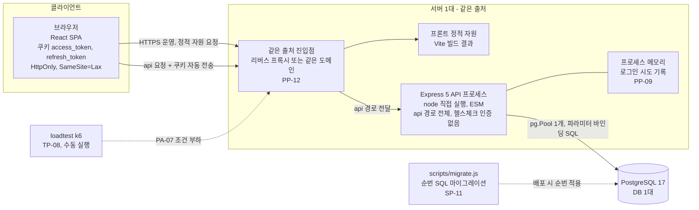

| 항목 | 내용 | 근거 |
|------|------|------|
| 같은 출처 | 진입점이 정적 자원과 `/api`를 같은 출처로 제공한다. CORS는 `FRONTEND_ORIGIN` 하나만 허용하는 안전장치다 | PP-12, SP-07, NFR-10 |
| 정적 자원 제공 주체 | 리버스 프록시인지 Express인지, TLS 종단 위치는 문서에 없다 | AD-02 |
| 개발 환경 | Vite 개발 서버가 `/api`를 백엔드로 프록시한다 | PP-03 |
| 인증 쿠키 | `access_token`(JWT HS384, 15분, `Path=/`)과 `refresh_token`(불투명, 7일, `Path=/api/auth`). 운영 `Secure`. JS에서 접근 불가 | PA-01, SP-03, NFR-10 |
| 로그인 차단 | 프로세스 메모리. 재시작 시 초기화, 단일 인스턴스 전제 | PP-09, SP-08 |
| DB 접속 | `pg.Pool` 하나, `date`(OID 1082)는 문자열로 파싱 | SP-10, NP-18 |
| 운영 | `GET /api/health`(DB `SELECT 1`, 실패 시 503), `SIGTERM` 시 정리 후 종료. 캐시 서버·큐·CI 없음 | SP-12, PP-19, PRD 8장 |

## 3. 프론트엔드 아키텍처

### 3.1 레이어 의존 방향

의존 방향은 `app → pages → features → (components, api, stores, lib)`이다. `components`는 `lib`(타입은 `api/types`)만, `api`와 `stores`는 `lib`만 import한다(LP 2.2).

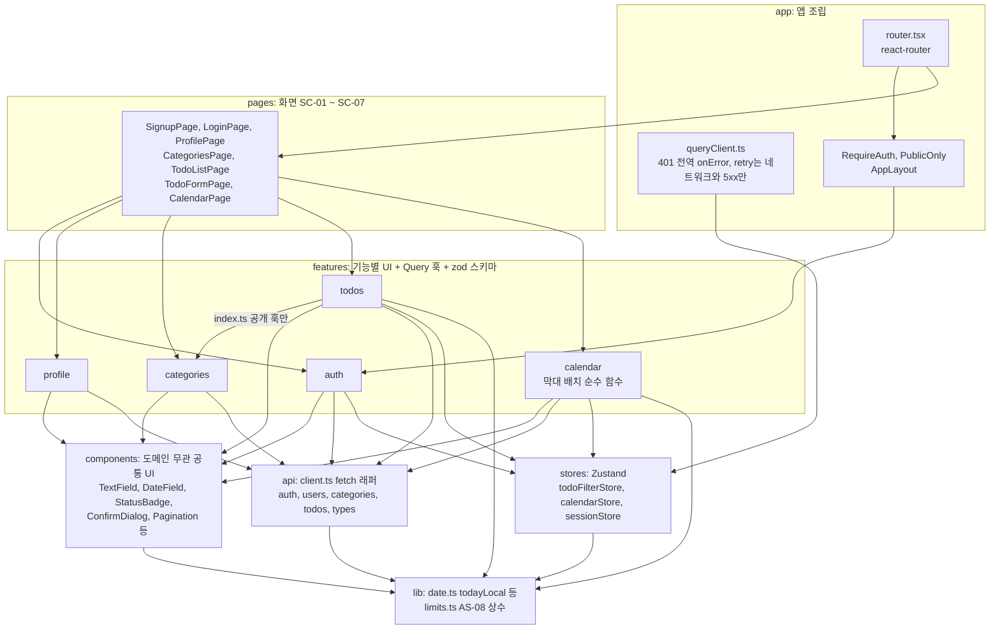

- 모든 호출은 `api/client.ts`의 단일 래퍼를 거친다(`credentials: 'include'`, 실패 시 `ApiError`). 컴포넌트가 `fetch`를 직접 쓰지 않는다. 래퍼는 `/api/auth/*`가 아닌 요청의 401 `UNAUTHENTICATED`에 갱신을 한 번(single-flight) 호출하고 원래 요청을 한 번 재시도한다(LP-08, 6.3, 6.9).
- 기능 간 import는 상대 기능의 `index.ts` 공개 항목만 허용한다. 예: SC-06의 카테고리 선택은 `features/categories`의 공개 훅을 쓴다(LP 2.2, 5번 문서 6.2).
- 프론트는 상태를 계산하지 않고 API가 준 `status`를 `StatusBadge`로 표시만 한다(LP-13).
- 근거: LP-01, LP 2.2, LP-08, LP-09, LP-13, 5번 문서 6.2 디렉토리 구조.

### 3.2 TanStack Query와 Zustand의 역할 구분

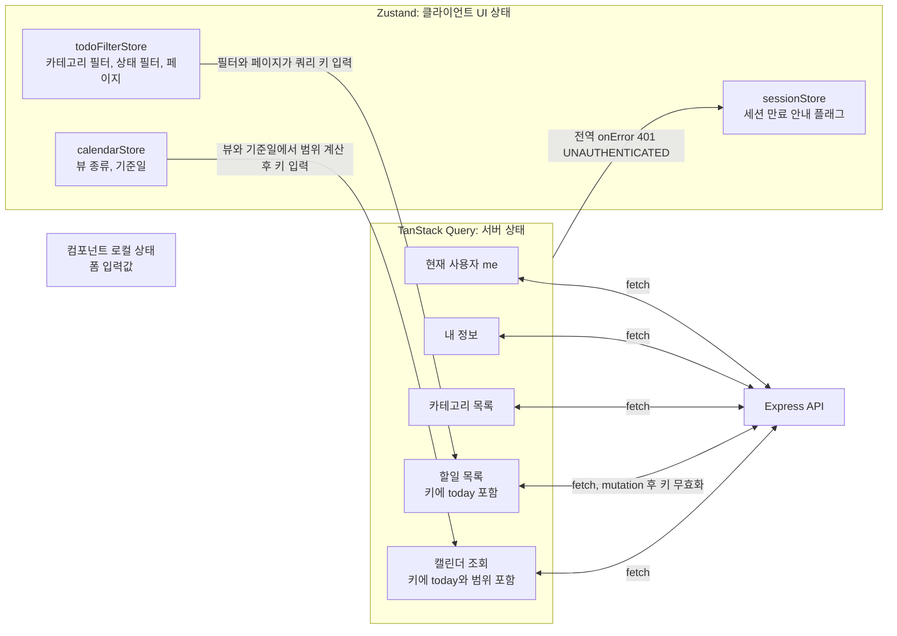

| 구분 | 보관 대상 | 하지 않는 일 | 근거 |
|------|-----------|--------------|------|
| TanStack Query | 할일, 카테고리, 내 정보, 현재 사용자 등 서버 데이터. 변경 성공 후 관련 키 무효화 | 필터·페이지·뷰 같은 UI 상태 보관 | CP-06, LP-11, LP-12 |
| Zustand | 목록 필터·페이지, 캘린더 뷰·기준일, 세션 만료 안내 플래그 | 서버 데이터 복제 | LP-12, WA-09, WA-17 |
| 컴포넌트 로컬 | 폼 입력값 | 전역 공유 | LP-12 |

## 4. 백엔드 아키텍처

### 4.1 미들웨어 체인

5번 문서에 있는 구성요소만 표시한다. 정확한 `app.js` 등록 순서는 문서에 명시가 없으며 아래는 구성요소의 논리적 위치다(AD-12).

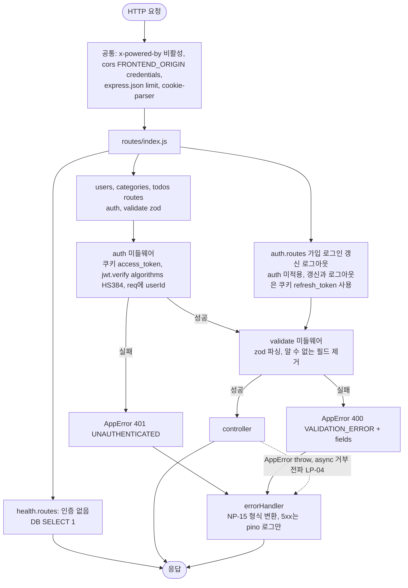

| 구성요소 | 역할 | 근거 |
|----------|------|------|
| `auth` | 쿠키 `access_token`의 JWT 검증(허용 알고리즘 `HS384`만). 페이로드는 `sub`·`iat`·`exp`. 갱신·로그아웃 경로에는 적용하지 않는다 | SP-03, PP-22 |
| `validate` | 라우트 경계 zod 검증. 통과 값만 controller에 전달 | LP-05, FR-13 |
| `errorHandler` | `AppError(status, code, message)`를 한 형식으로 응답. 500은 내부 정보 미노출, 5xx는 경로·시각과 함께 로그 | LP-04, NP-15, SP-09, NFR-12 |
| `pino` | 구조화 로그, `password`·`Cookie`·토큰 필드 `redact` | SP-09 |

### 4.2 레이어 의존 방향

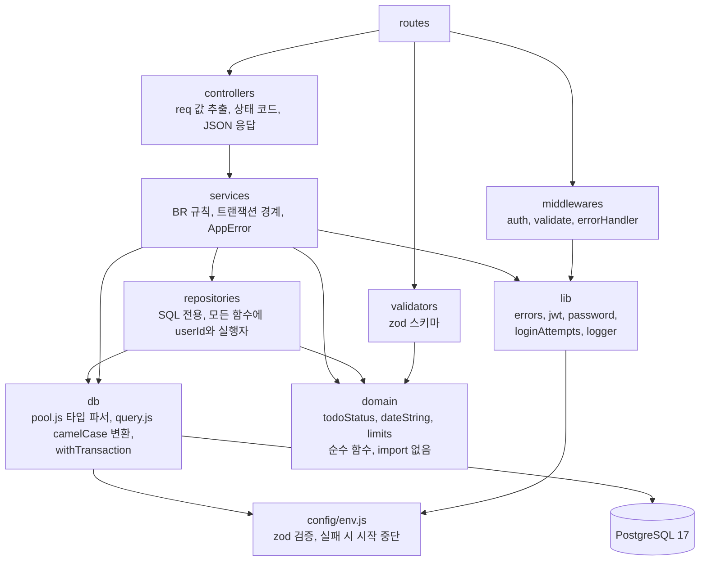

- 금지 방향: controller → repository 건너뛰기, 역방향 import, `domain`의 외부 import(LP-01). SQL은 `repositories`에만 두고 값은 `$n` 바인딩으로만 넣으며, 모든 쿼리 WHERE에 `user_id`를 포함한다(CP-04, CP-07, SP-05, SP-06).
- `services`는 `req`/`res`를 모른다. 쿠키 설정·만료는 controller가 `lib/jwt.js`의 쿠키 옵션으로 수행한다.
- 트랜잭션은 서비스가 `withTransaction`으로 묶고, 리포지토리 함수는 마지막 인자로 실행자(풀 또는 트랜잭션 클라이언트)를 받는다. 수동 클라이언트는 `finally`에서 반드시 반환한다(LP-03, SP-10).
- `validators → domain`(날짜 유효성 검사 재사용)은 5번 문서 2.1 문장에 명시가 없다(AD-14).
- 근거: LP-01~07, SP-05~06, SP-10.

## 5. 데이터 모델

ERD는 `7-erd.md`(v0.4)로 분리했다. 개념 ERD, 테이블 명세, 제약·인덱스, BR별 DB 보장 매핑은 그 문서를 따른다.

| 아키텍처 관점 요점 | 내용 | 근거 |
|------|------|------|
| 상태 비저장 | `status` 컬럼이 없다. 응답 시 `deriveStatus`로 파생한다 | BR-13, CP-02 |
| 트랜잭션 대상 | 가입(사용자 + 기본 카테고리, 6.1), 카테고리 삭제(할일 이동 + 삭제, 6.6), 토큰 갱신(`refresh_tokens` DELETE + INSERT, 6.9) | LP-03 |
| 세션 저장 | `refresh_tokens`에 Refresh Token의 SHA-256 해시만 저장한다(로그인마다 1행). Access Token은 저장하지 않는다 | `7-erd.md` 4.4, ER-13 |
| DB 제약이 서비스 검사 뒤의 최종 방어선 | 이메일 고유(409 변환), `end_date >= start_date`, 할일·카테고리 소유자 일치 복합 FK, FK `ON DELETE RESTRICT` | `7-erd.md` 5.1, ER-03, ER-04 |
| 조회 인덱스 | 목록 정렬과 캘린더 기간 겹침은 `(user_id, end_date, created_at, id)` 인덱스 하나로 받친다 | `7-erd.md` 5.2, NFR-04 |

## 6. 비즈니스 로직 시퀀스

### 6.0 시퀀스 대상 선정

| 절 | 지점 | 선정 이유 | 근거 |
|----|------|-----------|------|
| 6.1 | 회원가입 | 다중 테이블 트랜잭션(사용자 + 기본 카테고리), 이메일 중복 409, bcrypt를 트랜잭션 밖에서 수행 | BR-03, BR-06, LP-03 |
| 6.2 | 로그인 | 차단 판정 → 해시 비교 → 실패 집계의 순서, 계정 존재 비노출(더미 해시), 두 토큰 발급과 `refresh_tokens` INSERT·만료 행 정리. 규칙이 가장 많다 | SN-02, SA-03, SP-04, SP-08, PA-01 |
| 6.3 | 인증 미들웨어와 401 처리, 로그아웃 | 같은 401이라도 코드별로 프론트 동작(갱신·재시도, 안내·이동)이 갈린다. 네 곳(미들웨어, client 갱신, 전역 onError, 로그인 화면)이 협력. 로그아웃은 서버에서 Refresh 행을 삭제 | LP-08, LP-09, WA-21, FR-02, FR-11 |
| 6.4 | 할일 목록 조회 | `today` 전달, 상태 판정의 두 형태(SQL 조건과 `deriveStatus`), AND 필터, 정렬, 50건 페이지네이션 | FR-06, PA-06, LP-07 |
| 6.5 | 할일 등록·수정 | 검증 계층 분담(zod, 소유자 확인, DB 제약), 카테고리 소유권, 기본 카테고리 대체, 404 통일 | BR-04, BR-05, BR-07, PP-18 |
| 6.6 | 카테고리 삭제 | BR-08 거부와 BR-10 이동 + 삭제를 하나의 트랜잭션으로 묶는 유일한 다중 갱신 | BR-08, BR-10, LP-03 |
| 6.7 | 캘린더 조회 | 뷰 범위 계산(일~토), 기간 겹침 조건, 상태 파생 | FR-10, AS-09, CV-01~05 |
| 6.8 | 비밀번호 변경 | 현재 비밀번호 확인 후 변경, 세션 유지, 401과의 혼동 방지 | BR-12, WA-06, PP-22 |
| 6.9 | 토큰 갱신(rotation) | 행 삭제와 새 행 INSERT를 하나의 트랜잭션으로 묶고 만료를 이어받는다. 동시 401의 single-flight, 실패 시 쿠키 2종 만료와 원래 401 전달 | PA-01, SP-03, LP-08, LP-09, SN-15 |

**제외한 지점:** 할일 삭제와 완료 토글은 6.5와 같은 소유자 조건·404 패턴의 단일 문장이라 별도 시퀀스를 두지 않았다. 카테고리 등록·수정(BR-09 중복 409)과 이름 저장은 단일 문장이다. 회원 탈퇴는 제외 항목이다(OQ-01).

### 6.1 회원가입 (SN-01)

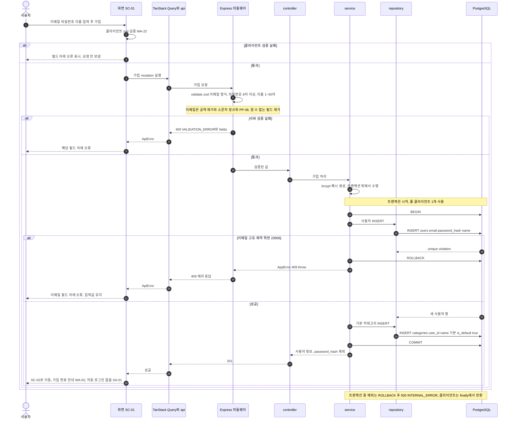

- 근거: BR-03, BR-06, FR-01, FR-13, LP-03, LP-06, SA-01, SP-04, SP-10, WA-02. 이메일 중복을 사전 조회가 아니라 DB 고유 제약(NP-10) 위반 변환으로 그린 것은 동시 가입에도 안전하기 때문이며, 선택은 AD-15에 남긴다. 쿠키는 발급하지 않는다.

### 6.2 로그인과 실패 차단 (SN-02)

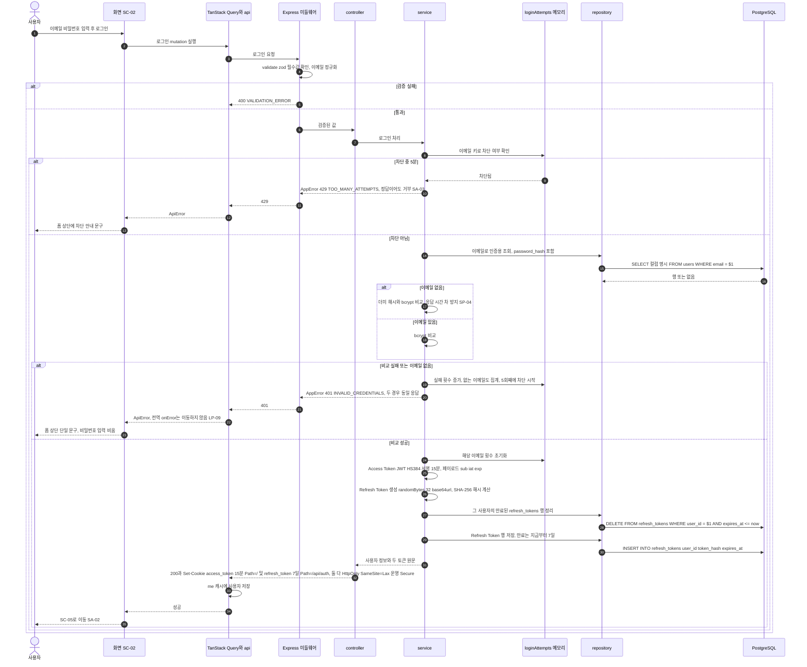

- 근거: FR-02, NFR-11, SN-02, SA-02, SA-03, SP-03, SP-04, SP-08, WA-03, PP-11, PA-01. 5회째 실패 응답은 401이고 6번째 시도부터 429다(SN-02 기대 결과). 차단 판정은 인메모리라 DB를 쓰지 않는다(PP-09). 로그인마다 `refresh_tokens` 1행이 생기며 여러 기기 로그인이 가능하다(SA-10). 만료 행 정리는 로그인 때만 한다. 원문 토큰은 저장하지 않고 해시만 저장한다(ER-13). 차단 세부 동작은 AD-05, 정리·INSERT의 트랜잭션 여부는 AD-16.

### 6.3 인증 미들웨어와 401 처리, 로그아웃 (SN-03, SN-04, SN-15)

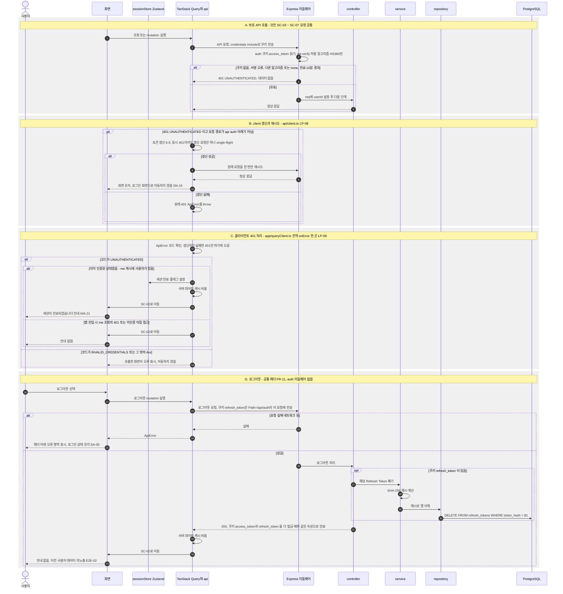

- 근거: FR-02, FR-11, LP-08~10, SP-03, SN-03, SN-04, SN-15, WA-21, SA-04, SA-05, E2E-02, PP-22. 로그인 요청의 `INVALID_CREDENTIALS` 401은 이동 대상이 아니다. TanStack Query 재시도는 4xx에 하지 않는다(LP-10). `/api/auth/*` 요청의 401은 갱신 대상이 아니다. 로그아웃은 서버에서 Refresh Token 행을 삭제해 세션을 폐기하지만, 이미 발급된 Access Token은 최대 15분 유효하다(PA-01 한계). 로그아웃은 인증 미들웨어 없이 `refresh_token` 쿠키만 사용하므로 Access Token이 만료된 뒤에도 폐기된다(AD-13 해결). 캐시 비움 시점은 6.3 C·D에 그린 대로 둔다.

### 6.4 할일 목록 조회와 필터 (SN-11)

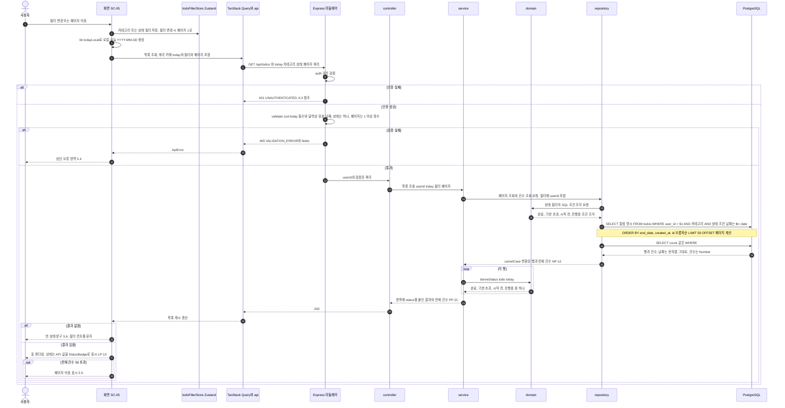

- 근거: FR-06, UC-07, BR-13, AS-06, PA-06, PP-06, PP-21, LP-07, LP-11, NP-12, NP-18, NP-20, NP-21, WA-09. 상태 판정은 SQL 조건과 `deriveStatus` 두 형태로 `domain/todoStatus.js`에 있고 일치 테스트로 묶인다(TP-02). 서버 시계는 상태 판정에 쓰지 않는다. 정렬 동점은 `id` 3순위로 해결(`7-erd.md` ER-05), 잘못된 카테고리 필터는 AD-08.

### 6.5 할일 등록·수정 (SN-07, SN-08, SN-13)

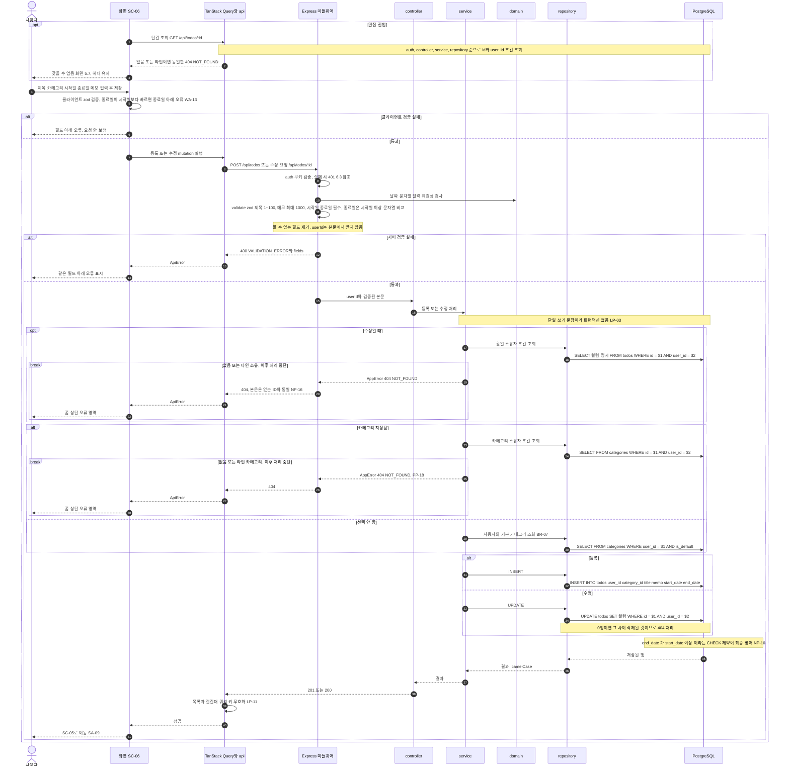

- 근거: FR-05, FR-08, FR-13, BR-02, BR-04, BR-05, BR-07, PP-18, NP-10, NP-16, NP-19, NP-20, SN-13, WA-13, WA-15, SP-06. 검증은 세 겹이다(클라이언트 UX, 서버 zod, DB 제약). 완료 토글과 삭제는 같은 소유자 조건·404 패턴을 따른다. 완료 토글 요청 형태와 BR-05 검증 위치는 AD-03, 경로 ID 형식 오류는 AD-11, 카테고리 소유자 일치는 복합 FK로 DB도 보장한다(`7-erd.md` ER-03).

### 6.6 카테고리 삭제 (SN-06)

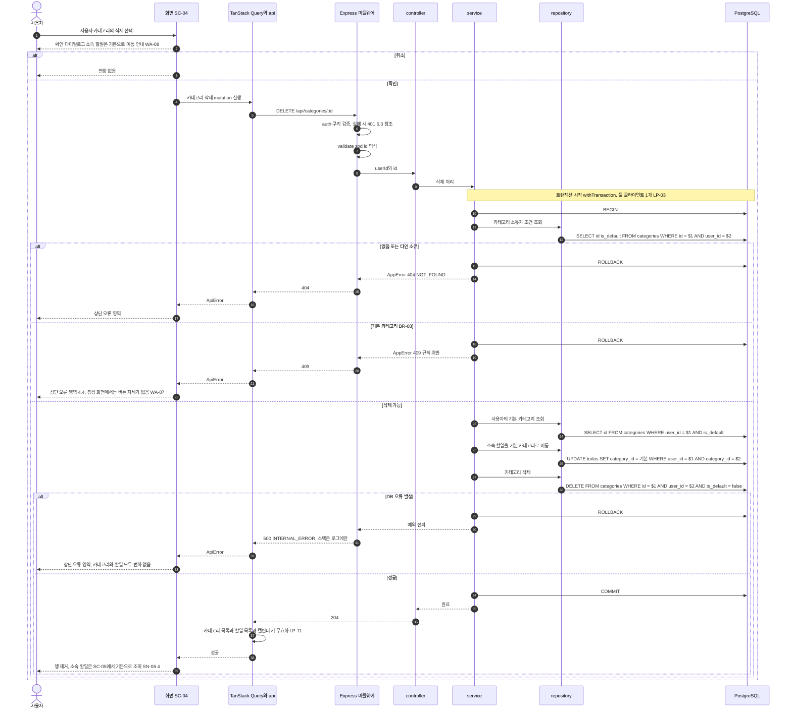

- 근거: BR-08, BR-10, FR-04, UC-05, LP-03, SP-10, SN-06, TP-11(할일 총수 불변). 이동과 삭제가 하나의 트랜잭션이라 중간 실패 시 할일이 사라지거나 카테고리만 남는 상태가 생기지 않는다. 삭제 후 목록 필터에 남은 카테고리 ID 처리는 AD-08, 동시성은 FK `ON DELETE RESTRICT`로 할일 소실 대신 한쪽이 실패한다(`7-erd.md` ER-04).

### 6.7 캘린더 조회 (SN-12)

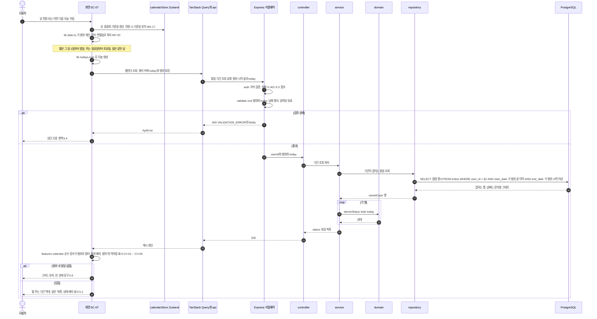

- 근거: FR-10, UC-11, AS-09, NFR-04(뷰 범위만 조회), PA-06, PP-06, PP-14, CV-01~05, LP-07, LP-11, NP-20, WA-16~18. 겹침 조건은 시작일이 범위 끝 이하이고 종료일이 범위 시작 이상이다(CV 표와 일치). 날짜 비교는 문자열이다. 조회 리소스 형태·결과 상한은 AD-01, AD-07.

### 6.8 비밀번호 변경 (SN-05)

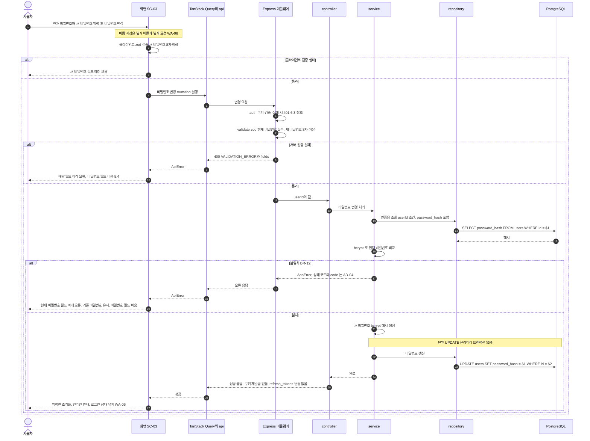

- 근거: FR-03, UC-04, BR-12, AS-05, WA-06, PP-22, SP-04, LP-06, SN-05. 변경 후에도 현재 세션(두 토큰)이 유지된다. 다른 기기의 Refresh Token 폐기 여부는 미결이다(PRD OQ-03, PP-23). 이메일은 수정 대상이 아니라 요청에 받지 않는다.

### 6.9 토큰 갱신(rotation) (SN-15)

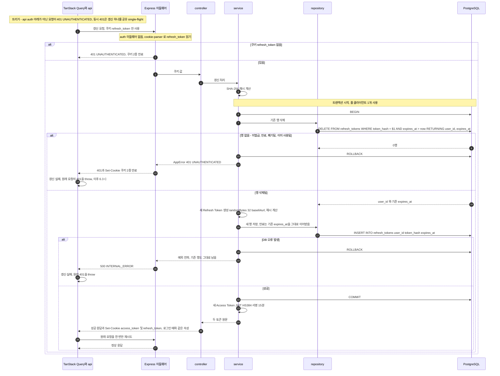

- 근거: PA-01, SP-03, LP-03, LP-08, LP-09, SN-03, SN-15, ER-13~15. Refresh Token의 절대 만료(로그인 후 최대 7일)를 유지하려고 새 행은 기존 `expires_at`을 이어받는다(확정 설계의 `RETURNING user_id`에 이어받기용 `expires_at`을 함께 반환하는 것으로 그렸다). 상태 코드와 응답 본문은 API 명세에서 정한다(AD-01). 이미 사용된 토큰은 행이 없어 401이며 계열 전체 폐기(재사용 탐지)는 하지 않는다(PA-01 한계, ER-15). 여러 탭의 동시 갱신은 AD-17.

## 7. 아키텍처 점검 요약

| 점검 | 결과 | 근거 |
|------|------|------|
| 문서에 없는 구성요소 추가 | 없음. 캐시 서버, 큐, 마이크로서비스, CI, 메트릭 서버, ORM은 그리지 않았다 | CP-01, PP-19, PRD 8장 |
| 상태 저장 컬럼 | 없음. `is_completed`만 저장 | BR-13, CP-02 |
| 모든 데이터 쿼리의 `user_id` 조건 | 시퀀스의 SQL 모두 포함(인증용 `users` 조회와 로그인 이메일 조회 제외) | SP-06 |
| 서버 시계 사용 범위 | 시각 기록, JWT·Refresh Token 만료, 로그인 차단만. 상태 판정은 요청의 `today` | NP-22, NP-21 |
| 트랜잭션 | 가입(6.1), 카테고리 삭제(6.6), 토큰 갱신(6.9)만 사용. 나머지는 단일 문장(로그인의 만료 행 정리와 INSERT는 AD-16) | LP-03 |

## 8. 가정·미결 사항

다이어그램 작성 중 발견한 문서 간 불일치와 문서에 없던 결정이다. 5번 문서 PP에 이미 있는 항목(PP-11 코드 목록, PP-13, PP-14, PP-15, PP-16, PP-21 등)은 중복하지 않고 참조만 한다.

| ID | 구분 | 내용 |
|----|------|------|
| AD-01 | 해결 | API 명세가 없어 엔드포인트 경로·메서드·요청 필드명·상태 필터 값 표기가 확정되지 않았다(NP-13, PP-11, PP-14, PP-21 참조). 본 문서는 동작 이름으로 적고 NP-13에 예시가 있는 `/api/todos`, `/api/todos/:id`만 경로를 썼다. 카테고리 삭제의 `/api/categories/:id`는 NP-13 규칙에서 유추한 표기다. → API 명세는 `backend/swagger.yaml`로 확정(8번 문서 PRE-02). 경로는 그 파일을 따른다. |
| AD-02 | 미결 | 프론트 정적 자원을 리버스 프록시와 Express 중 누가 제공하는지, TLS 종단 위치가 없다. PP-12는 '리버스 프록시 또는 같은 도메인'까지만 정한다. 2장 구성도는 이 둘을 '같은 출처 진입점'으로 묶었다. |
| AD-03 | 해결 | 완료 토글(WA-10)이 편집과 같은 요청(전체 수정)인지 별도 부분 수정인지 정해지지 않았다. 부분 수정이면 BR-05(종료일 ≥ 시작일)를 zod만으로 검증할 수 없고 서비스에서 기존 값과 비교해야 한다. 6.5는 전체 수정 기준으로 그렸다(PP-06 참조). → 별도 부분 수정 `PATCH /api/todos/{id}/completion`(`isCompleted`만)으로 결정. 날짜를 바꾸지 않아 BR-05 재검증이 필요 없다. |
| AD-04 | 해결 | 비밀번호 변경 시 현재 비밀번호 불일치의 상태 코드·`code`가 없다(400, 409 등). 401로 하면 LP-09의 `UNAUTHENTICATED` 이동 규칙과 코드로 구분해야 한다(PP-11 참조). 같은 이유로 BR-08 위반 등 409 `code` 세부 목록도 API 명세 대기다. → 400 `VALIDATION_ERROR` + `fields.currentPassword`로 결정. 409 `code`는 `EMAIL_ALREADY_EXISTS`, `CATEGORY_NAME_DUPLICATE`, `DEFAULT_CATEGORY_PROTECTED`, `CATEGORY_IN_USE`. |
| AD-05 | 미결 | 로그인 차단 세부: 차단 중 추가 시도가 차단 시간을 연장하는지, 차단 해제 후 횟수 초기화 방식, 실패 기록의 만료·정리 정책이 없다. 없는 이메일도 집계(SA-03)하므로 임의 이메일로 메모리가 계속 늘 수 있다(PP-09는 재시작·다중 인스턴스 한계만 다룸). → 차단 중 시도는 연장하지 않고, 해제 후 횟수 0으로 초기화하는 것으로 결정(API 명세 D-07). 실패 기록의 만료·정리 정책만 남았다(BE-07). |
| AD-06 | 해결 | 목록 정렬이 종료일, 생성일시 순이라 두 값이 같은 행끼리 순서가 비결정적이어서 페이지 경계에서 중복·누락이 생길 수 있다. 보조 정렬 키(`id`) 추가 여부가 없다(FR-06). → `7-erd.md` ER-05에서 `id`를 3순위 정렬 키로 결정. |
| AD-07 | 해결 | 캘린더 조회의 결과 건수 상한·정렬·범위 최대 길이가 없다. 목록의 50건 제한(PA-05)은 캘린더에 적용되지 않으며 NFR-04는 '뷰 범위만 조회'까지만 정한다. → 결과 건수 상한·페이지 없음, 범위 최대 42일(초과 400), 정렬은 목록과 같은 `end_date, created_at, id`로 결정. |
| AD-08 | 해결 | 목록의 카테고리 필터 ID가 없는 ID·타인 ID일 때 응답(404, 400, 빈 목록)이 없다. 카테고리 삭제 후 `todoFilterStore`에 삭제된 ID가 남으면 이 경우가 실제로 발생하므로 필터 초기화 시점(삭제 성공 시)도 정해야 한다(BR-02, LP-12). → 없는·타인 ID는 404 `NOT_FOUND`로 결정. 삭제 후 필터 초기화는 프론트(LP-12, 삭제 성공 시). |
| AD-09 | 해결 | 카테고리 삭제와 동시에 그 카테고리로 할일을 등록·수정하는 경쟁 상황 처리가 없다(행 잠금 여부, `todos.category_id` FK의 ON DELETE 동작). DDL 문서에서 확정이 필요하다. → `7-erd.md` ER-04에서 `ON DELETE RESTRICT`, 행 잠금 없음으로 결정. 23503의 응답 코드는 API 명세에서 정한다. |
| AD-10 | 해결 | 할일과 카테고리의 소유자 동일(도메인 3장)을 DB 제약(복합 FK 등)으로도 막을지, 서비스 검사(PP-18)만으로 둘지 NP-10에 없다. → `7-erd.md` ER-03에서 복합 FK로 결정. 서비스 검사(404 통일)는 유지. |
| AD-11 | 해결 | 경로의 ID가 정수 형식이 아닐 때(예: `abc`) 400인지 404인지 없다. NFR-06의 '없는 ID와 동일한 404' 원칙과 FR-13 입력 검증이 충돌할 수 있다. → 정수가 아닌 경로 ID는 없는 ID와 같은 404 `NOT_FOUND`로 결정. |
| AD-12 | 미결 | 5번 문서에 없는 항목: 미등록 경로 404, JSON 파싱 오류·본문 크기 초과(`express.json` limit)에 NP-15 형식을 적용하는지. `auth`와 `validate`의 순서도 명시가 없어 본 문서는 `auth` 먼저(미인증은 데이터 노출 없이 401, SN-03)로 그렸다. 미들웨어 등록 순서도 `app.js`에서 확정이 필요하다. → 미등록 경로는 404, JSON 파싱 오류·본문 크기 초과는 400 `VALIDATION_ERROR`(모두 NP-15 형식)로 결정(API 명세 D-10). `app.js` 미들웨어 등록 순서만 남았다(BE-04). |
| AD-13 | 해결 | 로그아웃 API가 인증 미들웨어 뒤에 있는지(쿠키 만료 후 로그아웃 요청이 401이 되는 경우의 동작)가 없었다. → 인증 미들웨어 없이 `refresh_token` 쿠키로 처리하고 항상 204로 응답하는 것으로 결정(6.3 D). 로그아웃·401 시 서버 데이터 캐시를 비우는 규칙은 문서에 없어 E2E-02를 만족시키도록 6.3에 그렸다(5번 문서 LP에는 없음). |
| AD-14 | 불일치 | 5번 문서 2.1의 의존 방향 문장(`routes → controllers → ...`)에 `validators`가 없고 표에서만 '`routes`에서만 참조'로 나온다. 또 `validators`가 `domain`(날짜 문자열 검증)을 import하는 것이 문장에 명시되지 않았다. 본 문서는 `routes → validators`, `validators → domain`으로 그렸다. |
| AD-15 | 가정 | 이메일 중복 판정을 사전 조회가 아니라 고유 제약 위반(23505)을 409로 변환하는 방식으로 그렸다. 동시 가입에서도 안전하며 NP-10 제약과 일치한다. 구현 시 사전 조회를 추가해도 결과는 같다. |
| AD-16 | 미결 | 로그인 시 만료 행 DELETE와 새 행 INSERT(6.2)를 하나의 트랜잭션으로 묶는지, 정리 DELETE 실패 시 로그인을 실패시키는지가 정해지지 않았다. 6.2는 두 문장을 순서대로 그렸다. |
| AD-17 | 미결 | single-flight는 한 탭 안에서만 갱신을 하나로 합친다. 같은 브라우저의 여러 탭이 동시에 갱신하면 먼저 처리된 요청이 행을 삭제하므로 나중 요청은 401(사용된 토큰)이 되어 그 탭만 세션 만료 안내로 이동할 수 있다. 재사용 탐지가 없어(PA-01) 계열 폐기로 번지지는 않는다. 허용 여부·유예 시간은 정해지지 않았다. |
