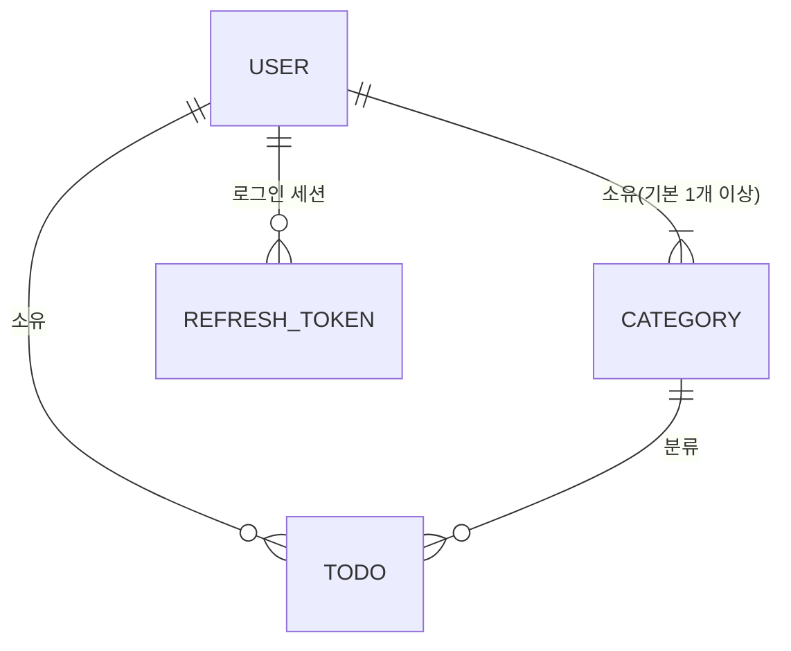
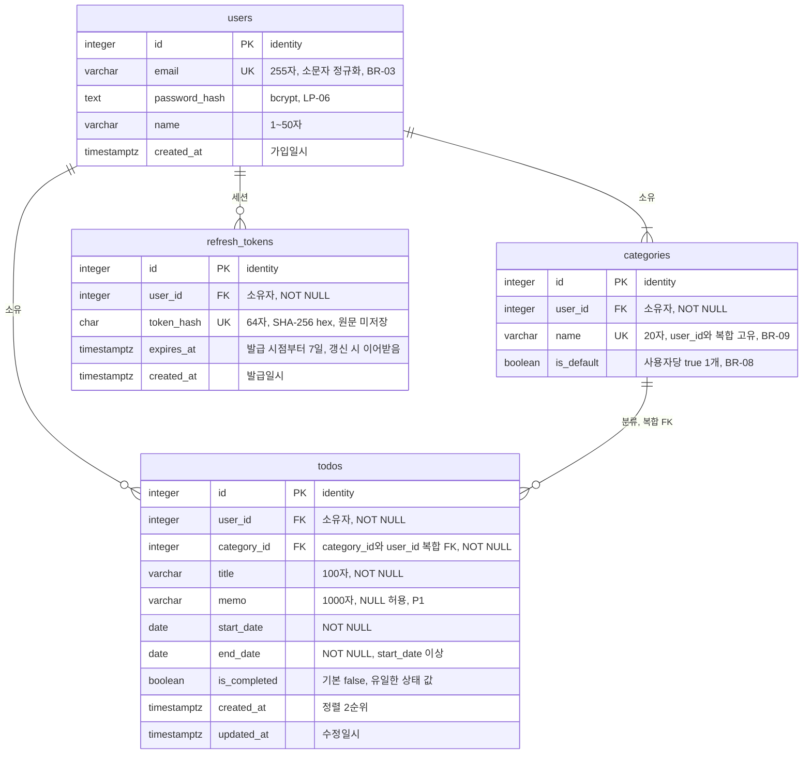
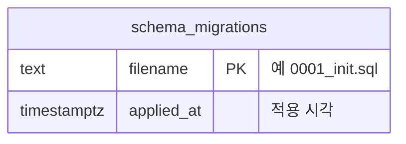

# TodoList ERD (초안)

## 버전 이력

| 버전 | 일자 | 작성자 | 상태 | 요약 |
|------|------|--------|------|------|
| v0.1 | 2026-11-04 | jtaewu | 초안 | 최초 작성 (6번 문서 5장 ERD를 분리·상세화) |
| v0.2 | 2026-11-04 | jtaewu | 초안 | 인증 변경 반영: `refresh_tokens` 테이블 추가 |
| v0.3 | 2026-11-04 | jtaewu | 초안 | 기준 문서 버전 갱신(5번 v0.3, 6번 v0.4) |

## 변경 이력

| 버전 | 일자 | 변경 섹션 | 구분 | 변경 내용 | 작성자 |
|------|------|-----------|------|-----------|--------|
| v0.1 | 2026-11-04 | 전체 | 신규 | ERD 초안 작성 | jtaewu |
| v0.2 | 2026-11-04 | 머리말 | 수정 | 기준 문서 버전 갱신(PRD v0.5, 5번 v0.2, 6번 v0.3) | jtaewu |
| v0.2 | 2026-11-04 | 1·2·3장 | 수정 | 범위 테이블 수 변경, 개념 ERD에 사용자 1:N Refresh Token 추가, 물리 ERD에 `refresh_tokens` 추가 | jtaewu |
| v0.2 | 2026-11-04 | 4·5장 | 추가 | 4.4 `refresh_tokens` 명세 추가(기존 4.4 `schema_migrations`는 4.5로 이동), 5.1 제약·5.2 인덱스 추가 | jtaewu |
| v0.2 | 2026-11-04 | 6장 | 수정 | BR-01 보장 수단에 Refresh 행 삭제 언급 | jtaewu |
| v0.2 | 2026-11-04 | 7장 | 추가 | ER-13(해시 저장), ER-14(절대 만료 이어받기), ER-15(재사용 탐지 없음), ER-16(정리 정책) | jtaewu |
| v0.3 | 2026-11-04 | 머리말 | 수정 | 기준 문서 버전 갱신(5번 v0.3, 6번 v0.4). 테이블·제약·인덱스 변경 없음 | jtaewu |

> 구분: 신규 / 추가 / 수정 / 삭제. 버전을 올릴 때는 '버전 이력'에 한 줄을 추가하고, 세부 변경 사항은 '변경 이력'에 섹션 단위로 기록한다.

> 본 문서는 `1-domain-definition.md`(v0.3), `2-PRD.md`(v0.5), `5-project-principle.md`(v0.3), `6-arch-diagram.md`(v0.4)를 기준으로 한다. 규칙(BR)·요구사항(FR/NFR)은 재정의하지 않고 ID로 참조한다. 네이밍·타입은 5번 문서 NP-08~10, NP-18, PP-07을 따른다.

## 1. 개요

**범위:** PostgreSQL 17 테이블 4개(`users`, `categories`, `todos`, `refresh_tokens`)와 마이그레이션 이력 테이블 1개(`schema_migrations`, SP-11). `pg`로 SQL을 직접 작성하고 순번 SQL 마이그레이션으로 적용한다(ORM 없음). DDL 파일 자체는 `backend/migrations/`에서 작성한다.

**고정 원칙:**
- 상태(status)는 저장하지 않는다. 저장 값은 `is_completed`뿐이다(BR-13).
- 날짜는 `date`, 시각은 `timestamptz`. `pg`는 `date`를 문자열 `YYYY-MM-DD`로 받는다(NP-18).
- 로그인 시도 제한은 인메모리라 테이블이 없다(PP-09).
- Refresh Token은 SHA-256 해시만 `refresh_tokens`에 저장한다. 원문과 Access Token은 저장하지 않는다(ER-13).
- 범위 밖(탈퇴 OQ-01, 비밀번호 재설정 OQ-02, 반복·알림·공유 EX-01)을 위한 테이블·컬럼은 없다. soft delete, 감사 로그, 정렬 순서 컬럼도 두지 않는다(BR-11 영구 삭제).

## 2. 개념 ERD

도메인 3장의 엔티티 3개·관계 3개에 인증 세션(Refresh Token)이 추가되었다(PA-01).

| 관계 | 카디널리티 | 근거 |
|------|-----------|------|
| 사용자 - 카테고리 | 1 : N (최소 1개 = 기본 카테고리) | BR-06, AS-04 |
| 사용자 - 할일 | 1 : N | BR-02 |
| 카테고리 - 할일 | 1 : N (할일은 반드시 하나의 카테고리에 속함) | BR-07 |
| 사용자 - Refresh Token | 1 : N (로그인마다 1개, 여러 기기 로그인 가능) | PA-01, SA-10 |
| 소유자 일치 | 할일의 소유자 = 그 카테고리의 소유자 | 도메인 3장, ER-03 |

## 3. 논리/물리 ERD

운영 테이블 `schema_migrations`는 업무 엔티티와 관계가 없어 별도 블록으로 둔다(SP-11, ER-10).

## 4. 테이블 명세

### 4.1 `users`

| 컬럼 | 타입 | NULL | 기본값 | 제약 | 근거 |
|------|------|------|--------|------|------|
| id | integer | NOT NULL | identity | PK | PP-07, NP-08 |
| email | varchar(255) | NOT NULL | - | `uq_users_email`, `ck_users_email_lower` | BR-03, AS-05, PP-08, ER-02 |
| password_hash | text | NOT NULL | - | - | NFR-05, LP-06, PA-02 |
| name | varchar(50) | NOT NULL | - | - | AS-08, FR-01 |
| created_at | timestamptz | NOT NULL | `now()` | - | 도메인 3장, NP-09 |

### 4.2 `categories`

| 컬럼 | 타입 | NULL | 기본값 | 제약 | 근거 |
|------|------|------|--------|------|------|
| id | integer | NOT NULL | identity | PK | PP-07 |
| user_id | integer | NOT NULL | - | `fk_categories_user_id` | BR-02, NP-08 |
| name | varchar(20) | NOT NULL | - | `uq_categories_user_id_name` | BR-09, AS-08, ER-08 |
| is_default | boolean | NOT NULL | `false` | `uq_categories_user_id_default`(부분) | BR-06, BR-08, AS-04, NP-09 |

추가 고유 제약 `uq_categories_id_user_id (id, user_id)`는 `todos`의 복합 FK 대상이다(ER-03).

### 4.3 `todos`

| 컬럼 | 타입 | NULL | 기본값 | 제약 | 근거 |
|------|------|------|--------|------|------|
| id | integer | NOT NULL | identity | PK | PP-07 |
| user_id | integer | NOT NULL | - | `fk_todos_user_id` | BR-02 |
| category_id | integer | NOT NULL | - | `fk_todos_category_id_user_id` (`category_id`, `user_id`) | BR-07, ER-03, ER-04 |
| title | varchar(100) | NOT NULL | - | - | BR-04, AS-08 |
| memo | varchar(1000) | **NULL 허용** | NULL | - | FR-12(P1, 선택), AS-08, ER-11 |
| start_date | date | NOT NULL | - | `ck_todos_end_date_gte_start_date`의 일부 | BR-04, AS-01, NP-17 |
| end_date | date | NOT NULL | - | `ck_todos_end_date_gte_start_date` | BR-04, BR-05, AS-01 |
| is_completed | boolean | NOT NULL | `false` | - | BR-13, 도메인 4장, NP-09 |
| created_at | timestamptz | NOT NULL | `now()` | - | FR-06(정렬 2순위), NP-22 |
| updated_at | timestamptz | NOT NULL | `now()` | - | 도메인 3장, ER-09 |

`status` 컬럼은 없다. 상태는 `today`(PA-06)와 `start_date`·`end_date`·`is_completed`로 조회 시 파생한다(LP-07).

### 4.4 `refresh_tokens`

| 컬럼 | 타입 | NULL | 기본값 | 제약 | 근거 |
|------|------|------|--------|------|------|
| id | integer | NOT NULL | identity | PK | PP-07 |
| user_id | integer | NOT NULL | - | `fk_refresh_tokens_user_id` | PA-01, ER-06 |
| token_hash | char(64) | NOT NULL | - | `uq_refresh_tokens_token_hash` | PA-01, SP-03, ER-13 |
| expires_at | timestamptz | NOT NULL | - | - | PA-01, ER-14 |
| created_at | timestamptz | NOT NULL | `now()` | - | NP-09, NP-22 |

로그인마다 1행이다. 갱신(rotation)은 기존 행을 삭제하고 새 행을 INSERT하며 `expires_at`을 이어받는다(ER-14).

### 4.5 `schema_migrations`

| 컬럼 | 타입 | NULL | 기본값 | 제약 | 근거 |
|------|------|------|--------|------|------|
| filename | text | NOT NULL | - | PK | SP-11, NP-11, ER-10 |
| applied_at | timestamptz | NOT NULL | `now()` | - | SP-11, ER-10 |

## 5. 제약·인덱스

NP-10 네이밍(`<접두>_<테이블>_<컬럼>`)을 따른다. PK 이름은 PostgreSQL 기본값을 쓴다.

### 5.1 제약

| 이름 | 테이블 | 정의 | 목적 | 근거 |
|------|--------|------|------|------|
| `uq_users_email` | users | UNIQUE (email) | 이메일 시스템 전체 고유. 가입 중복은 23505 → 409(동시 가입에도 안전). 로그인 조회도 이 인덱스를 쓴다 | BR-03, AD-15 |
| `ck_users_email_lower` | users | CHECK (email = lower(email)) | 소문자 정규화 누락 방어(별도 `lower()` 인덱스·citext 불필요) | PP-08, ER-02 |
| `uq_categories_user_id_name` | categories | UNIQUE (user_id, name) | 사용자별 카테고리 이름 고유 | BR-09 |
| `uq_categories_user_id_default` | categories | UNIQUE INDEX (user_id) WHERE is_default | 사용자당 기본 카테고리 최대 1개(부분 고유 인덱스) | AS-04, NP-10 |
| `uq_categories_id_user_id` | categories | UNIQUE (id, user_id) | 복합 FK의 참조 대상 | ER-03 |
| `ck_todos_end_date_gte_start_date` | todos | CHECK (end_date >= start_date) | 같은 날 허용, 역전 거부. 서버 검증 뒤의 최종 방어선 | BR-05, NP-10 |
| `fk_categories_user_id` | categories | FK (user_id) → users(id), ON DELETE RESTRICT | 소유자 존재 보장 | ER-06 |
| `uq_refresh_tokens_token_hash` | refresh_tokens | UNIQUE (token_hash) | 해시로 조회·삭제하는 갱신·로그아웃 경로의 조회 키 | PA-01, ER-13 |
| `fk_refresh_tokens_user_id` | refresh_tokens | FK (user_id) → users(id), ON DELETE RESTRICT | 소유자 존재 보장 | ER-06 |
| `fk_todos_user_id` | todos | FK (user_id) → users(id), ON DELETE RESTRICT | 소유자 존재 보장 | ER-06 |
| `fk_todos_category_id_user_id` | todos | FK (category_id, user_id) → categories(id, user_id), ON DELETE RESTRICT | 카테고리 존재 + 할일·카테고리 소유자 일치를 DB가 보장 | ER-03, ER-04, AD-09, AD-10 |

길이 CHECK는 두지 않는다. 최대 길이는 `varchar(n)`이 보장하고, 최소 길이(1자 이상)와 공백 처리는 서버 zod가 검증한다(FR-13, ER-01).

### 5.2 인덱스

| 이름 | 테이블 | 컬럼 | 받치는 쿼리 | 근거 |
|------|--------|------|-------------|------|
| `idx_todos_user_id_end_date_created_at_id` | todos | (user_id, end_date, created_at, id) | ① 목록: `WHERE user_id = $1 [AND category_id/상태 조건] ORDER BY end_date, created_at, id LIMIT 50`. ② 캘린더 기간 겹침: `WHERE user_id = $1 AND start_date <= 범위끝 AND end_date >= 범위시작`은 `end_date >= 범위시작`으로 스캔 범위를 좁히고 `start_date`는 필터로 적용 | FR-06, FR-10, NFR-04, PA-05, ER-05, ER-07 |
| `idx_todos_user_id_category_id` | todos | (user_id, category_id) | 카테고리 필터, BR-10 이동 `UPDATE ... WHERE user_id AND category_id`, 카테고리 삭제 시 FK 참조 검사(없으면 전체 스캔) | FR-06, BR-10, NFR-04, PA-07 |
| `idx_refresh_tokens_user_id` | refresh_tokens | (user_id) | 로그인 시 그 사용자의 만료 행 정리 `DELETE ... WHERE user_id = $1 AND expires_at <= now()`, FK 참조 검사 | PA-01, ER-16 |

`uq_users_email`, `uq_categories_user_id_name`(user_id 선두)도 각각 로그인 조회, 사용자별 카테고리 목록 조회를 받친다. 상태 필터(완료·기한 초과·시작 전·진행중)는 사용자 단위 행 수(PA-07: 200건)가 작아 별도 인덱스를 두지 않는다(ER-07).

## 6. 규칙 → DB 보장 매핑

DB = DB 제약이 보장, 서비스 = 서비스 로직(및 zod)이 보장. '병행'은 둘 다 둔다(DB는 최종 방어선).

| BR | 규칙 | 구분 | 보장 수단 |
|----|------|------|-----------|
| BR-01 | 인증된 사용자만 사용 | 서비스 | `auth` 미들웨어. DB 무관. 세션 폐기는 `refresh_tokens` 행 삭제로 한다(로그아웃, PA-01) |
| BR-02 | 본인 데이터만 접근, 타인은 404 | 서비스(+DB 일부) | 모든 쿼리 WHERE `user_id`(SP-06). DB는 복합 FK로 타인 카테고리 참조 저장만 차단(ER-03) |
| BR-03 | 이메일 전체 고유 | 병행 | `uq_users_email`, `ck_users_email_lower`. 서비스는 정규화·409 변환 |
| BR-04 | 제목·시작일·종료일 필수, 길이 | 병행 | NOT NULL + `varchar(n)` 최대 길이. 최소 길이·형식은 서비스(zod) |
| BR-05 | 종료일 ≥ 시작일 | 병행 | `ck_todos_end_date_gte_start_date` + zod |
| BR-06 | 가입 시 기본 카테고리 생성 | 서비스 | 가입 트랜잭션(LP-03). DB는 기본이 2개 이상 되는 것만 차단, 0개는 못 막음(ER-12) |
| BR-07 | 카테고리 미지정 시 기본에 속함 | 서비스 | 기본 카테고리 조회 후 INSERT/UPDATE. DB는 `category_id NOT NULL`로 미소속 저장만 차단 |
| BR-08 | 기본 카테고리 삭제·이름 변경 불가 | 서비스 | `is_default` 확인 후 409, DELETE에 `is_default = false` 조건. DB 제약으로는 불가(트리거 미도입) |
| BR-09 | 사용자 내 카테고리 이름 고유 | DB | `uq_categories_user_id_name` (서비스는 23505 → 409 변환) |
| BR-10 | 삭제 시 소속 할일을 기본으로 이동 | 서비스 + DB 안전망 | 이동 UPDATE → DELETE를 한 트랜잭션으로(6번 문서 6.6). `ON DELETE RESTRICT`가 이동 누락·경쟁 시 할일 소실 대신 실패시킴(ER-04) |
| BR-11 | 할일 영구 삭제 | 서비스 | 물리 `DELETE`. soft delete 컬럼 없음. 확인 절차는 UI |
| BR-12 | 비밀번호 변경 시 현재 비밀번호 확인 | 서비스 | bcrypt 비교. DB 무관 |
| BR-13 | 상태 비저장, 파생 | DB(구조) + 서비스 | `status` 컬럼 부재. 판정은 `domain/todoStatus.js`(LP-07) |

## 7. 가정·미결 사항

문서에 없던 결정이다. 권장안은 '가정', 정하지 못한 것은 '미결'이다. 6번 문서의 AD-06/09/10은 본 문서에서 결정했고, 6번 문서 v0.2에 해결로 반영했다.

| ID | 구분 | 내용 |
|----|------|------|
| ER-01 | 가정 | AS-08 길이는 `varchar(n)`(제목 100, 메모 1000, 카테고리 이름 20, 사용자 이름 50)으로 최대치만 DB가 강제하고, 별도 길이 CHECK는 두지 않는다. 이유: 세부값이 '구현 단계 확정'(AS-08)이라 변경 시 타입 변경 하나로 끝나고, 최소 길이·공백은 서버 zod가 담당(FR-13). 길이는 글자 수 기준이다. |
| ER-02 | 가정 | 이메일은 `varchar(255)`(일반적 상한, 문서 근거 없는 추정)이며 소문자 정규화는 서비스(PP-08), `ck_users_email_lower`는 누락 방어용이다. 일반 UNIQUE로 충분해 `citext`·`lower()` 인덱스는 쓰지 않는다. |
| ER-03 | 가정 (**AD-10 결정**) | 할일·카테고리 소유자 일치를 복합 FK `(category_id, user_id) → categories(id, user_id)`로 DB가 보장한다. 이를 위해 `uq_categories_id_user_id`를 추가한다. 이유: DDL 몇 줄로 PP-18의 서비스 검사가 뚫려도 타인 카테고리 참조가 저장되지 않는다. 서비스 검사(404 통일, NP-16)는 그대로 유지한다. `fk_todos_user_id`는 복합 FK로 간접 보장되지만 의도 명시를 위해 둔다. |
| ER-04 | 가정 (**AD-09 결정**) | `todos → categories` FK는 `ON DELETE RESTRICT`다(CASCADE는 BR-10 위반, SET NULL은 NOT NULL과 충돌). 정상 경로는 서비스가 이동 후 삭제한다. 삭제와 동시에 같은 카테고리로 할일을 등록·수정하면 한쪽이 FK 위반(23503)으로 실패하고 롤백되어 할일은 사라지지 않는다. 별도 행 잠금은 두지 않으며, 서비스는 23503을 404/409 중 하나로 변환한다(코드는 API 명세, 6번 문서 AD-04 계열). |
| ER-05 | 가정 (**AD-06 결정**) | 정렬 동점은 `id` 오름차순을 3순위로 추가한다: `ORDER BY end_date, created_at, id`(FR-06 확장). 이유: 페이지 경계 중복·누락 방지, 컬럼 추가 없이 가능. 인덱스 끝에 `id`를 포함한다. |
| ER-06 | 가정 | 사용자 FK는 `ON DELETE RESTRICT`다. 사용자 삭제는 범위 밖(OQ-01)이므로 CASCADE 등 탈퇴 시 데이터 처리 동작을 정하지 않는다. 탈퇴를 도입하면 재결정한다. |
| ER-07 | 가정 | 캘린더 겹침 조회는 별도 인덱스 없이 `idx_todos_user_id_end_date_created_at_id`를 쓴다(사용자당 약 200건, PA-07). 부하 테스트(NFR-01, R-02)에서 미달하면 `(user_id, start_date, end_date)` 인덱스를 추가한다. 캘린더 결과 상한·범위 최대 길이는 6번 문서 AD-07 소관이며 여기서 정하지 않는다. |
| ER-08 | 가정 | 카테고리 이름 고유는 대소문자·공백을 구분하는 정확 일치다. 앞뒤 공백 제거는 서비스(zod)가 한다. 기본 카테고리 이름 '기본'도 같은 고유 제약을 받아 사용자가 같은 이름을 만들 수 없다. |
| ER-09 | 가정 | `updated_at`은 트리거 없이 서비스의 UPDATE 문이 `now()`로 설정한다(트리거 미도입, CP-01). 서버 시계는 시각 기록에 쓸 수 있다(NP-22). |
| ER-10 | 가정 | `schema_migrations`는 `filename`(PK), `applied_at` 두 컬럼이다. 5번 문서 SP-11은 '적용 이력'까지만 정하므로 컬럼 구성은 본 문서의 가정이며 러너 구현 시 확정한다. |
| ER-11 | 가정 | 메모가 없으면 빈 문자열이 아니라 NULL로 저장한다(서비스가 빈 값을 NULL로 변환). |
| ER-12 | 미결 | '사용자당 기본 카테고리 최소 1개'(BR-06)는 DB로 보장하지 못한다(부분 고유 인덱스는 최대 1개만 보장). 지연 제약 트리거는 도입하지 않고 가입 트랜잭션에 의존한다. 가입 외 경로로 기본 카테고리가 없는 사용자가 생길 수 있는지는 구현 시 점검한다. |
| ER-13 | 가정 | Refresh Token은 SHA-256 해시(hex 64자, `char(64)`)만 저장하고 원문은 저장하지 않는다. 이유: DB가 유출되어도 토큰을 재사용할 수 없고, 토큰이 `randomBytes(32)`의 고엔트로피 값이라 솔트·느린 해시가 필요 없다. 해시 값은 `uq_refresh_tokens_token_hash`로 고유하다. |
| ER-14 | 가정 | `expires_at`은 로그인 시점부터 7일이며 갱신(rotation) 시 새 행이 기존 행의 `expires_at`을 그대로 이어받는다. 이유: 로그인 후 최대 7일이라는 절대 만료를 유지한다(슬라이딩 연장 없음). 갱신 시 기존 행 `DELETE ... RETURNING`과 새 행 INSERT는 한 트랜잭션이다(6번 문서 6.9). |
| ER-15 | 가정 | 재사용 탐지(토큰 계열 전체 폐기)를 하지 않는다. 이미 사용된 Refresh Token은 행이 없어 401이 될 뿐이며, 이를 위한 계열 식별 컬럼·상태 컬럼은 두지 않는다(PA-01 한계). |
| ER-16 | 가정 | 만료된 `refresh_tokens` 행의 정리는 그 사용자가 로그인할 때 DELETE하는 것뿐이다. 다시 로그인하지 않는 사용자의 만료 행은 남는다. 별도 정리 작업은 두지 않는다. |
