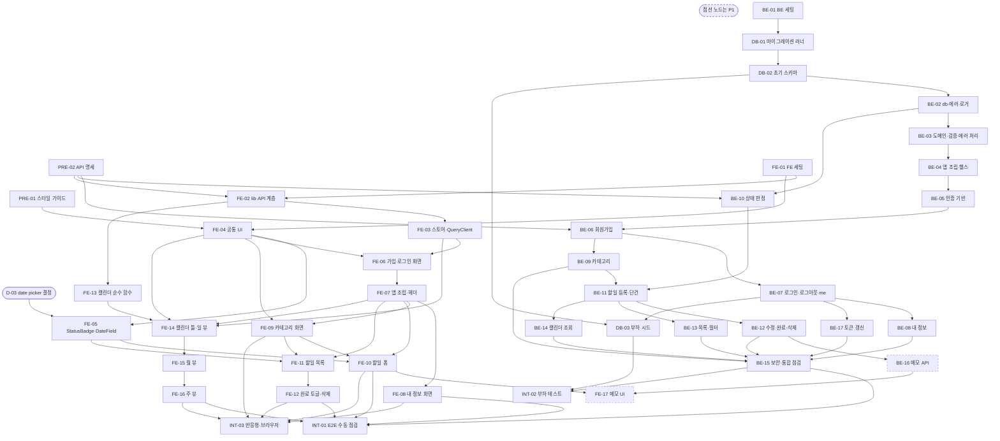

# TodoList 작업 실행 계획 (초안)

## 버전 이력

| 버전 | 일자       | 작성자 | 상태 | 요약      |
| ---- | ---------- | ------ | ---- | --------- |
| v0.1 | 2026-11-04 | jtaewu | 초안 | 최초 작성 |
| v0.2 | 2026-11-04 | jtaewu | 초안 | 인증 변경 반영: HS384 Access Token + Refresh Token(BE-17 신설), D-11 해결 |
| v0.3 | 2026-11-04 | jtaewu | 초안 | 문서 간 불일치 정리: 기준 문서 버전 갱신, D-14 SA 범위, 10장 불일치 7 처리 상태 |
| v0.4 | 2026-11-04 | jtaewu | 초안 | D-01 해결, D-16~18 추가, 정렬 불일치 해결 |

## 변경 이력

| 버전 | 일자       | 변경 섹션 | 구분 | 변경 내용                                                                      | 작성자 |
| ---- | ---------- | --------- | ---- | ------------------------------------------------------------------------------ | ------ |
| v0.1 | 2026-11-04 | 전체      | 신규 | DB·백엔드·프론트엔드 Task 분해, 일정 배치, 의존 그래프, 착수 전 결정 사항 작성 | jtaewu |
| v0.2 | 2026-11-04 | 머리말 | 수정 | 기준 문서 버전 갱신(PRD v0.5, 시나리오 v0.4, 와이어프레임 v0.3, 5번 v0.2, 6번 v0.3, ERD v0.2) | jtaewu |
| v0.2 | 2026-11-04 | 2·3·4장 | 수정 | 요약표·의존 그래프·일정에 BE-17 추가(선행 BE-07, BE-15의 선행으로 연결, D1 오후), BE-05·07, FE-02 제목 갱신 | jtaewu |
| v0.2 | 2026-11-04 | 5·6장 | 수정 | PRE-02에 갱신 엔드포인트, BE-01(`JWT_SECRET` 64자), DB-02(`refresh_tokens`), BE-05(HS384·alg 고정·쿠키 2종), BE-07(두 토큰 발급·행 INSERT·로그아웃 폐기), BE-15(쿠키 2종 Secure·원문 미저장 점검) | jtaewu |
| v0.2 | 2026-11-04 | 6장 | 추가 | BE-17 토큰 갱신(Refresh) API | jtaewu |
| v0.2 | 2026-11-04 | 7장 | 수정 | FE-02(갱신·single-flight·재시도), FE-03·FE-07 완료 조건을 '갱신 실패 시에만 만료 처리'로 변경 | jtaewu |
| v0.2 | 2026-11-04 | 8장 | 수정 | INT-01(쿠키 2종, SN-15), INT-02(유지 시간 10분은 Access 15분보다 짧음 확인) | jtaewu |
| v0.2 | 2026-11-04 | 9장 | 수정 | D-11 해결 처리 | jtaewu |
| v0.3 | 2026-11-04 | 머리말 | 수정 | 기준 문서 버전 갱신(5번 v0.3, 6번 v0.4, ERD v0.3) | jtaewu |
| v0.3 | 2026-11-04 | 9장 | 수정 | D-14 출처의 SA 범위를 SA-01~09에서 SA-01~11로 정정(SA-10·11은 시나리오 v0.4에서 추가) | jtaewu |
| v0.3 | 2026-11-04 | 10장 | 수정 | 불일치 7의 '5번 문서 6.1 docs 설명' 부분이 5번 v0.3에서 정정되었음을 처리 열에 기록 | jtaewu |
| v0.4 | 2026-11-04 | 머리말 | 수정 | 기준 문서 버전 갱신(PRD v0.6, 시나리오 v0.5, 와이어프레임 v0.4, 5번 v0.4, 6번 v0.5, ERD v0.4) | jtaewu |
| v0.4 | 2026-11-04 | 4장 | 수정 | 착수 전 결정 범위를 D-01~D-18 중 미결 항목으로 변경 | jtaewu |
| v0.4 | 2026-11-04 | 1·9·10장 | 수정 | D-01 해결(스킬 경로 수정), 1장 스킬 안내와 10장 불일치 1 처리 갱신 | jtaewu |
| v0.4 | 2026-11-04 | 9장 | 추가 | D-16(AD-16), D-17(AD-17), D-18(OQ-03·PP-23) 추가 | jtaewu |
| v0.4 | 2026-11-04 | 10장 | 수정 | 불일치 3 해결(PRD·시나리오에 정렬 3순위 반영) | jtaewu |

> 구분: 신규 / 추가 / 수정 / 삭제. 버전을 올릴 때는 '버전 이력'에 한 줄을 추가하고, 세부 변경 사항은 '변경 이력'에 섹션 단위로 기록한다.

> 본 문서는 `1-domain-definition.md`(v0.3), `2-PRD.md`(v0.6), `3-user-scenario.md`(v0.5), `4-wireframe.md`(v0.4), `5-project-principle.md`(v0.4), `6-arch-diagram.md`(v0.5), `7-erd.md`(v0.4), `schema.sql`을 기준으로 한다. 규칙·요구사항·화면은 재정의하지 않고 ID(FR/NFR/BR/SN/E2E/ST/CV/WA/TP/SP/ER/AD/PP 등)로 참조한다.

## 1. 개요와 Task 표기 규칙

**목적:** 1인 개발·2일(PRD 9장) 안에 P0 전체와 NFR을 달성하도록 작업을 독립적인 Task로 나누고, 순서·완료 조건·선행 관계를 고정한다. 문서에 없는 CI·Docker·캐시·모니터링·배포 Task는 만들지 않는다(CP-01, PP-19).

| 항목           | 규칙                                                                                                                                                                           |
| -------------- | ------------------------------------------------------------------------------------------------------------------------------------------------------------------------------ |
| ID 체계        | `PRE-xx` 착수 전 문서 작업, `DB-xx` 데이터베이스, `BE-xx` 백엔드, `FE-xx` 프론트엔드, `INT-xx` 통합 점검. 문서 전체에서 유일하며 각 Task는 `### BE-03. 제목` 한 줄로 시작한다  |
| 결정 ID        | `D-xx`는 9장 '착수 전 결정 사항'의 항목이다. Task의 선행 조건으로 인용한다                                                                                                     |
| 체크박스       | `- [ ]` = 미충족, `- [x]` = 충족. 모든 완료 조건은 자동 테스트 또는 명령 실행으로 확인 가능한 문장이다                                                                         |
| 공통 완료 조건 | 모든 DB·BE·FE Task는 `해당 범위 테스트 통과, 커버리지 90% 이상(TP-01)`을 포함한다. '범위'는 그 Task가 추가·변경한 파일이며, 패키지 전체 `thresholds`(90%)도 깨지지 않아야 한다 |
| 우선순위       | 별도 표기가 없으면 P0. P1은 `(P1)`로 표기한다                                                                                                                                  |
| 선행 Task      | 이 Task를 시작하기 전에 완료(모든 완료 조건 체크)되어 있어야 하는 Task ID 목록                                                                                                 |
| 근거           | 해당 Task가 구현·검증하는 FR/BR/SN 등 문서 ID                                                                                                                                  |

**스킬 사용법**

| 대상               | 실행                                                              | 비고                                                                                                            |
| ------------------ | ----------------------------------------------------------------- | --------------------------------------------------------------------------------------------------------------- |
| `DB-xx`, `BE-xx`   | `/develop-backend <TASK_NUMBER>` (예: `/develop-backend BE-03`)   | DB Task의 대상(`backend/migrations/`, `backend/scripts/`)이 `backend/` 안이므로 develop-backend 스킬로 수행한다 |
| `FE-xx`            | `/develop-frontend <TASK_NUMBER>` (예: `/develop-frontend FE-04`) | UI 컴포넌트는 스타일 가이드(PRE-01)를 적용한다                                                                  |
| `PRE-xx`, `INT-xx` | 스킬 대상 아님                                                    | 문서 작성·수동 점검·k6 실행이다. 완료 조건을 직접 확인하고 체크한다                                             |

- 스킬은 Task 하나를 받아 테스트(커버리지 90% 이상)와 구현을 수행하고, 테스트가 통과하면 그 Task의 완료 조건 체크박스를 체크한다. 재시도는 3회까지이며 미충족 요건은 보고된다.
- Task는 한 번의 스킬 실행으로 끝나는 크기이며 대상 디렉토리가 한 곳이다. 기능 수직 단위(인증, 카테고리, 할일, 목록, 캘린더)로 나누되, 공통 기반은 먼저 둔다.
- FE Task는 MSW로 API를 모킹해 BE 완료와 무관하게 검증한다(TP-05). 실서버 연동은 INT-01에서 확인한다. API 형태는 PRE-02(API 명세)가 유일한 계약이다.
- 두 스킬은 이 문서(`docs/8-plan.md`)를 읽는다(D-01 해결).

## 2. Task 요약

| ID     | 제목                                      | 대상      | 선행                              | 우선순위 | 배치    |
| ------ | ----------------------------------------- | --------- | --------------------------------- | -------- | ------- |
| PRE-01 | 스타일 가이드 확정                        | docs/     | 없음                              | P0       | 착수 전 |
| PRE-02 | API 명세 확정                             | docs/     | 없음                              | P0       | 착수 전 |
| BE-01  | 백엔드 프로젝트 세팅·환경 변수            | backend/  | 없음                              | P0       | D1 오전 |
| DB-01  | 마이그레이션 러너                         | backend/  | BE-01                             | P0       | D1 오전 |
| DB-02  | 초기 스키마 마이그레이션                  | backend/  | DB-01                             | P0       | D1 오전 |
| BE-02  | DB 모듈·에러·로거·테스트 기반             | backend/  | DB-02                             | P0       | D1 오전 |
| BE-03  | 날짜·길이 도메인, 검증·에러 처리 미들웨어 | backend/  | BE-02                             | P0       | D1 오전 |
| BE-04  | Express 앱 조립·헬스체크                  | backend/  | BE-03                             | P0       | D1 오전 |
| BE-05  | 인증 기반(JWT HS384·쿠키 2종·bcrypt·auth 미들웨어) | backend/  | BE-04                             | P0       | D1 오전 |
| BE-06  | 회원가입 API                              | backend/  | BE-05, PRE-02                     | P0       | D1 오전 |
| BE-07  | 로그인·로그아웃·me API, 로그인 시도 제한  | backend/  | BE-06                             | P0       | D1 오전 |
| BE-09  | 카테고리 API                              | backend/  | BE-06                             | P0       | D1 오후 |
| BE-10  | 할일 상태 판정 도메인                     | backend/  | BE-02, PRE-02                     | P0       | D1 오후 |
| BE-11  | 할일 등록·단건 조회 API                   | backend/  | BE-09, BE-10                      | P0       | D1 오후 |
| BE-12  | 할일 수정·완료 처리·삭제 API              | backend/  | BE-11                             | P0       | D1 오후 |
| BE-08  | 내 정보 수정·비밀번호 변경 API            | backend/  | BE-07                             | P0       | D2 오전 |
| BE-13  | 할일 목록·필터·페이지 API                 | backend/  | BE-11                             | P0       | D2 오전 |
| BE-14  | 캘린더(기간) 조회 API                     | backend/  | BE-11                             | P0       | D2 오전 |
| BE-15  | 보안·통합 점검                            | backend/  | BE-08, BE-09, BE-12, BE-13, BE-14, BE-17 | P0       | D2 오후 |
| BE-16  | 할일 메모 API                             | backend/  | BE-12                             | P1       | 여유 시 |
| BE-17  | 토큰 갱신(Refresh) API                    | backend/  | BE-07                             | P0       | D1 오후 |
| DB-03  | 부하 테스트 시드 스크립트                 | backend/  | DB-02, BE-07                      | P0       | D2 오후 |
| FE-01  | 프론트엔드 프로젝트 세팅·테스트 기반      | frontend/ | 없음                              | P0       | D1 오전 |
| FE-02  | lib(날짜·상수)·API 클라이언트(401 갱신·재시도) | frontend/ | FE-01, PRE-02                     | P0       | D1 오전 |
| FE-03  | 스토어·QueryClient(401 전역 처리)         | frontend/ | FE-02                             | P0       | D1 오전 |
| FE-04  | 공통 UI 컴포넌트·스타일 토큰              | frontend/ | FE-01, PRE-01                     | P0       | D1 오후 |
| FE-05  | StatusBadge·DateField                     | frontend/ | FE-04, D-03                       | P0       | D1 오후 |
| FE-06  | 회원가입·로그인 화면(SC-01·02)            | frontend/ | FE-03, FE-04                      | P0       | D1 오후 |
| FE-07  | 앱 조립·공통 헤더·로그아웃                | frontend/ | FE-06                             | P0       | D1 오후 |
| FE-09  | 카테고리 관리 화면(SC-04)                 | frontend/ | FE-04, FE-07                      | P0       | D1 오후 |
| FE-10  | 할일 등록/편집 화면(SC-06)                | frontend/ | FE-05, FE-07, FE-09               | P0       | D1 오후 |
| FE-08  | 내 정보 화면(SC-03)                       | frontend/ | FE-07                             | P0       | D2 오전 |
| FE-11  | 할일 목록 화면(SC-05) 조회·필터·페이지    | frontend/ | FE-05, FE-07, FE-09               | P0       | D2 오전 |
| FE-12  | 완료 토글·삭제                            | frontend/ | FE-11                             | P0       | D2 오전 |
| FE-13  | 캘린더 순수 함수                          | frontend/ | FE-02                             | P0       | D2 오전 |
| FE-14  | 캘린더 화면 틀·일 뷰(SC-07)               | frontend/ | FE-03, FE-04, FE-07, FE-13        | P0       | D2 오전 |
| FE-15  | 캘린더 월 뷰                              | frontend/ | FE-14                             | P0       | D2 오후 |
| FE-16  | 캘린더 주 뷰                              | frontend/ | FE-15                             | P0       | D2 오후 |
| FE-17  | 할일 메모 UI                              | frontend/ | FE-10, BE-16                      | P1       | 여유 시 |
| INT-01 | E2E 시나리오 수동 점검                    | 수동      | BE-15, FE-08, FE-10, FE-12, FE-16 | P0       | D2 오후 |
| INT-02 | 부하 테스트(k6)                           | loadtest/ | BE-15, DB-03                      | P0       | D2 오후 |
| INT-03 | 반응형·브라우저 확인                      | 수동      | FE-08, FE-09, FE-10, FE-12, FE-16 | P0       | D2 오후 |

## 3. 의존 그래프

BE 계열과 FE 계열은 PRE-02(API 명세)만 공유하며 서로 선행이 아니다. 계약 불일치는 INT-01에서 확인한다.

## 4. 일정 배치 (2일, 1인)

PRD 9장의 마일스톤에 Task를 배치했다. 한 사람이 BE·FE를 모두 맡으므로 PRD 일정보다 FE 비중이 커서, 아래와 같이 FE 인증 화면은 D1 오후로, 캘린더 월·주 뷰는 D2 오후로 밀린다(4장 하단 주의와 10장 불일치 4 참조).

| 시점    | PRD 마일스톤 (FR/NFR)                                          | 배치 Task                                                                          |
| ------- | -------------------------------------------------------------- | ---------------------------------------------------------------------------------- |
| 착수 전 | 결정 사항 확정(9장), 스타일 가이드, API 명세                   | D-01~D-18 중 미결 항목, PRE-01, PRE-02                                             |
| D1 오전 | 프로젝트 세팅, DB 스키마, 인증 (FR-01, 02, 11, 13, NFR-10, 11) | BE-01, DB-01, DB-02, BE-02, BE-03, BE-04, BE-05, BE-06, BE-07, FE-01, FE-02, FE-03 |
| D1 오후 | 카테고리, 할일 CRUD, 상태 파생 (FR-04, 05, 07, 08, 09), 토큰 갱신(FR-02) | BE-17, BE-09, BE-10, BE-11, BE-12, FE-04, FE-05, FE-06, FE-07, FE-09, FE-10 |
| D2 오전 | 목록·필터, 캘린더, 내 정보 (FR-03, 06, 10)                     | BE-08, BE-13, BE-14, FE-08, FE-11, FE-12, FE-13, FE-14                             |
| D2 오후 | 반응형 보정, 부하 테스트, 버그 수정 (NFR-01~09, 12)            | FE-15, FE-16, BE-15, DB-03, INT-01, INT-02, INT-03, 버그 수정                      |
| 여유 시 | 메모 (FR-12, P1)                                               | BE-16, FE-17                                                                       |

주의

- 위 배치는 의존 관계(3장)를 지키는 순서다. 같은 시점 안에서는 표의 나열 순서가 아니라 선행 Task 완료 순으로 진행한다.
- 일정이 밀리면 R-01의 순서(일 뷰 → 월 뷰 → 주 뷰)에 따라 FE-16(주 뷰)부터 줄인다. FE-14(일 뷰)는 줄이지 않는다.
- BE-17(토큰 갱신)은 BE-07 완료 후 D1 오후 초반에 처리한다.
- 로깅(NFR-12)은 BE-02에서 기반을 만들고 BE-15에서 검증한다. PRD 9장은 NFR-12를 D2 오후에 두었다.

## 5. Task 상세: 착수 전 문서 작업

### PRE-01. 스타일 가이드 확정

**대상:** `docs/` 아래 신규 문서 (프론트 스킬이 UI 개발 시 적용을 요구함, PP-15)

**수행 작업**

- 색상(상태 4종 포함, WA-19), 글꼴, 간격, 모서리, 버튼·입력·배지·막대·다이얼로그 스타일을 정한다.
- `frontend/src/styles/tokens.css`에 옮길 CSS 변수 목록을 표로 정리한다.
- 브레이크포인트(768px, WA-23)와 5번 문서 PP-15 갱신 사항을 기록한다.

**완료 조건**

- [ ] `docs/` 아래에 스타일 가이드 문서가 있고 버전 이력·변경 이력 표를 갖는다
- [ ] 상태 4종(시작 전·진행중·완료·기한 초과)의 색상 값이 정의되어 있고, 모양·선 모양(4번 문서 5.2)과 함께 쓰는 보조 수단임이 명시되어 있다(WA-19)
- [ ] CSS 변수 목록(이름·값)이 표로 정의되어 있다
- [ ] 5번 문서 PP-15를 해결로 바꿀 내용이 기록되어 있다

**선행 Task:** 없음 (D-02 결정 후 작성)

**근거:** PP-15, WA-19, WA-23, 도메인 7장

### PRE-02. API 명세 확정

**대상:** `docs/` 아래 신규 문서 (PRD 8장의 후속 문서, AD-01)

**수행 작업**

- 엔드포인트(경로·메서드), 요청·응답 필드, 상태 코드, 에러 `code`, 목록 응답 형태(전체 건수 포함 여부), 캘린더 조회 파라미터, 할일 `status` 값 표기를 정한다.
- 9장의 D-04~D-11 결정 결과를 반영한다.
- NP-13(경로), NP-14(상태 코드), NP-15(에러 형식)를 따른다.

**완료 조건**

- [ ] 인증(가입·로그인·토큰 갱신·로그아웃, 갱신·로그아웃은 인증 미들웨어 없이 `refresh_token` 쿠키 사용), 현재 사용자·내 정보(조회·이름 수정·비밀번호 변경), 카테고리(조회·등록·수정·삭제), 할일(목록·단건·등록·수정·완료 처리·삭제·기간 조회), 헬스체크가 엔드포인트 표로 정의되어 있다
- [ ] FR-01~FR-11, FR-13 각각에 대응 엔드포인트가 최소 하나 매핑되어 있다
- [ ] 에러 `code` 목록이 NP-15 형식으로 정의되어 있고 `VALIDATION_ERROR`, `UNAUTHENTICATED`, `INVALID_CREDENTIALS`, `NOT_FOUND`, `TOO_MANY_ATTEMPTS`, `INTERNAL_ERROR`와 409 계열 `code`가 포함된다
- [ ] D-04~D-11이 명세에 반영되어 있다(미반영 시 사유 기록)
- [ ] 목록 응답의 전체 건수 포함 여부(PP-21)와 캘린더 결과 상한(AD-07)이 확정되어 있다

**선행 Task:** 없음 (D-04~D-11 필요)

**근거:** AD-01, AD-03, AD-04, AD-05, AD-07, AD-08, AD-11, AD-12, AD-13, PP-11, PP-14, PP-21, NP-13~15

## 6. Task 상세: 데이터베이스·백엔드

DB Task와 BE Task 모두 `/develop-backend`로 수행한다. 모든 BE 통합 테스트는 실제 PostgreSQL 17 `_test` DB를 사용한다(TP-04).

### BE-01. 백엔드 프로젝트 세팅·환경 변수

**대상:** `backend/`, 저장소 루트 설정 파일

**수행 작업**

- `backend/package.json`(ESM, Express 5, 5번 문서 2.4 허용 목록만, 스크립트 `dev`·`test`·`test:coverage`·`lint`·`format`), `eslint.config.js`(계층 위반 `no-restricted-imports`, LP-01), `vitest.config.js`(`process.env.TZ` 비UTC, 커버리지 `thresholds` 90%, TP-01 제외 목록).
- `.env.example`(NODE_ENV, PORT, LOG_LEVEL, DATABASE_URL, TEST_DATABASE_URL, DB_POOL_MAX, JWT_SECRET, BCRYPT_COST, FRONTEND_ORIGIN)과 `src/config/env.js`(zod 검증, SP-01).
- 저장소 루트 `.editorconfig`, `.prettierrc`(TP-07).

**완료 조건**

- [ ] `npm run lint`, `npm test`, `npm run test:coverage`, `npm run format`이 존재하고 오류 없이 실행된다
- [ ] `env.js`가 필수 변수 누락, `JWT_SECRET` 64자 미만, 숫자 변수 형식 오류에서 예외를 던지고 정상 값은 파싱한다(SP-01, SP-03)
- [ ] `.env.example`의 변수 집합과 `env.js` 스키마의 변수 집합이 일치함을 테스트가 확인한다(SP-02)
- [ ] 테스트 실행 중 `process.env.TZ`가 UTC가 아니다(TP-06)
- [ ] ESLint가 `controllers`에서 `repositories`를 import하는 예시 파일을 오류로 보고한다(LP-01)
- [ ] 루트에 `.editorconfig`, `.prettierrc`가 있다
- [ ] 해당 범위 테스트 통과, 커버리지 90% 이상(TP-01)

**선행 Task:** 없음 (D-01, D-10, D-15 참조)

**근거:** SP-01, SP-02, SP-03, TP-01, TP-06, TP-07, LP-01, PP-01, PP-02

### DB-01. 마이그레이션 러너

**대상:** `backend/scripts/migrate.js`

**수행 작업**

- `backend/migrations/NNNN_설명.sql`을 순번대로 실행하는 러너. 파일마다 한 트랜잭션, 정방향만, `schema_migrations`(filename PK, applied_at)에 이력 기록(SP-11, ER-10).
- 러너는 연결 문자열을 인자로 받는 함수로 export하고, CLI 실행은 `config/env.js` 값을 쓴다.
- 이력 테이블은 러너가 `IF NOT EXISTS`로 자체 생성한다(D-15, 10장 불일치 2).

**완료 조건**

- [ ] 빈 `_test` DB에서 실행하면 임시 migrations 디렉토리의 파일이 순번대로 적용되고 `schema_migrations`에 filename이 기록된다
- [ ] 재실행 시 이미 적용된 파일은 다시 실행되지 않는다
- [ ] 중간 파일의 SQL 오류 시 그 파일의 변경이 전부 롤백되고 이력에 기록되지 않으며 종료 코드가 0이 아니다. 앞선 파일의 적용은 유지된다
- [ ] 개발·테스트가 같은 러너를 쓴다(테스트 setup이 이 함수를 호출할 수 있는 형태로 export된다)
- [ ] 해당 범위 테스트 통과, 커버리지 90% 이상(TP-01)

**선행 Task:** BE-01

**근거:** SP-11, NP-11, ER-10, TP-04

### DB-02. 초기 스키마 마이그레이션

**대상:** `backend/migrations/0001_init.sql`

**수행 작업**

- `docs/schema.sql`의 `users`, `categories`, `todos`, `refresh_tokens`와 제약·인덱스를 `0001_init.sql`로 옮긴다. 파일 내 `BEGIN`/`COMMIT`과 `schema_migrations` 생성은 러너 책임이므로 제외한다(10장 불일치 2).
- 제약·인덱스 이름은 7번 문서 5장과 같게 한다.

**완료 조건**

- [ ] DB-01 러너로 빈 `_test` DB에 적용하면 `users`, `categories`, `todos`, `refresh_tokens`, `schema_migrations`가 생성된다
- [ ] `pg_catalog` 조회로 제약 10종(`uq_users_email`, `ck_users_email_lower`, `uq_categories_user_id_name`, `uq_categories_id_user_id`, `ck_todos_end_date_gte_start_date`, `fk_categories_user_id`, `fk_todos_user_id`, `fk_todos_category_id_user_id`, `uq_refresh_tokens_token_hash`, `fk_refresh_tokens_user_id`)과 인덱스 4종(`uq_categories_user_id_default`, `idx_todos_user_id_end_date_created_at_id`, `idx_todos_user_id_category_id`, `idx_refresh_tokens_user_id`)의 이름·정의가 7번 문서와 일치한다
- [ ] `docs/schema.sql`을 임시 스키마에 실행한 결과와 `0001_init.sql` 적용 결과의 컬럼(이름·타입·NULL·기본값)·제약·인덱스 정의가 동일하다
- [ ] 제약 동작: 대문자 이메일·중복 이메일 거부, 같은 사용자 카테고리 이름 중복 거부, 사용자당 기본 카테고리 2개째 거부, `end_date < start_date` 거부·같은 날 허용, 타인 카테고리를 참조하는 todo INSERT 거부(23503), todo가 있는 카테고리 DELETE 거부(23503), `memo` NULL 허용, 중복 `token_hash` 거부, 없는 사용자를 참조하는 `refresh_tokens` INSERT 거부(23503), `refresh_tokens` 행이 있는 사용자 DELETE 거부(23503, ER-06)
- [ ] `todos`에 `status` 컬럼이 없다(BR-13)
- [ ] 해당 범위 테스트 통과, 커버리지 90% 이상(TP-01)

**선행 Task:** DB-01

**근거:** 7번 문서 4·5장, `schema.sql`, BR-03, BR-05, BR-09, BR-13, AS-04, ER-01~ER-16, NP-08~11, PA-01

### BE-02. DB 모듈·에러·로거·테스트 기반

**대상:** `backend/src/db/`, `backend/src/lib/`, `backend/tests/`

**수행 작업**

- `db/pool.js`: `pg.Pool` 하나, `DB_POOL_MAX`·타임아웃, 풀 `error` 이벤트 로깅, `date`(OID 1082) 문자열 파서, `int8`(OID 20) Number 파서(NP-18, SP-10).
- `db/query.js`: 조회 결과 snake_case → camelCase 변환(한 곳, NP-12), `withTransaction`(`finally`에서 반환, LP-03).
- `lib/errors.js`(`AppError(status, code, message)`), `lib/logger.js`(pino, 민감 필드 `redact`, SP-09).
- `tests/setup.js`(`TEST_DATABASE_URL`이 `_test`로 끝나는지 검사, DB-01 러너 적용, 테스트 전 `TRUNCATE`), `tests/helpers/`.

**완료 조건**

- [ ] `TZ`가 UTC가 아닌 상태에서 `date` 컬럼에 2024-02-29, 2026-03-01, 2026-12-31을 저장 후 조회한 값이 입력 문자열과 같다(TP-14, NP-18)
- [ ] `count(*)` 결과가 Number로 반환된다(PP-07)
- [ ] 조회 결과 키가 camelCase(`createdAt`, `isCompleted` 등)이고 파라미터는 `$n` 바인딩으로 전달된다(NP-12)
- [ ] `withTransaction`은 콜백 예외 시 변경을 롤백하고 성공 시 커밋하며, 두 경우 모두 클라이언트가 풀에 반환된다(LP-03, SP-10)
- [ ] 테스트 DB 이름이 `_test`로 끝나지 않으면 setup이 중단된다(TP-04)
- [ ] logger가 `password`, `Authorization`, `Cookie`, `Set-Cookie`, 토큰 필드를 로그에 남기지 않는다(SP-09, NFR-05)
- [ ] 해당 범위 테스트 통과, 커버리지 90% 이상(TP-01)

**선행 Task:** DB-02

**근거:** NP-12, NP-18, LP-03, SP-09, SP-10, TP-04, TP-06, TP-14, PP-07

### BE-03. 날짜·길이 도메인, 검증·에러 처리 미들웨어

**대상:** `backend/src/domain/`, `src/validators/common.schemas.js`, `src/middlewares/validate.js`, `src/middlewares/errorHandler.js`

**수행 작업**

- `domain/dateString.js`(형식 + 달력 유효성, 문자열 비교), `domain/limits.js`(AS-08 상수, ER-01 `varchar` 길이와 동일).
- `validators/common.schemas.js`(날짜·ID·`today`), `validate.js`(zod, 필드별 오류, 알 수 없는 필드 제거, LP-05), `errorHandler.js`(NP-15 형식, 5xx 로깅, 미등록 경로·JSON 오류 처리는 D-10).

**완료 조건**

- [ ] `2026-02-30`, `2026-13-01`, `2026-1-1`, 빈 문자열은 무효이고 `2024-02-29`는 유효, `2025-02-29`는 무효이다(NP-19)
- [ ] `limits.js` 상수가 AS-08(제목 100, 메모 1000, 카테고리 이름 20, 사용자 이름 50, 비밀번호 8)과 일치한다
- [ ] 검증 실패 시 400 `VALIDATION_ERROR`와 `fields`(필드명 → 문구)를 반환하고, 통과 시 `userId` 등 알 수 없는 필드는 제거된다(LP-05, FR-13)
- [ ] `AppError`는 NP-15 형식의 상태·`code`로 응답하고, 알 수 없는 예외는 500 `INTERNAL_ERROR`이며 응답 본문에 스택·내부 메시지가 없다(NP-15)
- [ ] 5xx는 요청 경로·시각과 함께 logger에 기록되고 비밀번호·토큰은 기록되지 않는다(NFR-12)
- [ ] 경로 ID 형식 오류의 응답이 D-10 결정과 일치한다
- [ ] 해당 범위 테스트 통과, 커버리지 90% 이상(TP-01)

**선행 Task:** BE-02 (D-10, D-15)

**근거:** FR-13, AS-08, NP-15, NP-19, LP-04, LP-05, NFR-12, TP-12

### BE-04. Express 앱 조립·헬스체크

**대상:** `backend/src/app.js`, `src/server.js`, `src/routes/index.js`, `src/routes/health.routes.js` 및 대응 controller·service·repository

**수행 작업**

- `app.js`: `x-powered-by` 비활성, `cors`(`FRONTEND_ORIGIN`, credentials), `express.json` limit, `cookie-parser`, 라우터, 404 처리, `errorHandler`.
- `GET /api/health`(인증 없음, DB `SELECT 1`, 실패 시 503, SP-12). `server.js`: listen과 `SIGTERM` 정리 종료.

**완료 조건**

- [ ] supertest로 `GET /api/health`가 쿠키 없이 200을 반환한다(SP-12)
- [ ] DB 쿼리 실패를 유발하면 503을 반환한다(SP-12)
- [ ] 응답 헤더에 `x-powered-by`가 없다(SP-07)
- [ ] 허용 출처가 아닌 `Origin` 요청에는 `Access-Control-Allow-Origin`이 설정되지 않고, 허용 출처는 `Access-Control-Allow-Credentials: true`를 받는다(NFR-10)
- [ ] 본문 크기 초과·잘못된 JSON·미등록 경로 응답이 D-10 결정(NP-15 형식 여부)과 일치한다
- [ ] `node src/server.js` 실행 후 `SIGTERM`을 보내면 진행 중 요청과 풀을 정리하고 종료 코드 0으로 종료한다(명령 실행으로 확인, `server.js`는 커버리지 제외)
- [ ] 해당 범위 테스트 통과, 커버리지 90% 이상(TP-01)

**선행 Task:** BE-03

**근거:** SP-07, SP-12, NFR-10, LP-02, LP-04

### BE-05. 인증 기반(JWT HS384·쿠키 2종·bcrypt·auth 미들웨어)

**대상:** `backend/src/lib/jwt.js`, `src/lib/password.js`, `src/middlewares/auth.js`

**수행 작업**

- `jwt.js`: Access Token 서명·검증. 서명 때 알고리즘 `HS384`를 명시하고 페이로드는 `sub`(사용자 ID)·`iat`·`exp`만 둔다. 검증 때 허용 알고리즘을 `['HS384']`로 고정한다. 만료 15분(Access)·7일(Refresh)은 이 모듈의 상수다(env 아님, PP-22).
- `jwt.js`: Refresh Token 생성(`crypto.randomBytes(32)` base64url)과 SHA-256 해시(hex 64자). 쿠키 이름 `access_token`·`refresh_token`, 쿠키 옵션 2종, 만료용 쿠키 옵션(발급 때와 같은 속성).
- `password.js`: bcrypt 해시·비교(`BCRYPT_COST`), 없는 이메일용 더미 해시 비교(SP-04).
- `auth.js`: `access_token` 쿠키 검증, `req`에 `userId` 설정, 실패 시 401 `UNAUTHENTICATED`.

**완료 조건**

- [ ] 유효 토큰이면 `req.userId`가 설정되고, 쿠키 없음·서명 오류·만료(fake timers로 15분 경과)는 401 `UNAUTHENTICATED` NP-15 형식을 반환한다(FR-02, SN-03)
- [ ] 서명한 토큰의 헤더 `alg`가 `HS384`이고, 같은 비밀키로 `HS256`·`HS512`로 서명한 토큰과 `alg: none` 토큰은 검증이 거부되어 401이다(SP-03, NFR-10, TP-13)
- [ ] 토큰 페이로드가 `sub`·`iat`·`exp` 외 값을 갖지 않고 `exp - iat`가 900초(15분)이다(PP-22, PA-01)
- [ ] Refresh Token은 호출마다 다른 43자 base64url 문자열이고 해시는 SHA-256 hex 64자이며 같은 입력에 같은 값이다(PA-01, SP-03)
- [ ] `access_token` 쿠키 옵션이 `HttpOnly`, `SameSite=Lax`, `Path=/`, `Max-Age` 15분이고 `refresh_token` 쿠키 옵션이 `HttpOnly`, `SameSite=Lax`, `Path=/api/auth`, `Max-Age` 7일이며, 둘 다 `NODE_ENV=production`일 때만 `Secure`가 붙는다. 만료용 옵션은 같은 `Path`를 쓴다(NFR-10, SP-03)
- [ ] 해시는 평문과 다르고 비교가 일치·불일치를 구분하며, `BCRYPT_COST`가 해시의 cost에 반영된다(PA-02, NFR-05)
- [ ] 더미 해시 비교 함수는 항상 false를 반환한다(SP-04)
- [ ] 해당 범위 테스트 통과, 커버리지 90% 이상(TP-01)

**선행 Task:** BE-04 (D-15: bcrypt 설치 여부, PP-10)

**근거:** FR-02, SP-03, SP-04, PA-01, PA-02, PP-22, NFR-05, NFR-10, TP-13

### BE-06. 회원가입 API

**대상:** `backend/src/routes/auth.routes.js`, `validators/auth.schemas.js`, `controllers/auth.controller.js`, `services/auth.service.js`, `repositories/users.repository.js`, `repositories/categories.repository.js`

**수행 작업**

- 입력: 이메일(공백 제거·소문자 정규화, 표준 형식), 비밀번호 8자 이상, 이름 1~50자.
- 서비스: bcrypt는 트랜잭션 밖, `withTransaction`으로 사용자 + '기본' 카테고리(`is_default = true`) INSERT, 이메일 고유 제약 위반(23505) → 409. 쿠키는 발급하지 않는다(SA-01).

**완료 조건**

- [ ] 유효 입력은 201이고 `users` 1행과 이름 '기본', `is_default = true`인 `categories` 1행이 생성된다(SN-01, BR-06)
- [ ] 대소문자·앞뒤 공백만 다른 같은 이메일로 재가입하면 409이고 `users`·`categories` 행 수가 늘지 않는다(BR-03, PP-08)
- [ ] 이메일 형식 오류, 비밀번호 7자 거부·8자 허용, 이름 빈 값·51자 거부·50자 허용, 필수 누락이 직접 요청에서 400 `VALIDATION_ERROR`와 해당 `fields`로 거부된다(FR-13, TP-12)
- [ ] 기본 카테고리 INSERT가 실패하면 `users` 행도 롤백된다(LP-03)
- [ ] 응답에 `password`, `passwordHash`가 없고 DB의 해시는 평문과 다른 bcrypt 값이다(NFR-05, LP-06)
- [ ] 요청 본문의 `id`, `isDefault` 등 알 수 없는 필드는 무시되고 `Set-Cookie`가 없다(LP-05, SA-01)
- [ ] 해당 범위 테스트 통과, 커버리지 90% 이상(TP-01)

**선행 Task:** BE-05, PRE-02

**근거:** FR-01, FR-13, BR-03, BR-06, SN-01, TP-11, TP-12, LP-03

### BE-07. 로그인·로그아웃·me API, 로그인 시도 제한

**대상:** `backend/src/lib/loginAttempts.js`, `repositories/refreshTokens.repository.js`, `services/auth.service.js`, `controllers/auth.controller.js`, `routes/auth.routes.js`, `routes/users.routes.js`(me 조회)

**수행 작업**

- 로그인: 인증용 조회(`password_hash` 포함은 이 함수에서만), 없는 이메일도 더미 해시 비교, 성공 시 Access Token과 Refresh Token을 함께 발급해 쿠키 2종을 설정한다. 그 사용자의 만료된 `refresh_tokens` 행을 DELETE하고 새 행(해시, 만료 7일)을 INSERT한다. 여러 기기 로그인이 가능하며 로그인마다 1행이다. 정리 정책은 이것뿐이다(ER-16).
- `loginAttempts`: 이메일(소문자) 단위 메모리, 연속 5회 실패 시 5분 차단, 성공 시 초기화, 없는 이메일도 집계, 차단 중 정답도 거부(SP-08, SA-03). 시각은 주입 가능해야 한다(TP-06). 세부 동작은 D-07.
- 로그아웃: 인증 미들웨어 없이 `refresh_token` 쿠키가 있으면 해시로 해당 행을 DELETE하고, 두 쿠키를 발급 때와 같은 속성으로 만료시키며 항상 204로 응답한다(D-11 해결). 현재 사용자 조회(`id`, `email`, `name`).

**완료 조건**

- [ ] 올바른 자격증명은 200과 `Set-Cookie` 2개(`access_token`: `HttpOnly`, `SameSite=Lax`, `Path=/`, 15분 / `refresh_token`: `HttpOnly`, `SameSite=Lax`, `Path=/api/auth`, 7일)를 반환하고 응답 본문에 비밀번호 해시와 토큰이 없다(SN-02, NFR-10)
- [ ] 로그인마다 `refresh_tokens` 1행이 INSERT되고 같은 계정으로 2번 로그인하면 2행이다. DB에는 쿠키 값이 아닌 SHA-256 해시(64자)만 있고 `expires_at`은 로그인 시각 + 7일이다(SA-10, ER-13)
- [ ] 로그인 시 그 사용자의 만료된 행만 삭제되고, 같은 사용자의 미만료 행과 다른 사용자의 만료 행은 남는다(ER-16)
- [ ] 비밀번호 오류와 없는 이메일이 상태 코드(401)·`code`(`INVALID_CREDENTIALS`)·본문이 동일하다(NP-16, FR-02)
- [ ] 없는 이메일 로그인에서도 bcrypt 비교(더미)가 수행된다(SP-04)
- [ ] 같은 이메일 연속 5회 실패 후 6번째 시도는 올바른 비밀번호여도 429 `TOO_MANY_ATTEMPTS`이고, fake timers로 5분 경과 후에는 성공하며, 5회 미만 실패 후 성공하면 횟수가 초기화된다(SN-02 1c~1e, SA-03, NFR-11)
- [ ] 존재하지 않는 이메일 5회 실패도 429이고, 대소문자가 다른 이메일은 같은 집계로 취급된다(SA-03, PP-08)
- [ ] 로그아웃은 `access_token` 쿠키 없이도 호출되며, `refresh_token` 쿠키의 해시와 일치하는 행만 삭제하고(다른 기기의 행은 유지) 두 쿠키를 발급 때와 같은 `Path`·`SameSite`·`HttpOnly`로 만료시키며 204를 반환한다(FR-11, SN-04, D-11)
- [ ] `refresh_token` 쿠키가 없거나 일치하는 행이 없어도 로그아웃은 204이고 두 쿠키가 만료된다(SN-04)
- [ ] 쿠키 없이 보호 API를 호출하면 401이다(FR-11, SN-04)
- [ ] 인증된 me 조회는 200으로 `id`, `email`, `name`을 반환하고(`password_hash` 없음) 미인증은 401이다(FR-03, SN-05)
- [ ] 로그에 비밀번호가 남지 않는다(NFR-05, NFR-12)
- [ ] 해당 범위 테스트 통과, 커버리지 90% 이상(TP-01)

**선행 Task:** BE-06 (D-07)

**근거:** FR-02, FR-03, FR-11, NFR-11, SN-02, SN-04, SA-03, SA-10, SP-03, SP-04, SP-08, PA-01, ER-13, ER-16, TP-13

### BE-08. 내 정보 수정·비밀번호 변경 API

**대상:** `backend/src/routes/users.routes.js`, `validators/users.schemas.js`, `controllers/users.controller.js`, `services/users.service.js`, `repositories/users.repository.js`

**수행 작업**

- 이름 수정, 비밀번호 변경(현재 비밀번호 bcrypt 확인 후 새 해시 저장, 쿠키 재발급 없음)은 별개 요청이다(WA-06). 이메일은 입력으로 받지 않는다(AS-05).
- 현재 비밀번호 불일치의 상태 코드·`code`는 D-06을 따른다.

**완료 조건**

- [ ] 이름 수정이 200이고 재조회에 반영되며, 빈 값·51자는 400, 50자는 허용된다(FR-03, AS-08)
- [ ] 요청에 `email`을 포함해도 이메일이 바뀌지 않는다(AS-05, SN-05 1a)
- [ ] 현재 비밀번호가 맞으면 변경되어 이전 비밀번호 로그인은 401, 새 비밀번호 로그인은 200이다(BR-12)
- [ ] 현재 비밀번호 불일치는 D-06 결정의 상태·`code`로 거부되고 DB 해시가 변하지 않으며 `UNAUTHENTICATED`가 아니다(BR-12, LP-09)
- [ ] 새 비밀번호 7자는 400, 8자는 허용된다(FR-13)
- [ ] 비밀번호 변경 후 기존 쿠키로 보호 API가 계속 200이다(WA-06, PP-22)
- [ ] 미인증 요청은 401이다
- [ ] 해당 범위 테스트 통과, 커버리지 90% 이상(TP-01)

**선행 Task:** BE-07 (D-06)

**근거:** FR-03, BR-12, AS-05, SN-05, WA-06, TP-11, TP-12

### BE-09. 카테고리 API

**대상:** `backend/src/routes/categories.routes.js`, `validators/categories.schemas.js`, `controllers/`, `services/`, `repositories/categories.repository.js`, `repositories/todos.repository.js`(소속 할일 이동 함수만)

**수행 작업**

- 목록(기본 포함, `isDefault` 표시), 등록, 이름 수정, 삭제. 모든 쿼리 WHERE에 `user_id`(SP-06).
- 삭제: `withTransaction`으로 소유자 확인 → 기본 카테고리면 409 → 소속 할일을 기본 카테고리로 이동 → 삭제(`is_default = false` 조건)(6번 문서 6.6). 23503 변환은 PRE-02를 따른다.

**완료 조건**

- [ ] 목록에 본인 카테고리만, 기본 카테고리에 `isDefault`가 표시되고 타인 카테고리는 없다(BR-02)
- [ ] 이름 1~20자 허용·21자와 빈 값은 400, 같은 사용자 내 중복은 409, 다른 사용자의 같은 이름은 허용된다(BR-09, TP-12)
- [ ] 기본 카테고리의 이름 수정·삭제는 409이고 데이터가 변하지 않는다(BR-08)
- [ ] 할일 2건이 속한 카테고리를 삭제하면 204이고, 그 2건이 기본 카테고리로 이동하며 `todos` 총수가 변하지 않는다(BR-10, SN-06, TP-11)
- [ ] 삭제의 두 단계 중 마지막 DELETE를 실패시키면 할일 이동도 롤백된다(LP-03)
- [ ] 타인 카테고리 ID와 존재하지 않는 ID에 대한 수정·삭제가 상태 코드·본문이 같은 404이고 타인 데이터는 변하지 않는다(NFR-06, TP-10)
- [ ] 경로 ID 형식 오류의 응답이 D-10 결정과 일치한다
- [ ] 해당 범위 테스트 통과, 커버리지 90% 이상(TP-01)

**선행 Task:** BE-06 (D-10)

**근거:** FR-04, BR-02, BR-08, BR-09, BR-10, SN-06, LP-03, ER-04, TP-10, TP-11

### BE-10. 할일 상태 판정 도메인

**대상:** `backend/src/domain/todoStatus.js`, `src/domain/todoStatus.test.js`

**수행 작업**

- `deriveStatus(todo, today)`(순수 함수)와 같은 규칙의 SQL 조건 조각(상태 4종, 기간 겹침 조건)을 한 파일에 둔다(LP-07). 값은 `$n` 파라미터 자리로만 받는다. 상태 값 표기는 PRE-02를 따른다.

**완료 조건**

- [ ] 3번 문서 4장 A표 ST-01~ST-13이 `deriveStatus`에서 모두 기대 상태와 일치한다(TP-02, TP-09)
- [ ] 시작일·종료일·오늘을 ±1일 격자로 바꿔 전수 조합한 결과 항상 정확히 한 상태이고, 완료=true이면 항상 '완료'이다(도메인 4장 상호 배타)
- [ ] ST-01~ST-13과 B표 CV-01~CV-05 fixture를 실제 DB `todos`에 넣고 SQL 조건 조각의 결과가 `deriveStatus`·기대 표시 여부와 일치한다(TP-02)
- [ ] SQL 조각 문자열에 날짜 리터럴이 없고 값은 파라미터로만 전달된다(SP-05)
- [ ] `TZ`가 UTC가 아닌 상태에서 통과한다(TP-06)
- [ ] `domain/todoStatus.js`는 다른 모듈을 import하지 않는다(LP 2.1)
- [ ] 해당 범위 테스트 통과, 커버리지 90% 이상(TP-01)

**선행 Task:** BE-02, PRE-02

**근거:** BR-13, 도메인 4장, ST-01~13, CV-01~05, LP-07, CP-02, CP-08, TP-02, TP-09

### BE-11. 할일 등록·단건 조회 API

**대상:** `backend/src/routes/todos.routes.js`, `validators/todos.schemas.js`, `controllers/todos.controller.js`, `services/todos.service.js`, `repositories/todos.repository.js`

**수행 작업**

- 등록: 제목 1~100자, 시작일·종료일 필수(달력 유효), 종료일 ≥ 시작일(문자열 비교), 카테고리 선택(미지정 시 기본 카테고리, BR-07). 지정된 카테고리는 소유자 조건으로 확인하고 타인·없음은 404(PP-18). 메모는 FR-12(BE-16) 전까지 받지 않는다.
- 단건 조회: `id`와 `user_id` 조건. `todos.repository`의 함수 시그니처는 `userId`와 실행자를 받는다(LP-03, SP-06).

**완료 조건**

- [ ] 유효 입력은 201이고 응답 필드가 PRE-02와 일치하며 `isCompleted`는 false이다(FR-05)
- [ ] 카테고리를 지정하지 않으면 사용자의 기본 카테고리에 속한다(BR-07, SN-07 3)
- [ ] 시작일=종료일은 201, 종료일<시작일은 400이며 `fields`에 종료일이 포함된다(BR-05, SN-07 1b, 1c)
- [ ] 제목·시작일·종료일 누락, 제목 100자 허용·101자와 빈 값 거부, `2026-02-30` 거부가 직접 요청에서 400이고 `todos` 행 수가 늘지 않는다(BR-04, TP-12)
- [ ] 타인 카테고리 ID를 지정하면 존재하지 않는 ID와 같은 404이고 행 수가 늘지 않는다(PP-18, SN-07 1e, TP-10)
- [ ] 본문에 `userId`를 넣어도 무시된다(LP-05)
- [ ] 단건 조회는 본인 것 200, 타인·없는 ID는 상태 코드·본문이 같은 404이다(SN-13, NFR-06)
- [ ] 월말·연말 날짜를 저장 후 조회한 문자열이 입력과 같다(TP-14)
- [ ] 미인증 요청은 401이다
- [ ] 해당 범위 테스트 통과, 커버리지 90% 이상(TP-01)

**선행 Task:** BE-09, BE-10

**근거:** FR-05, FR-13, BR-02, BR-04, BR-05, BR-07, SN-07, SN-13, PP-18, TP-10, TP-12, TP-14

### BE-12. 할일 수정·완료 처리·삭제 API

**대상:** `backend/src/routes/todos.routes.js`, `validators/todos.schemas.js`, `controllers/todos.controller.js`, `services/todos.service.js`, `repositories/todos.repository.js`

**수행 작업**

- 수정: 제목·기간·카테고리·완료 여부, 등록과 같은 검증, `updated_at`을 `now()`로 설정(ER-09), `UPDATE ... WHERE id AND user_id`가 0행이면 404.
- 완료 처리·해제: 요청 형태(전체 수정과 같은 요청인지 부분 수정인지)는 D-05를 따른다. 부분 수정이면 서비스에서 기존 값과 비교해 BR-05를 검증한다.
- 삭제: 영구 삭제(BR-11).

**완료 조건**

- [ ] 제목·기간·카테고리·완료 여부 변경이 저장되어 재조회에 유지되고 `updated_at`이 갱신된다(FR-08, SN-08)
- [ ] 역전된 기간·필수 비움·길이 초과 수정은 400이고 기존 값이 바뀌지 않는다(SN-08 2a, FR-13)
- [ ] 카테고리를 '선택 안 함'으로 수정하면 기본 카테고리가 된다(BR-07, SN-08 2b)
- [ ] 완료 처리 후 `isCompleted`가 true, 해제 후 false이며 D-05 결정 형태로 요청된다(FR-07, SN-09)
- [ ] 삭제는 204이고 이후 단건 조회가 404이며 `todos` 총수가 1 줄어든다(BR-11, SN-10 2b)
- [ ] 타인 할일·없는 ID에 대한 수정·완료 처리·삭제가 상태 코드·본문이 같은 404이고 타인 데이터가 변하지 않는다(SN-13, TP-10)
- [ ] 수정 시 타인 카테고리 ID 지정은 404이다(PP-18)
- [ ] 해당 범위 테스트 통과, 커버리지 90% 이상(TP-01)

**선행 Task:** BE-11 (D-05)

**근거:** FR-07, FR-08, FR-09, BR-02, BR-05, BR-07, BR-11, SN-08~SN-10, SN-13, AD-03, ER-09, TP-10

### BE-13. 할일 목록·필터·페이지 API

**대상:** `backend/src/routes/todos.routes.js`, `validators/todos.schemas.js`, `controllers/todos.controller.js`, `services/todos.service.js`, `repositories/todos.repository.js`

**수행 작업**

- `today`(필수), 카테고리 필터, 상태 필터(하나), 페이지. 정렬 `ORDER BY end_date, created_at, id`, 페이지당 50건, 상태 필터는 BE-10의 SQL 조각, 항목마다 `deriveStatus`로 `status` 부여. 전체 건수 포함 여부는 PRE-02(PP-21).
- 카테고리 필터 ID가 없는·타인 ID인 경우의 응답은 D-09를 따른다.

**완료 조건**

- [ ] `today` 누락과 `2026-02-30`은 400이다(PA-06, TP-12)
- [ ] ST-01~ST-13 fixture로 상태 필터 결과가 각 항목의 `status`와 일치하고, 모든 할일이 네 상태 필터 중 정확히 하나에 나타난다(TP-02, FR-06)
- [ ] 상태 필터와 카테고리 필터가 AND로 적용되고, 상태 값을 둘 이상 보내거나 잘못된 값은 400이다(AS-06, SN-11 3)
- [ ] 정렬이 종료일 오름차순, 같으면 생성일시, 그래도 같으면 `id` 오름차순이다(FR-06, ER-05)
- [ ] 120건 데이터에서 1페이지 50건, 3페이지 20건이고 종료일·생성일시가 같은 데이터가 많아도 페이지 간 중복·누락이 없다(FR-06, PA-05)
- [ ] 전체 건수 필드가 PRE-02 결정(PP-21)대로 반환된다
- [ ] 다른 `today`로 다시 조회하면 상태가 재판정된다. 서버 시스템 시각을 바꿔도 같은 `today`의 결과는 같다(SN-11 1b, NP-21)
- [ ] 타 사용자 할일은 어떤 필터에서도 나타나지 않는다(SN-11 1c, BR-02)
- [ ] 없는·타인 카테고리 ID 필터의 응답이 D-09 결정과 일치한다
- [ ] 해당 범위 테스트 통과, 커버리지 90% 이상(TP-01)

**선행 Task:** BE-11 (D-09)

**근거:** FR-06, BR-13, AS-06, PA-05, PA-06, PP-21, LP-07, ER-05, SN-11, TP-02, TP-12

### BE-14. 캘린더(기간) 조회 API

**대상:** `backend/src/routes/todos.routes.js`, `validators/todos.schemas.js`, `controllers/todos.controller.js`, `services/todos.service.js`, `repositories/todos.repository.js`

**수행 작업**

- 뷰 범위(시작~끝)와 `today`를 받아 `start_date <= 범위끝 AND end_date >= 범위시작`인 본인 할일을 조회하고 `status`를 붙인다. 결과 상한·정렬·범위 최대 길이는 D-08을 따른다.

**완료 조건**

- [ ] B표 CV-01~CV-05의 범위·기간 조합에서 겹침 대상 선택이 기대와 일치한다(CV-01 포함, CV-03 제외, CV-05 제외 등)
- [ ] SN-12 데이터(A 11-02~11-04, B 11-06~11-10, C 10-28~11-03)로 월 범위(11-01~11-30)는 A·B·C, 주 범위(11-01~11-07)는 A·B·C, 일 범위(11-04)는 A만 반환한다
- [ ] 각 항목에 `today` 기준 `status`가 포함되고 완료된 할일은 '완료'이다(SN-12 3a)
- [ ] 범위 형식 오류·시작>끝·`today` 누락은 400이다(FR-13)
- [ ] 타 사용자 할일은 포함되지 않는다(BR-02)
- [ ] 결과 상한·범위 최대 길이가 D-08 결정과 일치한다(NFR-04)
- [ ] 해당 범위 테스트 통과, 커버리지 90% 이상(TP-01)

**선행 Task:** BE-11 (D-08)

**근거:** FR-10, BR-13, AS-09, NFR-04, PA-06, PP-14, SN-12, CV-01~05, TP-02

### BE-15. 보안·통합 점검

**대상:** `backend/tests/api/`, 필요한 경우 `backend/src/` 수정

**수행 작업**

- 개별 Task에서 흩어진 보안·검증 요구를 표 기반 통합 테스트로 한 번 더 확인하고, 누락을 수정한다.

**완료 조건**

- [ ] 할일·카테고리 각 리소스의 조회·수정·완료 처리·삭제를 타인 ID와 없는 ID로 순회 요청했을 때 상태 코드·본문이 모두 같은 404이고 타인 데이터가 변하지 않는다(TP-10, SN-13, NFR-06)
- [ ] 모든 보호 라우트를 쿠키 없이 순회 요청하면 401 `UNAUTHENTICATED`이다(SN-03, FR-02)
- [ ] 가입·로그인·me·내 정보 등 모든 응답 JSON에 `passwordHash`·`password_hash` 키가 없다(TP-13, LP-06)
- [ ] `NODE_ENV=production`에서 로그인·갱신 응답의 쿠키 2종(`access_token`, `refresh_token`) 모두에 `Secure`가 붙는다(NFR-10, TP-13)
- [ ] 로그인·갱신 후 `refresh_tokens.token_hash`에 쿠키로 전달된 원문이 없고(원문 조회 0건) 모든 값이 SHA-256 hex 64자이며, 로그에도 토큰 원문이 없다(SP-03, ER-13)
- [ ] 5xx를 유발했을 때 로그에 요청 경로·시각이 있고 비밀번호·토큰이 없다(NFR-12)
- [ ] `src/repositories/`에 `SELECT *`와 문자열 보간 SQL이 없음을 검사하는 테스트가 통과한다(LP-06, SP-05, NFR-07)
- [ ] 카테고리 삭제·수정 시도 후에도 모든 사용자에게 기본 카테고리가 정확히 1개 존재한다(ER-12)
- [ ] TP-12의 AS-08 경계값(제목 100/101, 메모 해당 시, 카테고리 20/21, 이름 50/51, 비밀번호 7/8, 이메일 형식)이 API 직접 요청으로 모두 검증되어 있다
- [ ] `npm run test:coverage`가 패키지 전체 임계치(90%)로 통과하고 `npm run lint` 오류가 0이다(TP-01, TP-07)

**선행 Task:** BE-08, BE-09, BE-12, BE-13, BE-14, BE-17

**근거:** TP-10, TP-12, TP-13, NFR-05~07, NFR-10, NFR-12, ER-12, ER-13

### BE-16. 할일 메모 API (P1)

**대상:** `backend/src/validators/todos.schemas.js`, `services/todos.service.js`, `repositories/todos.repository.js`

**수행 작업**

- 등록·수정·단건·목록 응답에 `memo`를 포함한다. 최대 1,000자, 선택, 빈 값은 NULL로 저장(ER-11).

**완료 조건**

- [ ] 메모가 있는 등록·수정이 저장되어 재조회 시 같은 값이 반환된다(FR-12, SN-14)
- [ ] 메모 1,000자는 허용, 1,001자는 400이다(AS-08, SN-14 1a)
- [ ] 메모 생략·빈 문자열은 허용되고 NULL로 저장된다(ER-11, SN-14 1b)
- [ ] 메모 없는 기존 요청 형태가 그대로 동작한다
- [ ] 해당 범위 테스트 통과, 커버리지 90% 이상(TP-01)

**선행 Task:** BE-12

**근거:** FR-12, AS-08, ER-11, SN-14

### BE-17. 토큰 갱신(Refresh) API

**대상:** `backend/src/routes/auth.routes.js`, `controllers/auth.controller.js`, `services/auth.service.js`, `repositories/refreshTokens.repository.js`

**수행 작업**

- `POST /api/auth/refresh`(경로는 PRE-02): auth 미들웨어 없이 `refresh_token` 쿠키만 사용한다.
- 서비스는 `withTransaction` 한 번에서 `DELETE ... WHERE token_hash = $1 AND expires_at > now() RETURNING`으로 기존 행을 지우고, 새 Refresh Token 행을 INSERT하되 `expires_at`은 기존 행의 값을 이어받는다. 이어서 새 Access Token과 새 Refresh Token 쿠키를 발급한다(6번 문서 6.9).
- 행이 없거나 만료되었으면 401 `UNAUTHENTICATED`와 함께 두 쿠키를 만료시킨다. 재사용 탐지(계열 폐기)는 하지 않는다(PA-01, ER-15).

**완료 조건**

- [ ] 유효한 `refresh_token` 쿠키만으로(`access_token` 없이) 호출하면 성공하고 `access_token`·`refresh_token` 쿠키가 BE-05와 같은 속성으로 새로 설정된다(SN-15, NFR-10)
- [ ] 새 `access_token`은 `HS384`로 서명되고 `sub`가 그 사용자이며, 새 Access Token으로 보호 API가 200이다(SP-03)
- [ ] rotation: 갱신 후 이전 행이 없고 새 행 1개가 있어 그 사용자의 행 수가 변하지 않으며 새 `token_hash`는 이전과 다르다. DB에는 해시만 있다(ER-13)
- [ ] 새 행의 `expires_at`이 이전 행과 같다. fake timers로 로그인 후 6일 23시간에 갱신해도 연장되지 않으며, 7일 경과 후에는 401이다(ER-14, PA-01)
- [ ] 이미 사용된(갱신·로그아웃으로 삭제된) 토큰으로 다시 호출하면 401 `UNAUTHENTICATED`이고 두 쿠키가 만료되며, 같은 사용자의 다른 행은 변하지 않는다(ER-15, TP-13)
- [ ] 쿠키 없음·임의 값·만료된 행은 모두 401 `UNAUTHENTICATED`이고 두 쿠키가 만료된다(FR-02, SN-03)
- [ ] 새 행 INSERT가 실패하면(실패 주입) 롤백되어 기존 행이 그대로 남고 500이다(LP-03)
- [ ] 같은 토큰으로 동시에 2회 호출하면 한쪽만 성공하고 다른 쪽은 401이다(DELETE의 원자성, ER-15)
- [ ] 로그에 토큰 원문이 남지 않는다(SP-09, NFR-12)
- [ ] 해당 범위 테스트 통과, 커버리지 90% 이상(TP-01)

**선행 Task:** BE-07 (PRE-02)

**근거:** FR-02, PA-01, SP-03, SN-03, SN-15, ER-13~ER-15, TP-13

### DB-03. 부하 테스트 시드 스크립트

**대상:** `backend/scripts/seed-loadtest.js` (`/develop-backend`로 수행)

**수행 작업**

- PA-07 조건(사용자 1,000명 × 사용자당 할일 200건 × 카테고리 5개)을 만든다. 각 사용자는 로그인할 수 있는 계정이며 기본 카테고리가 정확히 1개다. 사용자·할일 수는 인자로 줄일 수 있어야 한다(테스트용).
- 카테고리 5개에 기본 카테고리가 포함되는지는 PA-07에 명시가 없으므로 스크립트에서 한 가지로 고정하고 주석으로 남긴다(D-15).

**완료 조건**

- [ ] 축소 인자(예: 사용자 3명, 할일 10건)로 실행하면 사용자·할일·카테고리 수가 인자와 일치하고 사용자마다 기본 카테고리가 정확히 1개이다(PA-07, AS-04)
- [ ] 시드 계정으로 로그인 API가 200을 반환한다(BE-07 연동)
- [ ] 생성된 할일이 DB 제약(기간 순서, 소유자 일치 복합 FK)을 모두 만족한다
- [ ] 생성 데이터에 시작 전·진행중·완료·기한 초과 상태가 모두 존재한다
- [ ] 이미 사용자가 있는 DB에서는 아무것도 바꾸지 않고 0이 아닌 종료 코드로 끝난다
- [ ] 해당 범위 테스트 통과, 커버리지 90% 이상(TP-01)

**선행 Task:** DB-02, BE-07

**근거:** PA-07, TP-08, NFR-01, AS-04

## 7. Task 상세: 프론트엔드

FE Task는 모두 `/develop-frontend`로 수행하며, 네트워크는 MSW로 모킹한다(TP-05). UI 컴포넌트는 스타일 가이드(PRE-01)의 토큰만 사용한다.

### FE-01. 프론트엔드 프로젝트 세팅·테스트 기반

**대상:** `frontend/`

**수행 작업**

- Vite + React 19 + TypeScript(`strict`), `package.json`(5번 문서 2.4 허용 목록만, 스크립트 `dev`·`test`·`test:coverage`·`lint`·`format`), `eslint.config.js`(`any` 금지, react-hooks, 계층 import 제한), `vitest.config.ts`(jsdom, `TZ` 비UTC, 커버리지 `thresholds` 90%, `main.tsx` 제외), `vite.config.ts`(`/api` 프록시, PP-03), `.env.example`(`VITE_API_BASE_URL`).
- `src/test/`: `setup.ts`, `server.ts`(MSW), `handlers.ts`, `renderWithProviders.tsx`(QueryClient 새 인스턴스, 라우터, 스토어 초기화).

**완료 조건**

- [ ] `npm run lint`, `npm test`, `npm run test:coverage`, `npm run format`이 존재하고 오류 없이 실행되며 `tsc` 타입 검사가 통과한다
- [ ] `tsconfig`가 `strict`이고 ESLint가 `any` 사용 예시 파일을 오류로 보고한다(TP-07)
- [ ] 테스트 실행 중 `process.env.TZ`가 UTC가 아니다(TP-06)
- [ ] `renderWithProviders`로 렌더한 샘플 컴포넌트가 MSW 핸들러 응답을 받아 표시하고, 테스트마다 QueryClient·스토어가 초기화된다(TP-05)
- [ ] 해당 범위 테스트 통과, 커버리지 90% 이상(TP-01)

**선행 Task:** 없음

**근거:** TP-01, TP-05, TP-06, TP-07, PP-03, SP-02

### FE-02. lib(날짜·상수)·API 클라이언트 계층

**대상:** `frontend/src/lib/`, `frontend/src/api/`, `frontend/src/test/handlers.ts`

**수행 작업**

- `lib/date.ts`: `todayLocal()`, 정수 연·월·일 기반 날짜 덧셈·월/주(일~토) 범위·비교·`MM-DD` 표기(WA-24), 모두 문자열 반환(NP-20, NP-21). `lib/limits.ts`(AS-08 상수). 화면 경로 상수는 `lib/` 아래 한 모듈(LP-14).
- `api/client.ts`: 단일 `fetch` 래퍼(`credentials: 'include'`, JSON, `ApiError{status, code, message, fields}`, `VITE_API_BASE_URL`을 읽는 유일한 모듈). `/api/auth/*`가 아닌 요청이 401 `UNAUTHENTICATED`를 받으면 `POST /api/auth/refresh`를 한 번 호출하고 성공하면 원래 요청을 한 번 재시도한다. 동시 401에도 갱신 요청은 하나만 보내고 나머지는 그 결과를 기다린다(single-flight). 갱신 실패 시 원래 401을 던진다(LP-08), `api/auth.ts`, `users.ts`, `categories.ts`, `todos.ts`, `types.ts`. 경로·필드는 PRE-02를 따른다.

**완료 조건**

- [ ] `TZ`가 UTC가 아닌 상태에서 시스템 시각을 로컬 2026-11-04 23:30으로 고정하면 `todayLocal()`이 `2026-11-04`를 반환한다(TP-06, NP-21)
- [ ] 날짜 계산이 월말·연말·윤년 경계에서 정확하다(예: 2026-12-31 + 1일 = 2027-01-01, 2026-11-04의 주 시작 = 2026-11-01, 2026-11 월 범위 = 11-01~11-30)(AS-09, NP-20)
- [ ] `lib/limits.ts` 상수가 AS-08과 일치한다(제목 100, 메모 1000, 카테고리 20, 이름 50, 비밀번호 8)
- [ ] 모든 요청에 `credentials: 'include'`가 설정되고 JSON 응답과 204 응답을 처리한다(LP-08)
- [ ] `/api/auth/*`가 아닌 요청이 401 `UNAUTHENTICATED`를 받으면 갱신 요청을 한 번 보내고, 성공하면 원래 요청을 한 번만 재시도해 그 응답을 반환한다(LP-08, SN-15)
- [ ] 동시에 3개 요청이 401을 받아도 갱신 요청은 1회이고 3개 모두 갱신 후 재시도된다(single-flight). 갱신이 끝난 뒤의 새 401에는 다시 갱신을 시도한다
- [ ] `/api/auth/*` 요청의 401(로그인 `INVALID_CREDENTIALS`, 갱신 자체의 401 포함)은 갱신 없이 그대로 던져진다(LP-08, LP-09)
- [ ] 갱신이 실패하면 재시도 없이 원래 401 `ApiError`를 던지고, 재시도가 다시 401이어도 추가 갱신 없이 그 401을 던진다(LP-09, SN-03)
- [ ] NP-15 형식 오류 응답이 `ApiError`(`status`, `code`, `message`, `fields`)로 변환되고 네트워크 실패도 `ApiError`로 던져진다(LP-08)
- [ ] 각 리소스 함수가 PRE-02의 경로·메서드로 요청하고, 목록·캘린더 호출은 `today` 파라미터를 포함한다(PA-06)
- [ ] `fetch`는 `api/client.ts` 밖에서 사용되지 않음을 검사하는 테스트가 통과한다(LP-08)
- [ ] 해당 범위 테스트 통과, 커버리지 90% 이상(TP-01)

**선행 Task:** FE-01, PRE-02

**근거:** LP-08, LP-14, NP-20, NP-21, AS-08, AS-09, PA-06, TP-06, WA-24

### FE-03. 스토어·QueryClient(401 전역 처리)

**대상:** `frontend/src/stores/`, `frontend/src/app/queryClient.ts`

**수행 작업**

- `todoFilterStore`(카테고리·상태·페이지, 필터 변경 시 페이지 1), `calendarStore`(뷰·기준일, 전환 시 기준일 유지, 이전·다음·오늘, 초기값은 D-13), `sessionStore`(만료 안내 플래그).
- `queryClient.ts`: 4xx는 재시도 없음·네트워크와 5xx만 재시도(LP-10), 전역 `onError`의 401 `UNAUTHENTICATED` 처리(LP-09, `api/client.ts`의 갱신·재시도가 실패한 401만 도달), 기능별 쿼리 키 팩토리(목록·캘린더 키에 `today` 포함, LP-11).

**완료 조건**

- [ ] 필터를 바꾸면 페이지가 1로 돌아간다(WA-09, TP-15)
- [ ] `calendarStore`에서 뷰를 전환해도 기준일이 유지되고, 이전·다음이 월 ±1개월, 주 ±7일, 일 ±1일로 이동하며 오늘 이동이 동작한다(WA-17)
- [ ] Access Token 만료 401이 갱신·재시도로 성공하면(MSW) `onError`가 호출되지 않고 만료 플래그가 켜지지 않으며 로그인 경로로 이동하지 않는다(SN-15, WA-21)
- [ ] 이미 인증된 상태(현재 사용자 캐시 있음)에서 갱신까지 실패한 401 `UNAUTHENTICATED`를 받으면 `sessionStore` 만료 플래그가 켜지고 서버 데이터 캐시가 비워지며 로그인 경로로의 이동이 호출된다(LP-09, WA-21, TP-15)
- [ ] 현재 사용자 캐시가 없을 때의 (갱신 실패) 401 `UNAUTHENTICATED`는 플래그를 켜지 않고 이동만 호출한다(LP-09, SN-03)
- [ ] 401 `INVALID_CREDENTIALS`와 400·404·409는 이동하지 않고 재시도하지 않으며, 5xx·네트워크 오류는 재시도한다(LP-09, LP-10, TP-15)
- [ ] 목록·캘린더 쿼리 키에 `today`가 포함된다(LP-11)
- [ ] 서버 데이터를 Zustand 스토어가 보관하지 않는다(스토어 상태 키에 서버 엔티티 없음, LP-12)
- [ ] 해당 범위 테스트 통과, 커버리지 90% 이상(TP-01)

**선행 Task:** FE-02 (D-13)

**근거:** LP-08, LP-09, LP-10, LP-11, LP-12, WA-09, WA-17, WA-21, SN-15, TP-15

### FE-04. 공통 UI 컴포넌트·스타일 토큰

**대상:** `frontend/src/styles/`, `frontend/src/components/ui/`

**수행 작업**

- `styles/tokens.css`(PRE-01 변수), `styles/global.css`.
- `Button`, `TextField`(라벨·`error`·마스킹), `ErrorBanner`, `ConfirmDialog`(제목·본문 props, 할일·카테고리 변형 공용), `EmptyState`, `NotFoundPanel`, `Pagination`(데스크톱 번호, 모바일 `현재 / 전체`). 반응형은 768px 미디어 쿼리(WA-23).

**완료 조건**

- [ ] `tokens.css`의 변수 이름·값이 PRE-01 표와 일치하고, `components/ui`의 CSS에 색상 리터럴(`#hex`, `rgb(`)이 없음을 검사하는 테스트가 통과한다
- [ ] `TextField`는 `error`가 있으면 입력 바로 아래에 오류 문구를 표시하고, 비밀번호 유형은 입력을 마스킹한다(5.4)
- [ ] `ErrorBanner`가 메시지가 있을 때만 표시된다(5.4)
- [ ] `ConfirmDialog`는 확인 시 `onConfirm`만, 취소 시 `onCancel`만 호출하고 제목·본문을 props로 표시한다(5.1, BR-11)
- [ ] `EmptyState`가 문구와 부가 액션 슬롯을 표시하고 `NotFoundPanel`이 문구와 '할일 목록으로' 버튼을 표시한다(5.6, 5.7)
- [ ] `Pagination`은 현재 페이지를 강조하고, 첫·마지막 페이지에서 이전·다음을 비활성화하며, 전체 페이지가 1 이하이면 렌더하지 않고, 모바일용 `현재 / 전체` 표기를 제공한다(5.5)
- [ ] `components/`가 `api/`, `stores/`를 import하면 lint 오류가 난다(LP 2.2)
- [ ] 해당 범위 테스트 통과, 커버리지 90% 이상(TP-01)

**선행 Task:** FE-01, PRE-01

**근거:** 4번 문서 5.1·5.4~5.7, 6장, LP 2.2, PP-15, WA-23

### FE-05. StatusBadge·DateField

**대상:** `frontend/src/components/ui/StatusBadge.tsx`, `DateField.tsx`

**수행 작업**

- `StatusBadge`: 상태 4종을 라벨 + 모양(`( )`, `(>)`, `(v)`, `(!)`)으로 표시하고 막대 선 모양 변형을 제공한다(5.2, WA-19).
- `DateField`: D-03 결정 방식의 날짜 입력. 값은 항상 `YYYY-MM-DD` 문자열, `error` props.

**완료 조건**

- [ ] `StatusBadge`가 네 상태에서 서로 다른 라벨·모양을 렌더하고 완료 상태의 변형이 취소선을 지원한다(FR-10, WA-19)
- [ ] `DateField`에서 날짜를 선택·입력한 결과 `onChange` 값이 항상 `YYYY-MM-DD` 문자열이다(CP-03)
- [ ] `TZ`가 UTC가 아닌 상태에서 선택한 날짜가 하루 밀리지 않는다(TP-06)
- [ ] `error`가 있으면 필드 아래에 표시된다(5.4)
- [ ] 종료일처럼 시작일 이전 날짜를 선택하는 것을 컴포넌트가 막지 않는다(WA-13)
- [ ] 직접 입력 허용 여부가 D-03 결정과 일치한다
- [ ] 해당 범위 테스트 통과, 커버리지 90% 이상(TP-01)

**선행 Task:** FE-04, D-03

**근거:** FR-05, FR-10, CP-03, WA-13, WA-19, PP-13, 4번 문서 5.2·5.3

### FE-06. 회원가입·로그인 화면(SC-01·02)

**대상:** `frontend/src/features/auth/`, `frontend/src/pages/SignupPage.tsx`, `pages/LoginPage.tsx`

**수행 작업**

- 가입 폼(이메일·비밀번호·이름, zod 클라이언트 검증, 서버 `fields`를 같은 위치에 표시), 로그인 폼(단일 실패 문구, 차단 문구, 만료 안내), 훅 `useMe`, `useSignup`, `useLogin`, `useLogout`.
- 가입 성공 → SC-02 이동 + 안내(SA-01, WA-02). 로그인 성공 → SC-05 이동(SA-02, SA-04).

**완료 조건**

- [ ] 이메일 형식 오류, 비밀번호 7자, 이름 빈 값·51자는 요청 없이 해당 필드 아래 오류를 표시한다(WA-22, TP-15)
- [ ] 서버 409(이메일 중복)는 이메일 필드 아래에, 서버 400 `fields`는 같은 필드 아래에 표시되고 입력값이 유지된다(FR-13, WA-22)
- [ ] 가입 성공 시 로그인 화면으로 이동하고 '가입이 완료되었습니다. 로그인해 주세요.' 안내가 보이며, 직접 접근 시에는 보이지 않는다(WA-02, SA-01)
- [ ] 로그인 성공 시 할일 목록 경로로 이동한다(SA-02)
- [ ] 401 `INVALID_CREDENTIALS`는 폼 상단 단일 문구로 표시되고 비밀번호 필드가 비워지며 로그인 화면에 남는다(WA-03, LP-09, TP-15)
- [ ] 429 응답은 차단 안내 문구('로그인 시도가 5회 실패했습니다. 5분 후 다시 시도해 주세요.')로 표시된다(WA-03)
- [ ] 세션 만료 플래그가 켜진 채 진입하면 '세션이 만료되었습니다. 다시 로그인해 주세요.'가 보이고, 꺼져 있으면 보이지 않는다(WA-21, TP-15)
- [ ] 서버 오류·네트워크 실패는 폼 상단 오류 영역에 표시된다(4번 문서 4.1)
- [ ] 해당 범위 테스트 통과, 커버리지 90% 이상(TP-01)

**선행 Task:** FE-03, FE-04 (D-14: WA-03 문구 확정)

**근거:** FR-01, FR-02, FR-13, SN-01, SN-02, SN-03, SA-01, SA-02, SA-04, WA-02, WA-03, WA-21, WA-22, TP-15

### FE-07. 앱 조립·공통 헤더·로그아웃

**대상:** `frontend/src/app/`, `frontend/src/components/layout/AppHeader.tsx`, `frontend/src/main.tsx`

**수행 작업**

- `router.tsx`(react-router, 화면 경로 상수 사용), `RequireAuth`(미인증 → SC-02), `PublicOnly`(로그인 상태의 SC-01·02 → SC-05, WA-01), `AppLayout`(헤더 + 본문), `AppHeader`(내비 4개·현재 항목 강조·사용자 이름·로그아웃·모바일 `[=]` 메뉴·헤더 오류 영역), `main.tsx`(QueryClientProvider, 라우터).
- 이후 화면 Task는 각자 라우트를 `router.tsx`에 등록한다.

**완료 조건**

- [ ] 현재 사용자 조회가 401이고 갱신도 실패하면 SC-03~07 경로 직접 접근이 로그인 화면으로 이동하고 만료 안내는 표시되지 않는다(SN-03, WA-21)
- [ ] 로그인 상태에서 SC-01·SC-02에 접근하면 할일 목록으로 이동한다(WA-01)
- [ ] 헤더에 내비 4개(할일 목록·캘린더·카테고리·내 정보)가 있고 현재 항목이 강조되며 SC-06에서는 '할일 목록'이 강조된다. 사용자 이름이 표시된다(4번 문서 3장, WA-04)
- [ ] 로그아웃 클릭 시 로그아웃 요청이 성공(204)하면 갱신 요청 없이 로그인 화면으로 이동하고 서버 데이터 캐시가 비워져 이전 사용자 데이터가 남지 않는다(FR-11, E2E-02, AD-13)
- [ ] 로그아웃 요청 실패(MSW 500·네트워크) 시 이동하지 않고 헤더 아래 오류 영역에 표시한다(SA-05, WA-05)
- [ ] 모바일 `[=]` 메뉴가 열리고 닫히며 항목 선택 시 닫힌다. 로그아웃 버튼은 항상 존재한다(WA-04)
- [ ] 해당 범위 테스트 통과, 커버리지 90% 이상(TP-01, `main.tsx` 제외)

**선행 Task:** FE-06

**근거:** FR-02, FR-11, SN-03, SN-04, SA-05, WA-01, WA-04, WA-05, E2E-02, LP-08, LP-09, AD-13

### FE-08. 내 정보 화면(SC-03)

**대상:** `frontend/src/features/profile/`, `frontend/src/pages/ProfilePage.tsx`

**수행 작업**

- 이메일 읽기 전용, 이름 저장, 비밀번호 변경(별개 버튼·별개 요청, WA-06). 이름 저장 성공 시 헤더 이름 갱신.

**완료 조건**

- [ ] 이메일이 읽기 전용으로 표시되고 편집 수단이 없다(AS-05, SN-05 1a)
- [ ] 이름이 빈 값·51자이면 요청 없이 필드 아래 오류가 표시되고, 저장 성공 시 안내가 표시되며 공통 헤더 이름이 즉시 갱신된다(WA-04, FR-13)
- [ ] 새 비밀번호 7자는 필드 아래 오류를 표시한다(AS-08)
- [ ] 현재 비밀번호 불일치 응답(D-06 결정 코드)은 현재 비밀번호 필드 아래에 표시되고 두 비밀번호 필드가 비워진다(BR-12, 5.4)
- [ ] 불일치 응답이 401이어도 로그인 화면으로 이동하지 않는다(LP-09, AD-04)
- [ ] 비밀번호 변경 성공 시 입력란이 초기화되고 안내가 표시되며 로그인 상태가 유지된다(WA-06)
- [ ] 이름 저장과 비밀번호 변경이 서로 다른 요청이다(WA-06)
- [ ] 해당 범위 테스트 통과, 커버리지 90% 이상(TP-01)

**선행 Task:** FE-07 (D-06)

**근거:** FR-03, BR-12, AS-05, SN-05, WA-04, WA-06, TP-15

### FE-09. 카테고리 관리 화면(SC-04)

**대상:** `frontend/src/features/categories/`(`index.ts`에서 `useCategories` 공개), `frontend/src/pages/CategoriesPage.tsx`

**수행 작업**

- 목록, 추가, 인라인 수정(저장·취소), 삭제(`ConfirmDialog` 카테고리 변형, WA-08), 기본 카테고리 행의 '수정·삭제 불가' 표시(WA-07).
- 삭제 성공 시 카테고리·할일·캘린더 쿼리 무효화, 삭제된 카테고리가 `todoFilterStore` 필터에 있으면 '전체'로 초기화(D-09).

**완료 조건**

- [ ] 기본 카테고리 행에 수정·삭제 버튼이 없고 '수정·삭제 불가' 문구가 있다(WA-07, BR-08)
- [ ] 추가에서 빈 값·21자는 요청 없이 오류, 서버 409(중복)는 입력 아래에 표시된다(BR-09, WA-22)
- [ ] 수정이 인라인 입력으로 전환되고 저장·취소가 동작하며 중복 오류는 해당 행 아래에 표시된다(WA-07)
- [ ] 삭제 확인 다이얼로그에 '소속 할일은 삭제되지 않고 '기본' 카테고리로 이동합니다.' 문구가 있고, 취소하면 삭제 요청이 없으며 확인하면 행이 제거된다(WA-08, SN-06 3c)
- [ ] 삭제 성공 후 할일 목록·캘린더 쿼리가 무효화되고 삭제된 카테고리로 필터 중이었다면 필터가 '전체'로 바뀐다(LP-11, AD-08)
- [ ] 직접 요청 거부(409 등)는 화면 상단 오류 영역에 표시된다(4번 문서 4.4)
- [ ] `features/categories/index.ts`가 `useCategories`를 공개한다(SC-06 카테고리 선택용)
- [ ] 해당 범위 테스트 통과, 커버리지 90% 이상(TP-01)

**선행 Task:** FE-04, FE-07 (D-09)

**근거:** FR-04, BR-08, BR-09, BR-10, SN-06, WA-07, WA-08, LP 2.2, 4번 문서 4.4

### FE-10. 할일 등록/편집 화면(SC-06)

**대상:** `frontend/src/features/todos/`(폼·zod 스키마·`useTodo`·`useCreateTodo`·`useUpdateTodo`), `frontend/src/pages/TodoFormPage.tsx`

**수행 작업**

- 제목, 카테고리 드롭다운('선택 안 함 (기본 카테고리)', WA-15), 시작일·종료일(`DateField`), 편집 모드의 완료 체크. 저장·취소 → SC-05(SA-09, WA-14). 편집 진입 404 → `NotFoundPanel`.
- 종료일<시작일 오류는 날짜 변경 시와 저장 시 종료일 아래에 표시한다(WA-13). 메모 입력란은 FE-17 전까지 두지 않는다.

**완료 조건**

- [ ] 등록 모드는 카테고리 초기값이 '선택 안 함'이고 완료 체크가 없다. 편집 모드는 현재 값이 채워지고 완료 체크가 있다(WA-15, SN-08 1)
- [ ] 제목·시작일·종료일이 비면 해당 필드 아래 오류를 표시하고 요청이 없다. 제목 101자는 오류이다(BR-04, WA-22)
- [ ] 종료일<시작일이면 날짜 변경 시와 저장 시 종료일 아래에 오류가 표시되고, 같은 날은 오류가 없다(BR-05, WA-13)
- [ ] 저장 성공 시 할일 목록 경로로 이동하고 목록·캘린더 쿼리가 무효화되며, 취소는 요청 없이 이동한다(SA-09, WA-14, LP-11)
- [ ] 카테고리를 선택하지 않고 저장한 요청이 PRE-02의 '미지정' 형태이다(BR-07)
- [ ] 서버 400 `fields`는 같은 필드 아래에, 서버·네트워크 오류는 폼 상단 오류 영역에 표시되며 입력값이 유지된다(FR-13, 5.4)
- [ ] 편집 진입 시 404이면 헤더를 유지한 채 '할일을 찾을 수 없습니다.' 화면이 표시된다(SN-13 1a, 5.7)
- [ ] 해당 범위 테스트 통과, 커버리지 90% 이상(TP-01)

**선행 Task:** FE-05, FE-07, FE-09

**근거:** FR-05, FR-08, FR-13, BR-04, BR-05, BR-07, SN-07, SN-08, SN-13, SA-09, WA-13~15, WA-22, TP-15

### FE-11. 할일 목록 화면(SC-05) 조회·필터·페이지

**대상:** `frontend/src/features/todos/`(목록·행·필터 UI, `useTodos`), `frontend/src/pages/TodoListPage.tsx`

**수행 작업**

- 카테고리 드롭다운('전체' + 카테고리), 상태 라디오(모바일은 드롭다운, '전체'가 해제), 고정 정렬 안내, 표(모바일은 카드), `StatusBadge`, `Pagination`, `EmptyState`, `[ + 새 할일 ]`, 제목·`[ 편집 ]` → SC-06. 날짜 표기는 WA-24. 필터·페이지는 `todoFilterStore`.

**완료 조건**

- [ ] 목록 요청에 `todayLocal()` 값이 `today`로 포함되고 쿼리 키에도 포함된다(PA-06, LP-11, TP-15)
- [ ] 각 행이 API의 `status`를 `StatusBadge`로 표시하고 프론트에 상태 판정 로직이 없다(LP-13, BR-13)
- [ ] 상태 필터는 한 번에 하나만 선택되고 카테고리 필터와 함께 요청에 실리며 '전체'가 해제이다. 필터를 바꾸면 페이지가 1로 돌아간다(AS-06, WA-09, TP-15)
- [ ] 전체 건수가 50을 초과할 때만 페이지 이동이 표시되고 이전·다음이 해당 `page`로 요청한다(5.5, FR-06)
- [ ] 할일이 하나도 없으면 '아직 등록한 할일이 없습니다. 첫 할일을 등록해 보세요.'와 `[ + 새 할일 ]`이, 필터 결과가 없으면 '조건에 맞는 할일이 없습니다.'와 필터 컨트롤이 표시된다(5.6)
- [ ] 조회 실패 시 본문 상단 오류 영역에 '처리하지 못했습니다. 다시 시도해 주세요.'가 표시된다(5.4)
- [ ] `[ + 새 할일 ]`, 제목, `[ 편집 ]`이 SC-06 경로로 이동한다(WA-10, WA-12)
- [ ] 정렬 안내 문구가 표시되고 정렬 변경 수단은 없다(4.5)
- [ ] 해당 범위 테스트 통과, 커버리지 90% 이상(TP-01)

**선행 Task:** FE-05, FE-07, FE-09

**근거:** FR-06, BR-13, AS-06, PA-06, SN-11, LP-11, LP-13, WA-09, WA-10, WA-12, WA-24, TP-15

### FE-12. 완료 토글·삭제

**대상:** `frontend/src/features/todos/`(`useToggleTodo`, `useDeleteTodo`, 목록 행 연동), `frontend/src/pages/TodoListPage.tsx`

**수행 작업**

- 완료 토글 즉시 저장, 실패 시 이전 상태로 복원(WA-10). 삭제는 할일 변형 `ConfirmDialog` 후 실행. 삭제 후 현재 페이지가 비면 이전 페이지로 이동(WA-11). 요청 형태는 D-05.

**완료 조건**

- [ ] 토글 클릭 시 요청이 1회 전송되고 성공 후 행의 상태 배지가 갱신된다(FR-07, WA-10)
- [ ] 토글 요청이 실패하면 토글이 이전 상태로 돌아가고 본문 상단 오류 영역에 표시된다(WA-10, 5.4)
- [ ] '완료' 필터에서 완료를 해제하면 그 행이 목록에서 사라진다(SN-09 3b)
- [ ] 삭제 클릭 시 '삭제하면 복구할 수 없습니다.' 다이얼로그가 표시되고, 취소하면 삭제 요청이 없고 목록이 그대로이며, 확인하면 요청 후 행이 사라지고 목록·캘린더 쿼리가 무효화된다(BR-11, SN-10, TP-15)
- [ ] 삭제 요청 실패 시 행이 유지되고 오류 영역에 표시된다(5.4)
- [ ] 현재 페이지의 마지막 항목을 삭제해 페이지가 비면 이전 페이지로 이동한다(WA-11)
- [ ] 해당 범위 테스트 통과, 커버리지 90% 이상(TP-01)

**선행 Task:** FE-11 (D-05)

**근거:** FR-07, FR-09, BR-11, SN-09, SN-10, WA-10, WA-11, 4번 문서 5.1, TP-15

### FE-13. 캘린더 순수 함수

**대상:** `frontend/src/features/calendar/`(순수 함수와 `*.test.ts`)

**수행 작업**

- 기준일·뷰에서 조회 범위 계산(`lib/date.ts` 사용), 할일 기간을 뷰 범위로 자른 표시 구간·범위 밖 이어짐 플래그(`<`, `>`), 월·주 뷰의 주 행 분할, 날짜별 막대 수가 한도를 넘을 때의 초과 건수 계산. 한도 값은 인자로 받는다(WA-18).

**완료 조건**

- [ ] 3번 문서 B표 CV-01(월 10-28~11-03 → 11-01~11-03, 시작 이어짐), CV-02(주 11-06~11-12 → 11-06~11-07, 끝 이어짐), CV-03(표시 안 함), CV-04(일 뷰 당일 표시), CV-05(표시 안 함)가 기대와 일치한다(TP-15)
- [ ] 2026-11 월 범위가 11-01~11-30이고 주 행이 일요일 시작이며, SN-12 데이터에서 B(11-06~11-10)가 11-06~11-07, 11-08~11-10 두 행 구간으로 분할되고 C는 11-01~11-03 한 구간이다(SN-12, AS-09)
- [ ] 주 뷰 11-01~11-07에서 B는 11-06~11-07에만 표시되고 끝 이어짐이 설정된다(SN-12 기대 결과)
- [ ] 한 날짜의 막대 수가 한도를 넘으면 초과 건수 N이 계산된다(WA-18)
- [ ] 월말·연말·윤년 경계(예: 기준일 2026-11-30의 주 = 11-29~12-05)에서 정확하다(NP-20)
- [ ] 입력 객체를 변경하지 않으며 `TZ`가 UTC가 아닌 상태에서 통과한다(CP-08, TP-06)
- [ ] 해당 범위 테스트 통과, 커버리지 90% 이상(TP-01)

**선행 Task:** FE-02

**근거:** FR-10, AS-09, PP-14, SN-12, CV-01~05, WA-18, NP-20, TP-15

### FE-14. 캘린더 화면 틀·일 뷰(SC-07)

**대상:** `frontend/src/features/calendar/`, `frontend/src/pages/CalendarPage.tsx`

**수행 작업**

- 툴바(`[ < ]`, `[ 오늘 ]`, `[ > ]`, 범위 제목, 월/주/일 라디오), `useCalendarTodos`(범위·`today` 키, LP-11), 일 뷰(목록 + 상태 배지 + 항목 클릭 → SC-06), 빈 상태, 조회 실패 오류 영역. 월·주 뷰 자리는 FE-15, FE-16이 채운다. 일 뷰를 먼저 구현한다(R-01).

**완료 조건**

- [ ] 일 뷰 요청이 기준일 범위와 `today`를 포함하고, 응답 항목이 제목·카테고리·기간·상태 배지와 함께 목록으로 표시된다(FR-10, SN-12 3)
- [ ] 범위 제목이 월 `2026년 11월`, 주 `2026.11.01 ~ 11.07`, 일 `2026.11.04 (수)` 형식이다(4번 문서 4.7)
- [ ] `[ < ]` `[ > ]`가 현재 뷰 단위로 이동해 새 범위로 다시 요청하고, `[ 오늘 ]`이 오늘을 포함한 범위로 이동한다(SN-12 2a, WA-17)
- [ ] 월/주/일 전환 시 기준일이 유지된다(WA-17)
- [ ] 일 뷰 항목 클릭이 SC-06 편집 경로로 이동한다(WA-16)
- [ ] 항목이 없으면 '이 날짜에 할일이 없습니다.'가 표시되고 조회 실패 시 본문 상단 오류 영역이 표시된다(5.6, 5.4)
- [ ] 완료된 할일이 완료 배지로 표시된다(SN-12 3a)
- [ ] 해당 범위 테스트 통과, 커버리지 90% 이상(TP-01)

**선행 Task:** FE-03, FE-04, FE-07, FE-13 (D-13)

**근거:** FR-10, SN-12, WA-16, WA-17, LP-11, R-01, 4번 문서 4.7

### FE-15. 캘린더 월 뷰

**대상:** `frontend/src/features/calendar/`(월 뷰 컴포넌트)

**수행 작업**

- FE-13 함수로 주 행별 기간 막대 배치. 막대는 상태 배지 모양과 선 모양(5.2)을 쓰고, 데스크톱은 제목 포함·모바일은 제목 없이 모양+선만. 오늘 날짜 표시, `[+N건]`(WA-18), 날짜 칸 클릭 → 일 뷰, 막대 클릭 → SC-06(모바일은 막대 탭 → 일 뷰, WA-16).

**완료 조건**

- [ ] SN-12 데이터로 2026-11 월 뷰에서 C가 11-01~11-03 칸에만, B가 두 주 행에 걸쳐, A가 11-02~11-04에 막대로 표시된다(SN-12 기대 결과)
- [ ] 상태 4종의 막대가 서로 다른 선 모양·배지 모양으로 렌더된다(FR-10, WA-19)
- [ ] 오늘 날짜 칸에 '(오늘)' 표시가 있다(4번 문서 4.7)
- [ ] 날짜 칸 클릭은 해당 날짜의 일 뷰로 전환하고, 데스크톱 막대 클릭은 SC-06 편집 경로로 이동하며, `[+N건]` 클릭은 해당 날짜의 일 뷰로 전환한다(WA-16, WA-18)
- [ ] 모바일 변형 막대에는 제목 텍스트가 없고 탭하면 일 뷰로 이동한다(WA-16)
- [ ] 범위 내 할일이 없으면 그리드를 유지하고 '이 기간에 할일이 없습니다.'가 표시된다(5.6)
- [ ] 해당 범위 테스트 통과, 커버리지 90% 이상(TP-01)

**선행 Task:** FE-14

**근거:** FR-10, SN-12, CV-01, WA-16, WA-18, WA-19, 4번 문서 4.7·5.2

### FE-16. 캘린더 주 뷰

**대상:** `frontend/src/features/calendar/`(주 뷰 컴포넌트)

**수행 작업**

- 일~토 7열 헤더(`일 11/01` 형식), FE-15와 같은 막대·클릭 규칙 재사용.

**완료 조건**

- [ ] 주 뷰 2026-11-01~11-07이 일요일 시작 7열이다(AS-09)
- [ ] SN-12 데이터에서 B가 11-06~11-07에만 표시되고 끝 이어짐이 표시된다(SN-12 기대 결과, CV-02)
- [ ] 겹침이 없는 할일(CV-03)은 표시되지 않는다
- [ ] 월 뷰에서 주 뷰로 전환하면 기준일을 포함한 주가 표시되고, 기준일 2026-11-30이면 11-29~12-05이다(WA-17)
- [ ] 막대 클릭·날짜 칸 클릭·`[+N건]` 동작이 월 뷰와 같다(WA-16, WA-18)
- [ ] 범위 내 할일이 없으면 '이 기간에 할일이 없습니다.'가 표시된다(5.6)
- [ ] 해당 범위 테스트 통과, 커버리지 90% 이상(TP-01)

**선행 Task:** FE-15

**근거:** FR-10, AS-09, SN-12, CV-02, CV-03, WA-16, WA-17, WA-18

### FE-17. 할일 메모 UI (P1)

**대상:** `frontend/src/features/todos/`(폼 메모 입력), `frontend/src/api/types.ts`

**수행 작업**

- SC-06에 메모 입력과 `0 / 1000` 글자 수 카운터를 추가하고 요청·응답에 `memo`를 반영한다.

**완료 조건**

- [ ] 메모 입력란과 글자 수 카운터가 표시되고 1,000자는 허용, 1,001자는 요청 없이 필드 아래 오류이다(WA-22, SN-14 1a)
- [ ] 저장 요청에 메모가 포함되고 편집 진입 시 기존 메모가 채워지며 수정 후 재조회 시 유지된다(SN-14)
- [ ] 메모를 비워도 저장된다(SN-14 1b)
- [ ] 서버 400의 메모 오류가 메모 필드 아래에 표시된다(FR-13)
- [ ] 해당 범위 테스트 통과, 커버리지 90% 이상(TP-01)

**선행 Task:** FE-10, BE-16

**근거:** FR-12, AS-08, SN-14, WA-22

## 8. Task 상세: 통합

`INT-xx`는 스킬 대상이 아니다. 완료 조건을 직접 확인하고 체크한다. 실패한 항목은 해당 BE/FE Task의 완료 조건을 해제하고 수정한다.

### INT-01. E2E 시나리오 수동 점검

**대상:** 수동 점검(실서버: `backend/` + `frontend/` 연동)

**수행 작업**

- DB 마이그레이션 적용 후 백엔드·프론트를 함께 실행하고 `3-user-scenario.md`의 E2E-01, E2E-02, SN-01~SN-13, SN-15를 따라 확인한다. SN-15는 개발자 도구에서 `access_token` 쿠키를 삭제해 Access Token 만료를 재현한다. BE·FE 계약(PRE-02) 불일치도 이 단계에서 확인한다.

**완료 조건**

- [ ] E2E-01 1~8단계가 중간 오류 없이 완료되고 마지막에 할일이 '완료'로 조회되며, 로그인 이후 로그인 화면으로 되돌아가지 않고 기본 카테고리에 속한다
- [ ] G-04: SC-01 진입부터 첫 할일 저장 화면(SC-06) 도달까지 화면 전환이 3회 이하이다
- [ ] E2E-02 1~4단계가 통과한다: 로그아웃 후 뒤로가기·직접 접근이 로그인 화면으로 이동하고 이전 사용자의 할일·카테고리·내 정보가 어떤 화면에도 보이지 않으며, 브라우저 개발자 도구에서 로그아웃 응답의 `access_token`·`refresh_token` 쿠키 만료와 DB의 `refresh_tokens` 행 삭제가 확인된다(FR-11)
- [ ] 로그인 응답의 `Set-Cookie` 2개(`access_token`, `refresh_token`) 모두에 `HttpOnly`, `SameSite=Lax`가 있고 `refresh_token`의 `Path`는 `/api/auth`이다(NFR-10)
- [ ] SN-15: `access_token`을 삭제한 뒤 화면 동작을 하면 로그인 화면으로 이동하지 않고 같은 화면이 유지되며 새 쿠키 2종이 설정된다. `refresh_token`까지 삭제하거나 DB 행을 삭제한 뒤 동작하면 세션 만료 안내와 함께 로그인 화면으로 이동한다(SN-03 1a, WA-21)
- [ ] SN-01~SN-13, SN-15의 정상·예외 흐름이 모두 기대 결과와 일치한다(G-01 P0 인수 통과율 100%)
- [ ] ST-01~ST-13 상태 표시와 CV-01~CV-05 캘린더 표시를 화면에서 대표 항목으로 확인했다(예: ST-02, ST-04, ST-07, ST-10, CV-01, CV-02)
- [ ] (FR-12 구현 시) SN-14가 통과한다

**선행 Task:** BE-15, FE-08, FE-10, FE-12, FE-16

**근거:** E2E-01, E2E-02, SN-01~13, SN-15, G-01, G-04, FR-02, FR-11, NFR-10, TP-03, PP-17

### INT-02. 부하 테스트(k6)

**대상:** 저장소 루트 `loadtest/`

**수행 작업**

- PA-07 조건의 k6 스크립트 작성: 가상 사용자 1,000명(각자 다른 시드 계정), 요청 간 대기 5~10초, 램프업 2분 + 유지 10분, 요청 비율 목록·캘린더 조회 70% / 할일 등록·수정·완료·삭제 25% / 로그인 5%.
- DB-03으로 시드한 DB에 `NODE_ENV=production`, 운영과 같은 풀 설정으로 서버를 띄워 실행한다. 미달 시 DB_POOL_MAX, BCRYPT_COST, `UV_THREADPOOL_SIZE`(PP-10), 인덱스(ER-07)를 조정하고 재측정한다(R-02, R-03). 수치는 가정(PA-03)이다.

**완료 조건**

- [ ] `loadtest/`에 k6 스크립트가 있고 스크립트 상단 주석에 실행 명령이 있다
- [ ] 스크립트의 가상 사용자 수·대기 시간·램프업/유지 시간·요청 비율·계정 분리가 PA-07 조건과 일치한다
- [ ] 스크립트의 임계치(thresholds)가 일반 API p95 ≤ 500ms(NFR-01), 5xx·타임아웃 에러율 ≤ 1%(NFR-02), 로그인 p95 ≤ 1,500ms(NFR-03)로 설정되어 있다
- [ ] DB-03 시드 DB에서 실행한 k6가 위 임계치를 모두 만족하고 종료 코드 0으로 끝난다(G-03)
- [ ] 램프업 2분 + 유지 10분(총 12분)이 Access Token 만료 15분보다 짧아 부하 중 토큰 갱신이 발생하지 않음을 확인한다(PA-01, PA-07)
- [ ] 부하 중 로그인 차단(429)이 발생하지 않는다(PA-07, NFR-11)
- [ ] 임계치 미달로 조정한 항목이 있으면 조정 내용과 재측정 통과 결과가 스크립트 주석 또는 5번 문서 PP 갱신으로 기록되어 있다
- [ ] 단위·통합 테스트 실행(`npm test`)에 `loadtest/`가 포함되지 않는다(TP-08)

**선행 Task:** BE-15, DB-03 (D-12: 같은 출처 진입점 구성)

**근거:** NFR-01~04, PA-03, PA-07, TP-08, R-02, R-03, G-03

### INT-03. 반응형·브라우저 확인

**대상:** 수동 점검(브라우저 개발자 도구)

**수행 작업**

- 360px 폭에서 SC-01~07, 공통 헤더, 다이얼로그를 확인하고 768px 경계에서 레이아웃 전환을 확인한다(4번 문서 6장). 최신 Chrome·Edge·Safari·Firefox에서 E2E-01을 수행한다(NFR-09, 가정).

**완료 조건**

- [ ] 360px에서 SC-01~SC-07 각 화면이 가로 스크롤 없이 깨지지 않고 주요 기능(가입, 로그인, 카테고리 추가·삭제, 할일 등록·완료·삭제, 캘린더 이동)을 사용할 수 있다(NFR-08)
- [ ] 767px와 768px에서 모바일·데스크톱 레이아웃이 전환된다(WA-23): 공통 헤더 `[=]` 메뉴, SC-05 표 ↔ 카드·상태 필터 라디오 ↔ 드롭다운·페이지 번호 ↔ `현재 / 전체`, SC-06 버튼 세로 배치
- [ ] 360px 캘린더 월·주 뷰에서 막대가 제목 없이 표시되고 막대·날짜 탭이 일 뷰로 이동한다(WA-16)
- [ ] 360px에서 확인 다이얼로그의 내용과 버튼이 잘리지 않는다(4번 문서 6장)
- [ ] 최신 Chrome, Edge, Safari, Firefox에서 E2E-01이 통과한다. 확인하지 못한 브라우저는 '미확인'으로 기록한다(NFR-09)
- [ ] 발견된 결함은 해당 FE Task의 완료 조건을 해제하고 수정 후 재확인했다

**선행 Task:** FE-08, FE-09, FE-10, FE-12, FE-16

**근거:** NFR-08, NFR-09, WA-16, WA-23, 4번 문서 6장

## 9. 착수 전 결정 사항

문서에 없거나 미결인 항목이다. 이 계획은 결정하지 않으며 영향 Task만 기록한다. 필요 시점 전에 확정하고, 확정 후 관련 문서(5번 PP, 6번 AD 등)를 갱신한다.

| ID   | 출처                              | 내용                                                                                                                                                                                                                        | 영향 Task                                     | 필요 시점       |
| ---- | --------------------------------- | --------------------------------------------------------------------------------------------------------------------------------------------------------------------------------------------------------------------------- | --------------------------------------------- | --------------- |
| D-01 | PP-16 | **해결.** 두 스킬 파일의 계획 문서 경로를 `docs/5-plan.md`에서 `docs/8-plan.md`로 수정했다 | 모든 DB·BE·FE Task(스킬 실행) | 완료 |
| D-02 | PP-15                             | 스타일 가이드 부재. 프론트 스킬이 UI 개발 시 적용을 요구하며 PP-15는 가이드 작성 전 `components/ui` 구현을 금지                                                                                                             | PRE-01 → FE-04 이후 모든 UI Task(FE-04~FE-16) | FE-04 전        |
| D-03 | PP-13, WA-13, 4번 5.3             | date picker 방식: 네이티브 `<input type="date">`(PP-13 제안) 대 직접 입력 불가 팝업(5.3). 종료일<시작일 선택을 막지 않는 WA-13과의 정합                                                                                     | FE-05, FE-10                                  | FE-05 전        |
| D-04 | AD-01, PP-11, PP-14, PP-21, WA-09 | API 명세 전체(경로·필드·상태 값 표기·409 `code` 목록·목록 전체 건수·캘린더 조회 리소스 형태)                                                                                                                                | PRE-02 → BE-06~BE-14, FE-02, 이후 FE 전부     | BE-06, FE-02 전 |
| D-05 | AD-03                             | 완료 토글이 전체 수정과 같은 요청인지 부분 수정인지. 부분 수정이면 BR-05을 서비스에서 기존 값과 비교해 검증                                                                                                                 | BE-12, FE-12                                  | BE-12 전        |
| D-06 | AD-04                             | 현재 비밀번호 불일치의 상태 코드·`code`. 401이면 LP-09 이동 규칙과 `code`로 구분 필요                                                                                                                                       | BE-08, FE-08                                  | BE-08 전        |
| D-07 | AD-05                             | 로그인 차단 세부(차단 중 시도의 연장 여부, 차단 해제 후 초기화, 기록 만료·정리)                                                                                                                                             | BE-07                                         | BE-07 전        |
| D-08 | AD-07                             | 캘린더 조회 결과 상한·정렬·범위 최대 길이                                                                                                                                                                                   | BE-14, FE-13~FE-16, INT-02                    | BE-14 전        |
| D-09 | AD-08                             | 목록 카테고리 필터 ID가 없는·타인 ID일 때 응답, 카테고리 삭제 후 필터 초기화 시점                                                                                                                                           | BE-13, FE-09, FE-11                           | BE-13 전        |
| D-10 | AD-11, AD-12, AD-14               | 경로 ID 형식 오류(400/404), 미등록 경로·JSON 파싱 오류·본문 초과의 NP-15 적용, 미들웨어 등록 순서, `validators → domain` import 허용                                                                                        | BE-01(ESLint 규칙), BE-03, BE-04, BE-09~BE-12 | BE-03 전        |
| D-11 | AD-13                             | **해결.** 로그아웃 API는 인증 미들웨어 없이 `refresh_token` 쿠키로 행을 삭제하고 항상 204로 응답한다(BE-07). 로그아웃·갱신 실패 시 서버 데이터 캐시 비움은 FE-03·FE-07 완료 조건으로 확정                                                | BE-07, FE-07 (반영 완료)                      | 해결            |
| D-12 | AD-02                             | 프론트 정적 자원 제공 주체(리버스 프록시/Express), TLS 종단 위치. 이 계획에는 배포 Task가 없다                                                                                                                              | INT-02(부하 시 진입점 구성)                   | INT-02 전       |
| D-13 | 문서 없음(신규 발견)              | 캘린더 화면 진입 시 초기 뷰(월/주/일)                                                                                                                                                                                       | FE-03, FE-14                                  | FE-03 전        |
| D-14 | SA-01~11, WA-01~24                | SA/WA 가정의 확정. 구현에 직접 영향: SA-03(차단 집계) → BE-07, WA-03(로그인 실패·차단 문구, 구현 단계 확정) → FE-06, WA-18(`[+N건]` 표시 한도 값) → FE-13·15·16, WA-23(768px 경계) → FE-04·INT-03, WA-24(날짜 표기) → FE-11 | 좌측 열 Task                                  | 각 Task 전      |
| D-15 | AS-08, PP-20, PP-10, ER-10, PA-07 | 구현 단계 확정 값: AS-08 세부 길이(BE `limits.js`, FE `limits.ts` 동일 유지), bcrypt 설치 가능 여부, `schema_migrations` 컬럼 구성, PA-07 '카테고리 5개'에 기본 포함 여부                                                   | BE-03, FE-02, BE-05, DB-01, DB-03             | 각 Task 전      |
| D-16 | AD-16 | 로그인 시 만료 Refresh 행 DELETE와 새 행 INSERT를 한 트랜잭션으로 묶는지 | BE-07 | BE-07 전 |
| D-17 | AD-17 | 여러 탭이 동시에 토큰을 갱신하면 늦은 탭이 401을 받아 세션 만료 화면으로 이동할 수 있음(single-flight는 탭 단위) | FE-02 | FE-02 전 |
| D-18 | PRD OQ-03, PP-23 | 비밀번호 변경 시 다른 기기의 Refresh Token 폐기 여부(현재 세션 유지는 WA-06으로 확정) | BE-08 | BE-08 전 |

제외 항목(OQ-01 회원 탈퇴, OQ-02 비밀번호 찾기·재설정, EX-01 반복·알림·공유)은 Task를 만들지 않는다(R-05).

## 10. 문서 간 불일치 메모

계획 수립 중 발견했으며 이 문서는 해결하지 않고 Task에서 선택한 처리 방식만 적는다.

| 번호 | 내용                                                                                                                                                                            | 계획에서의 처리                                                                                                          |
| ---- | ------------------------------------------------------------------------------------------------------------------------------------------------------------------------------- | ------------------------------------------------------------------------------------------------------------------------ |
| 1    | 스킬 두 개가 `docs/5-plan.md`를 읽지만 5번은 `5-project-principle.md`이고 계획 문서는 `8-plan.md`다(PP-16)                                                                      | **해결.** D-01: 스킬 경로를 `docs/8-plan.md`로 수정 |
| 2    | `schema.sql`은 `BEGIN`/`COMMIT`과 `schema_migrations` 생성을 포함하나 SP-11은 러너가 파일마다 트랜잭션을 걸고 이력 테이블을 관리한다. 그대로 `0001_init.sql`로 쓰면 중복·충돌   | DB-01은 이력 테이블을 자체 생성, DB-02의 `0001_init.sql`은 두 요소를 제외하고 DB-02 완료 조건에서 schema.sql과 동치 비교 |
| 3    | PRD FR-06·시나리오 SN-11의 정렬은 '종료일, 생성일시'이나 ER-05가 `id`를 3순위로 추가함. PRD·시나리오에는 미반영                                                                 | **해결.** PRD v0.6 FR-06, 시나리오 v0.5 SN-11에 `id` 3순위 반영. BE-13은 그대로 적용 |
| 4    | PRD 9장 일정은 BE·FE를 구분하지 않아 D1 오전에 FR-01·02·11의 화면까지 포함되나 1인 일정에는 과다                                                                                | 4장: FE 인증 화면은 D1 오후, 캘린더 월·주는 D2 오후로 배치, 줄이는 순서는 R-01                                           |
| 5    | PRD 9장은 NFR-12(5xx 로그)를 D2 오후에 두나 5번 SP-09의 로거 기반은 초반에 필요                                                                                                 | BE-02에서 구축, BE-15에서 검증                                                                                           |
| 6    | 4번 문서 5.3·WA-13은 '직접 입력 불가 팝업', 5번 PP-13은 네이티브 `<input type="date">` 제안                                                                                     | D-03                                                                                                                     |
| 7    | 5번 문서 6.1의 `docs/` 설명이 '1~5번 문서'이나 현재 1~8번과 `schema.sql`이 있음. `me`(현재 사용자) 조회는 6번 문서 시퀀스·5번 `features/auth`에 등장하나 엔드포인트 정의가 없음 | 7의 docs 설명은 5번 v0.3에서 정정됨. `me`는 PRE-02에서 포함, BE-07에 me 조회 배치                                        |
| 8    | 도메인 3·6번 문서가 정하지 않은 캘린더 초기 뷰                                                                                                                                  | D-13                                                                                                                     |
